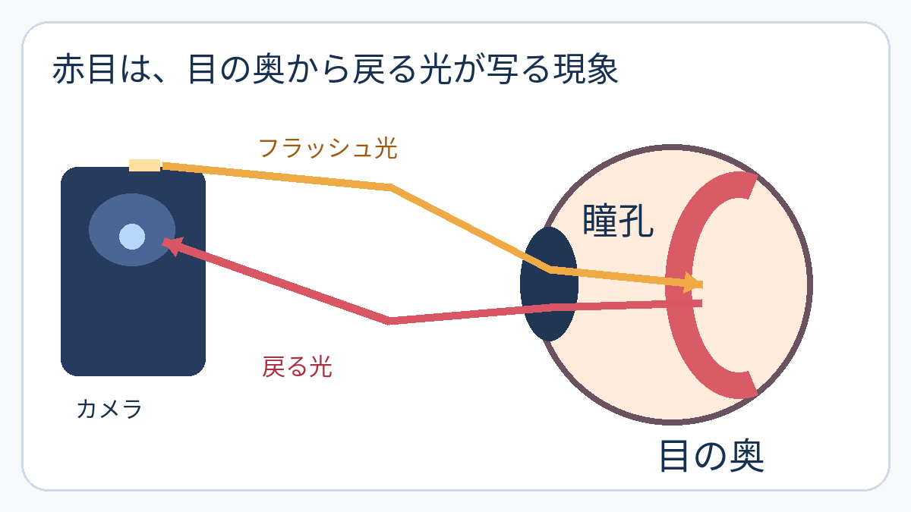

**フラッシュ写真で瞳が赤く写るのは、目に入ったフラッシュの光が目の奥で反射し、カメラに戻ってくるためです。** 黒く見えるはずの瞳孔のところに、奥からの赤い光が写り込みます。

## 光は目の中を往復する

瞳孔は光が入る通り道です。[ニコンの目の構造の説明](https://www.healthcare.nikon.com/en/eyecare/valuing-eyes/)によると、入った光はレンズを通って眼球の奥の網膜へ届きます。

フラッシュ写真では、その光の一部が目の奥から戻り、瞳孔を通ってレンズに届きます。[キヤノンのカメラ説明書](https://files.canon-europe.com/files/soft24329/manual/EOSD30_CUG_EN.pdf)は、この網膜からの反射で瞳が赤く写る現象を「赤目」と説明しています。目の表面そのものが赤く光っているわけではありません。

図は光の経路を示す非縮尺の模式図です。赤い層そのものが光を出すという意味ではありません。

## なぜ暗い場所や近いフラッシュで目立つ？

暗い場所では瞳孔が開き、光が出入りする通り道が広がります。また、フラッシュがレンズの近くにあるほど、戻ってきた光がレンズに入りやすくなります。キヤノンの説明書も、この二つを赤目が起こりやすい条件として挙げています。

図は配置を単純化した模式図です。光がすべて戻るわけではありません。

つまり赤目は、単に「暗いから赤い」のではなく、**瞳孔の開き方と、照らす光・撮るレンズの位置関係**が重なった結果です。赤目は目だけでなく、撮る側の配置にも左右されるのですね。
