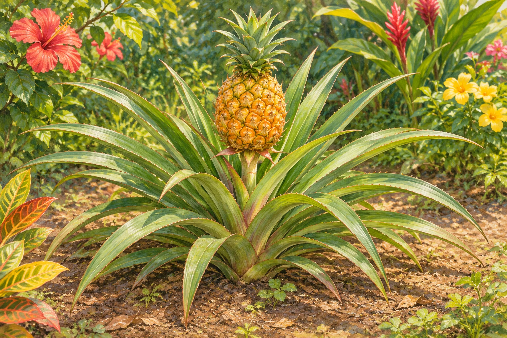

**パイナップルは木ではなく、草の仲間である多年草です。実が育つ場所は高い枝ではなく、地面に広がる株の中心です。**

## 育っている姿を見ると 意外と低い

売り場では実だけを見るので、ヤシの木のような高い場所からぶら下がる姿を想像しても不思議ではありません。でも、長い葉が集まった株の中心に実があると知ると、探す高さがまるで変わります。私には、この「目線の高さが変わる感じ」がいちばん面白いところです。

参考イラスト（AI生成）。実物写真ではありません。

林野庁の植物資料では、パイナップルは熱帯アメリカ原産の多年草とされています。果物として売られているからといって、植物が必ず木とは限りません。「食べるときの分類」と「植物としての姿」を分けて考えると、この意外さがすっきりします。

## 株の真ん中から花の軸が伸びる

林野庁の資料によると、硬い剣状の葉が集まった株の中心から花穂が現れ、伸びた花軸の先に花の集まりがつきます。同資料に掲載された写真でも、葉の間から立ち上がる実の姿を確認できます。

つまり、探す場所は高い木の枝ではなく、地面に広がる株の中心です。店頭では切り離された実しか見ないので、育っている姿を知ると印象が変わります。

## 実がなるまでの時間にも注目

同資料は、苗を植えてから花穂が現れるまでを12〜18カ月、開花後に結実するまでを約6カ月と説明しています。

ただし、これは同資料に示された目安です。栽培条件や品種を問わず同じ日数で収穫できる、という意味ではありません。毎日実を採れる植物を想像すると、現実とは大きな差がありそうです。

下の参考資料には、実際の株の写真も掲載されています。**パイナップルは、高い木ではなく草の株に実る果物です。**
