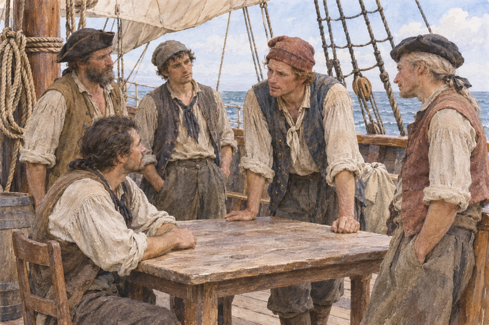

**船長を多数の賛成で選び、船内の重要事項や取り分を決める。そんな海賊船の姿が、18世紀の本に記されています。** ただし、すべての海賊船が同じ方法で運営されていた、という話ではありません。手がかりは、1724年に「キャプテン・チャールズ・ジョンソン」の名で刊行された『海賊史』です。

## 船長も、いつも「絶対」ではなかった

同書のロバーツについての説明には、船長の地位は多数の支持で得るとあります。一方、ロバーツは有力な仲間を集め、影響力を強めたとも書かれています。さらに、追跡や戦闘では船長に強い権限があったと説明されます。選ばれた船長であっても、いつも多数決だけで動くという話ではありません。

## 投票と取り分は、別々の取り決め

同書がロバーツの一味について紹介する規約の「要旨」には、重要事項に各人が票を持つとあります。一方、獲得物の取り分は一律ではなく、船長などの役職には多めの配分を定めています。また、活動中に手足を失うなどした場合、共同の蓄えから補償するという項目もあります。投票の項目があることと、全員が平等だったことは同じではありません。

それに、この本は規約そのものの原本ではありません。著者は「海賊たちの情報から得た要旨」と断っており、船でいつ、どの程度守られたかまでは、この記述だけで確かめられません。また、規約の前にはアイルランド人を対象から排除する記述もあります。現代の平等な参加制度と同じものではありません。

海賊の規約は、現代の理想的な組織の先取りとしてではなく、**危険な集団が船内の利害を調整しようとしたことを伝える、一つの歴史資料**として読むのがよさそうです。しかも彼らの活動は、船の外の人々に被害を与えるものでした。「船内にルールがあった」という意外さと、その限界を一緒に覚えておきたいところです。
