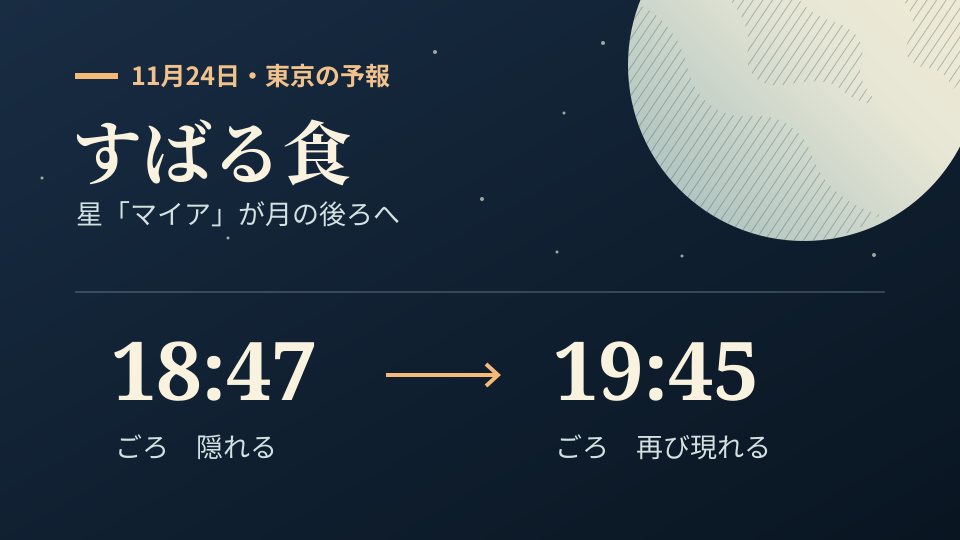

11月24日（火）の夕方、月が「すばる」の前を通り、星を一つずつ隠していきます。東京で注目したいのは、**18時47分ごろ**。星団の仲間の一つ「マイア」が月の縁で見えなくなり、**19時45分ごろ**に再び姿を見せる予報です。

## どうして一斉に消えないの？

すばるは、おうし座にあるプレアデス星団の和名です。空ではひとかたまりに見えても、星と星の間にはすき間があります。そこを手前の月が横切るので、月の縁がどの星に追いつくかによって、見えなくなる時刻がずれます。月が星を隠すこうした現象を「星食」と呼びます。

## 肉眼でも見える？

24日は満月です。晴れて月がよく見える夜でも、そのすぐそばにある星は月明かりに埋もれてしまいます。アストロアーツによると、今回は双眼鏡でも見づらく、星が消える瞬間を追うには天体望遠鏡が適しています。

マイアの予報時刻は東京から見た場合です。ほかの地域で観察するときは、星空シミュレーションの観察地点を自分の町に合わせると、いつ、月の縁のどこを見るかを確かめられます。
