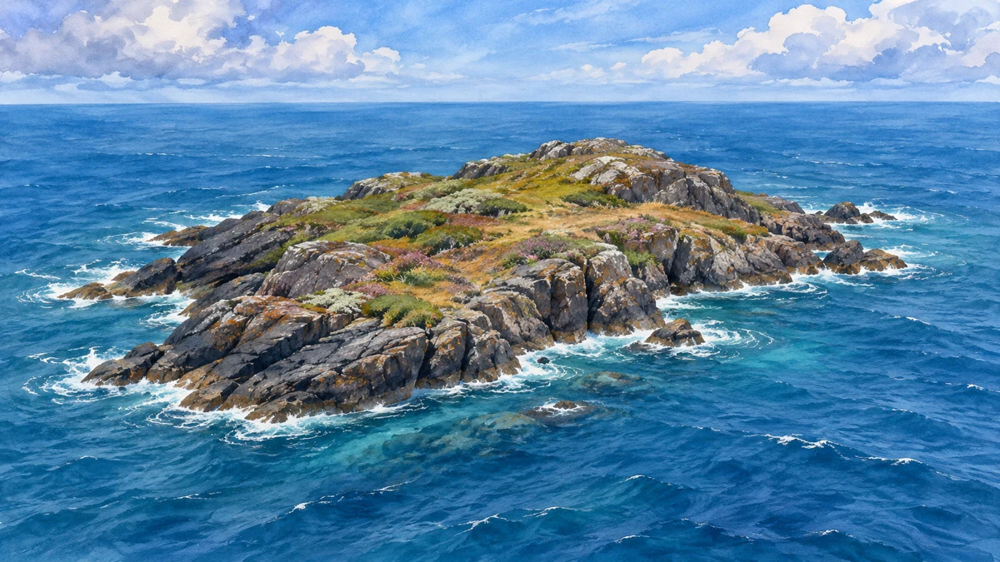
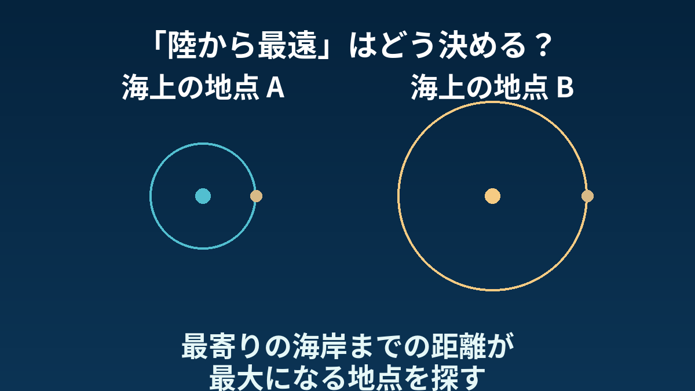

**ポイント・ネモは、最寄りの陸まで約2700kmも離れた、南太平洋の海上の地点です。** 島の名前ではなく、「陸から最も遠い海の地点」の呼び名。では、何をどう比べて「最も遠い」としているのでしょう。

## 基準は「いちばん近い海岸」

[NOAAの解説](https://oceanservice.noaa.gov/facts/nemo.html)では、最寄りの陸まで約2688kmと紹介されています。挙げられているのは、北側のデュシー島、北東側のモツ・ヌイ、南側のマーヘル島です。大陸ではなく、こうした小さな島々が最寄りの陸になるのが面白いところです。

小さな島も「陸」に含まれることをイメージするための挿絵です。デュシー島など、本文に登場する実在の島の姿を再現したものではありません。

海上のある地点から、最も近い海岸までの距離を測る。それを海の各地点で比べ、その距離が最大になるところが**海の到達不能極**です。ポイント・ネモは、その海上の地点に当たります。

図は地点の選び方を示したもので、船の航路を比較したものではありません。

## 数字は、どう測るかとも結びついている

海岸線をどう表し、地球上の距離をどう計算するかも大切です。[2010年のウェッセルの研究](https://tos.org/oceanography/assets/docs/23-3_wessel.pdf)では、南極周辺の海岸線データを改め、地球の楕円体形状に沿う距離を使って再計算しています。

そのため、座標や距離の数字は、使った資料や計算法と一緒に読む必要があります。本稿の「約2700km」は、NOAAの紹介値を丸めた目安で、どんな測り方でも不変の厳密値という意味ではありません。

地図で見落としそうな小さな島が、地球規模の「最も遠い場所」を決める。この取り合わせが面白いと感じます。

「最も遠い」の基準は陸であって、人や船までの距離、海の深さではない。そこを分けて見ると、怖さの演出だけでなく、地球の海の広さが見えてくる場所です。
