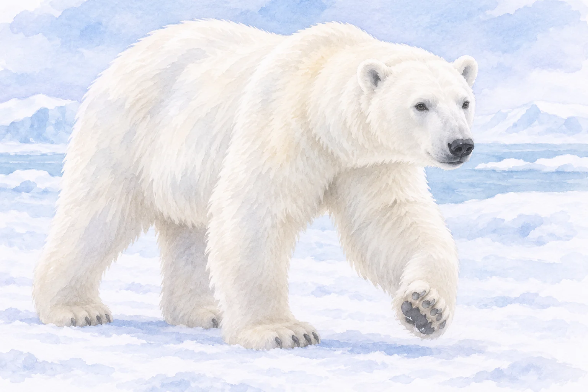
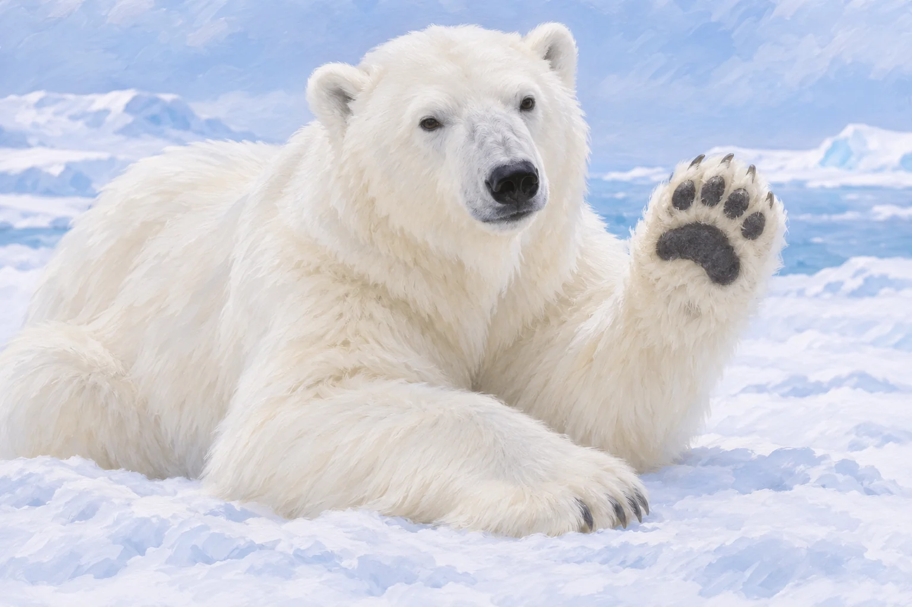

**シロクマ、つまりホッキョクグマの皮膚は、成獣では黒い色をしています。** 体が白く見えるのは、その上を覆う毛の見え方によるものです。

AI生成の参考イラスト。黒い皮膚を直接示す精密図ではなく、外観参考イラスト。黒い色の機能は示さない。

## 白い姿と黒い皮膚

[Polar Bears Internationalの解説](https://polarbearsinternational.org/polar-bears/polar-bear-facts/adaptations-characteristics/)によると、毛そのものには白い色素がありません。色素のない毛が可視光を散乱・反射するため、毛皮全体は白く見えます。黒い皮膚は毛の下にあり、鼻や足の裏などでその色を確認しやすくなっています。

AI生成の参考・概念イラスト。外観のみ。鼻・肉球は毛の下の皮膚全体を直接証明しない。

生まれたばかりの子は例外です。[同団体の研究者による説明](https://polarbearsinternational.org/news-media/articles/why-polar-bears-have-black-skin/)では、子の皮膚は最初ピンク色で、生後数か月の間に黒くなるとされています。

## なぜ黒いのかは、まだ決着していない

黒い皮膚が日光の熱を吸収するのに役立つ、あるいは紫外線から守るという考えがあります。ただし、同団体はどちらも仮説として紹介し、黒い色の目的はまだ分かっていないと明記しています。

白く見える毛の下の皮膚は、成獣では黒色です。鼻や足の裏に見える黒さと、生まれたばかりの子のピンク色の皮膚を分けて考えると、同じホッキョクグマの色の変化が分かります。
