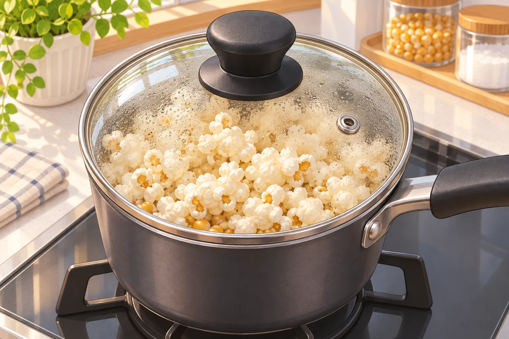
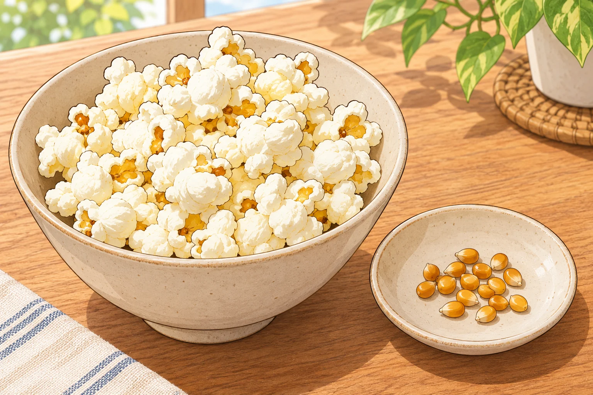

**ポップコーンが弾けるのは、粒の中の水分が熱で蒸気になり、硬い外皮の内側に圧力がたまるからです。**皮が破れると、中の温まったでんぷんが一気に広がって、見慣れた白い形になります。

## 小さな粒が「圧力鍋」になる

ポップコーンに使うのは「爆裂種」と呼ばれる種類のトウモロコシです。粒を包む外皮が硬いのが特徴で、普通のスイートコーンとは異なります。加熱されると内部の水分は蒸気になろうとしますが、皮がそれを閉じ込めます。圧力が高まって皮が耐えられなくなると破れ、内部のでんぷんが急に膨張します。米パデュー大学の食品科学者は、粒が裏返るように変形すると説明しています。

「水が蒸発して粒が割れる」だけでなく、中のでんぷんが熱で変化し、ふくらむことが白い姿の鍵です。パチンという音の直後に起きる形の変化は、粒の中の水分、丈夫な皮、でんぷんの組み合わせによるものなのです。

粒の中の水分と硬い皮が、弾ける仕組みに関わっています。調理の際は製品の表示に従ってください。AI生成の参考イラスト。

## どんなトウモロコシでも弾ける？

いいえ。普通のトウモロコシを乾かして加熱すれば同じように弾けるわけではありません。パデュー大学は、ポップコーン用の硬い外皮こそが、内部の水分を保って圧力をためる鍵だと説明しています。皮に傷や弱いところがある粒は、加熱中に水分が逃げてしまい、弾けないことがあります。

水分量も重要です。同大学が示す目安は粒の重さの約13〜14.5％。ウィスコンシン大学の栽培資料も、弾けた後の体積が大きくなりやすい範囲を13〜14.5％としています。乾きすぎれば圧力を作る水分が不足しますが、多ければよいわけでもありません。この数字は栽培・加工の資料にある目安で、家庭で粒に水を加えて調整するための手順ではありません。

## 弾けない粒が残る理由

鍋の底に残る粒を見て「火が足りなかった」と思うかもしれません。しかし、外皮の傷や水分不足など、粒そのものの状態も影響します。パデュー大学の研究紹介では、品種によって弾けなかった粒の割合が異なったと報告されています。全部の粒が必ず弾けるわけではないのです。

弾けない粒には、水分量や外皮の状態なども影響します。AI生成の参考イラスト。

保存するときは製品の表示に従い、袋や容器をきちんと閉じて、乾燥しすぎや湿気を避けます。弾け残りがあっても、熱が足りなかったと決めつけて加熱を延ばすのではなく、製品の調理時間を守りましょう。粒の中の水分と、それを閉じ込める皮の両方がそろって、あの大きなふくらみが生まれます。
