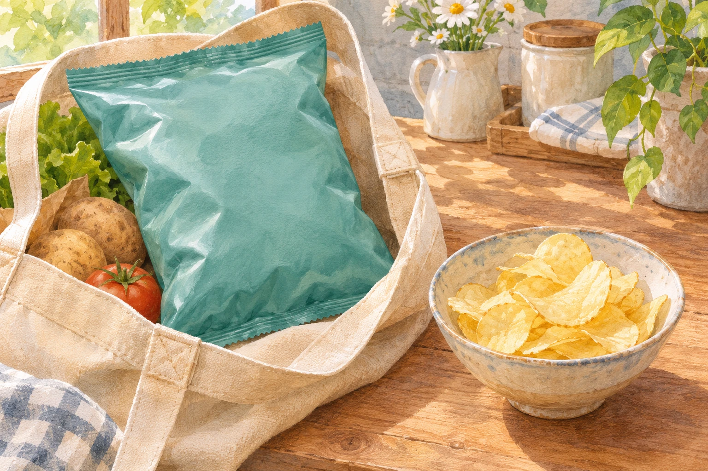
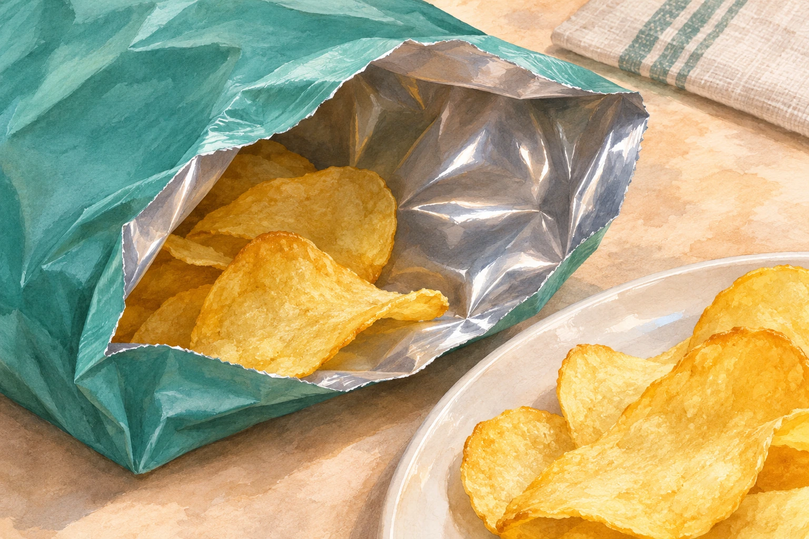

**ポテトチップスの袋のふくらみは、ただの「空きスペース」ではありません。** [カルビーの説明](https://faq.calbee.co.jp/faq_detail.html?id=69)によると、同社のポテトチップスの袋には空気の代わりに窒素を入れ、油の酸化を抑えるとともに、チップスを割れにくくしています。

## どうして空気ではなく窒素？

ポテトチップスの油は、空気に触れていると時間とともに酸化し、味やにおいが変わることがあります。そこで、袋の中に窒素を入れて、酸化を抑えます。[カルビーの公開PDF](https://www.calbee.co.jp/ir/pdf/2022/houkoku_202209_release.pdf)も、袋内の酸素濃度を低くする包装工程を説明しています。これは「窒素が味を付ける」という話ではなく、酸化の原因になる酸素との接触を減らすための工夫です。

ふくらみのある袋と薄いチップスの参考イラスト（AI生成）。実在商品の包装や、中のガスの種類・量を示した図ではありません。

同じ窒素でも、もう一つ役割があります。袋がふくらむと、中の薄いチップスが押しつぶされにくくなります。つまり、ガスの**種類**は風味を守るため、ガスでできる**ふくらみ**は形を守るため。二つの役割を分けて考えると、袋の見え方が変わります。

## 中身を守るのは、ガスだけではない

袋そのものにも工夫があります。[カルビーは](https://faq.calbee.co.jp/faq_detail.html?id=1202)、自社の「ポテトチップス」の袋を、光と湿気を防ぐためにアルミ蒸着フィルムへ変えたと説明しています。同じ公開PDFでも、光を通しにくいフィルムで密封する工程が示されています。中の窒素だけでなく、袋の素材も、風味や食感を保つ役割を担うわけです。

袋の内側の見え方を描いた参考イラスト（AI生成）。特定商品の写真や、フィルムの層・厚さ・遮光性能を再現した図ではありません。

ここで挙げたのはカルビーが説明する自社商品の包装です。「どの菓子袋も窒素だけで満たされている」「袋の半分以上がガス」といった割合までは、これらの資料からは言えません。

開けたときに見える空間にも、**味を守る**ことと**割れにくくする**こと、二つの理由があります。袋の中の余白を見る目が、ちょっと変わりますね。
