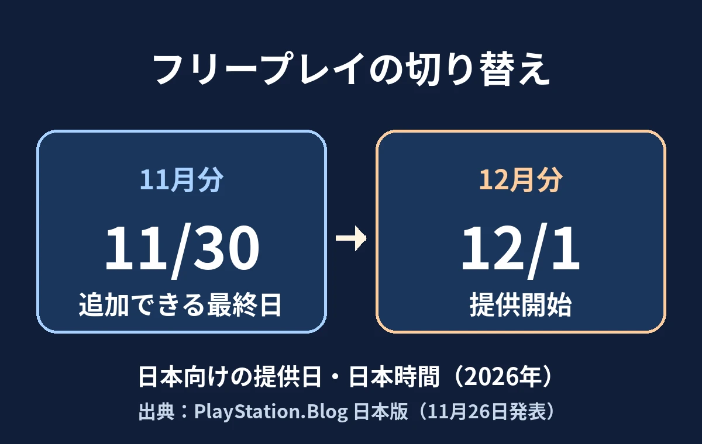

ソニー・インタラクティブエンタテインメントは11月26日、日本向けのPlayStation Plus（PS Plus）で、12月1日から『BLEACH Rebirth of Souls』など3作品をフリープレイに追加すると発表しました。米国の公式発表では『BLEACH』ではなく『Amnesia: The Bunker』。海外の記事や投稿を見て作品名が違っても、両方とも各地域向けの正式な発表です。

## 先に確認したいのは11月分、追加は30日まで

日本の11月分は『Secret Neighbor』『トゥームレイダー IV-VI リマスター』『Monster Train 2』です。日本の公式発表では、**11月30日まで**ゲームライブラリーに追加できます。気になる作品がある加入者は、12月分が始まるのを待たず、自分のアカウントの「毎月のフリープレイ」を確認してください。

図：日本向けの2026年11月から12月への切り替え。日付は日本時間、出典はPlayStation.Blog日本版の11月26日発表です。切り替え時刻は示していません。

## 日米で共通の2本と、違う1本

- **日本・米国で共通：** 『トニー・ホーク プロ・スケーター 3+4』と『ドラゴンボール ゼノバース2』。
- **日本の3本目：** 『BLEACH Rebirth of Souls』。
- **米国の3本目：** 『Amnesia: The Bunker』。

日本の3作品は公式発表でPS5・PS4向け。米国版では『Amnesia: The Bunker』の対応機種はPS4と案内されています。また、11月分にも地域差があり、米国の案内に載る『Dead Island 2』は、日本の11月分のリストには載っていません。

## 日本のアカウントなら、日本向けのラインアップを

PS Plusのフリープレイは、加入中に追加費用なしで遊べる月替わりの特典です。PS4では「PlayStation Plus」から「毎月のフリープレイ」へ進むと、対象作品をライブラリーに追加できます。PS5では「PlayStation Plus」の「特典」にある「毎月のフリープレイ」を開きます。機種ごとの手順は[日本の公式サポート](https://www.playstation.com/ja-jp/support/subscriptions/subscribe-ps-plus-download-monthly-games/)で確認できます。

12月1日以降に追加する人は、提供期限も自分のアカウントのストア表示で確認してください。米国版に書かれた終了日を、そのまま日本版の期限として扱わないのが確実です。
