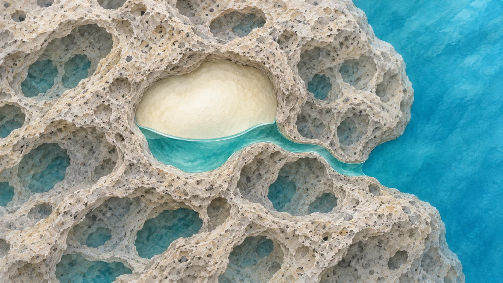
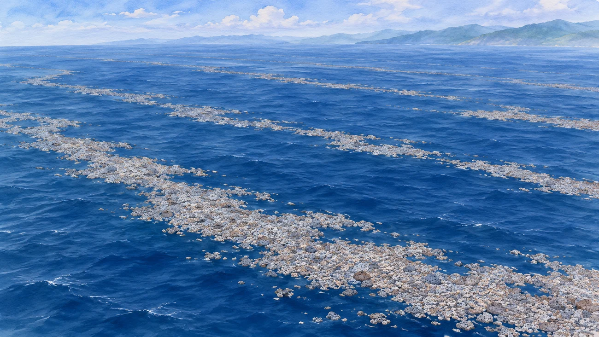

**軽石は、中の気体も含めた石全体の密度が水より小さければ浮きます。** しかも、水が入ったからといってすぐに沈むとは限りません。入り込んだ水が、気体の逃げ道をふさぐことがあるからです。

## 石の中に残った、火山の泡の跡

軽石の小さな穴は、マグマから出たガスの泡の跡です。固まった石をつくっているのは主に火山ガラスですが、穴の中まで何もかもガラスで詰まっているわけではありません。気体がたくさん残っていれば、石全体の大きさの割に軽くなります。

## 水が入るのに、なぜ気体が逃げきらない？

穴が外とつながっていたら、水が入り、気体は押し出されそうですよね。ところが、軽石の中の通り道はまっすぐな管ではありません。X線で調べた研究では、水が入り込んだあとにも気体が取り残されていました。途中の狭い通り道に入った水が、気体の逃げ道をふさいだのです。

白っぽい部分は気体、青緑は水。水中の穴を拡大したイメージ（AI生成）で、実際のX線画像ではありません。

狭い通り道では、水と気体の境目が表面張力で保たれます。ただ、気体がずっと閉じ込められるわけではありません。研究では、気体が水に溶けて少しずつ外へ広がり、やがて軽石が沈むという説明が、実験で測った浮遊時間と整合しました。

## すぐ沈む軽石もある

軽石には、外とつながった穴だけでなく、最初から閉じている穴もあります。桜島の軽石を使った別の研究では、五つの試料が、ほぼすぐに沈むものから十日を超えて浮くものまで分かれました。この実験では、石の大きさだけでは浮く時間を説明できず、穴の量やつながり方が関係していました。

## 海を渡った軽石

2021年8月、海底火山の福徳岡ノ場（ふくとくおかのば）で生まれた軽石は、海流に乗って1,000 km以上離れた場所まで漂流しました。JAXAは地球観測衛星「しきさい」で、海面に浮かぶ軽石の広がりをとらえています。

軽石が海を漂う様子のイメージ（AI生成）。実際の分布や衛星画像を再現したものではありません。日本で観測されたのは軽石の漂流で、気体が閉じ込められる様子を調べたX線実験とは別です。

## 感想

「穴があるから軽い」で終わると思っていたら、その穴に入る水が、気体の出口をふさぐこともある。水が石を沈める側にだけ働くわけではないのが、いちばん意外でした。海を渡った軽石の話を読むと、表面の小さな穴がその奥でどうつながっているのか、のぞいてみたくなります。
