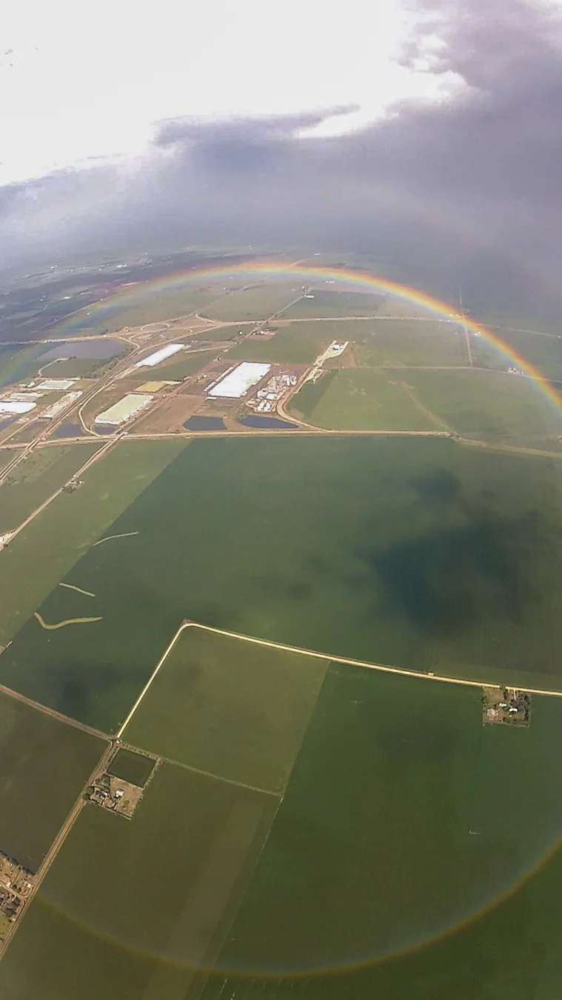

**虹は、条件がそろえば円形に見えます。** 普段、地上から見える虹が弧なのは、虹の下側が地面や景色に隠れやすいからです。空に七色の半円が「置かれている」のではなく、太陽、水滴、見る人の位置がそろったときに見える光の現象です。

スカイダイビング中の映像の一コマ。左右は画面の外に出ていますが、畑を背景にした下側の弧も見えます。[Steve Kaufman / Wikimedia Commons](https://commons.wikimedia.org/wiki/File:Circular_rainbow.jpg)、[CC BY-SA 3.0](https://creativecommons.org/licenses/by-sa/3.0/)。元画像の全体を縮小してWebPに変換。切り抜き・描き足しなし。

## 水滴の中で光の進み方が変わる

[NOAAの解説](https://www.nesdis.noaa.gov/about/k-12-education/optical-phenomena/what-causes-rainbow)によると、太陽の光が空気中の水滴に入ると曲がり、水滴の内側で反射して、出るときにも曲がります。光の色によって曲がり方が少し違うので、私たちには色の帯に見えます。

虹を見るには、太陽が自分の後ろ側にあり、前方に水滴があることが大切です。太陽を背にして、雨の残る空を探すのが基本になります。

## 弧に見えるのは、下側が見えにくいから

虹は、見る人から見た太陽の反対側に現れます。地上では円の下側が地面に遮られ、上側の弧だけが見えやすくなります。[英国気象庁Met Office](https://weather.metoffice.gov.uk/learn-about/weather/optical-effects/rainbows)は、太陽が高いほど見える弧は小さくなり、飛行機などの高い場所では円形に見える場合があると説明しています。

太陽を背に雨の方向を見る条件を表したAI生成の概念イラスト。光路や実際の観測位置を再現した図ではありません。

とはいえ、高い場所に行けば必ず丸く見えるわけではありません。太陽を背にした側に水滴があり、円の下側まで見通せる必要があります。水滴の分布や太陽の位置が変われば、見える範囲も変わります。

## 虹は、見る人と一緒に動く

虹は空の決まった場所にある物ではありません。見る人の位置が変われば、見えている水滴との関係も変わります。同じ雨上がりの空でも、立つ場所によって虹の見え方が違うのはそのためです。地上で虹を見るときは、太陽を背にした自分の位置と、水滴がある方向を確かめると、弧がどこに現れるかを考えやすくなります。
