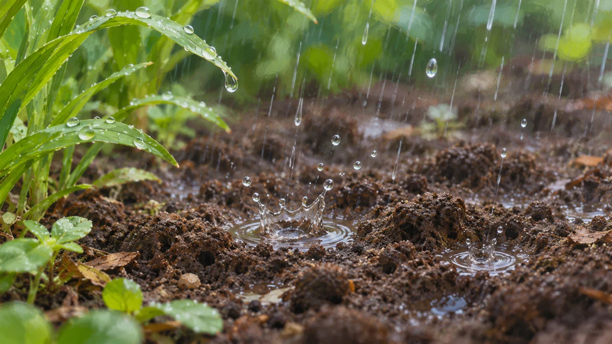
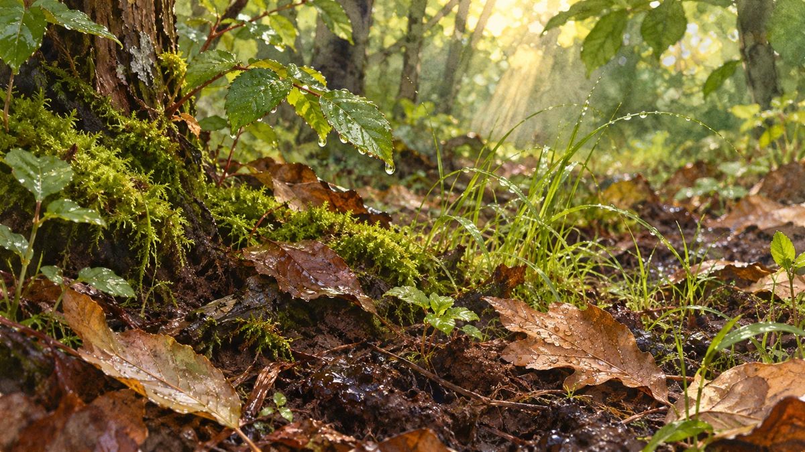

**雨粒が土に当たって生む小さな飛沫が、土の香りを空気へ運ぶ経路の一つかもしれません。** MITの研究チームが観察したのは、雨滴の中の泡がはじける現象です。ふだんは見えないほど小さな出来事が、雨上がりのにおいにつながる可能性があります。

## 雨粒の中で、泡がはじける

[MITの研究チームの説明](https://news.mit.edu/2015/rainfall-can-release-aerosols-0114)によると、土など細かな孔のある表面に水滴が当たると、接触した場所に小さな空気の泡が閉じ込められることがあります。泡が水滴の中を上がって表面ではじけると、細かな水滴が空気中に散った「エアロゾル」が生まれます。

雨と土の場面のイメージです。絵に見える水しぶきは、研究で観察された微小な泡や飛沫を再現したものではありません。

[論文の公開要旨](https://dspace.mit.edu/entities/publication/04a89902-bea5-41d4-8402-3293b7a95729)では、こうした飛沫が表面にある物質を周囲へ運びうることも示しています。一方、雨上がりの香りとのつながりは、研究者が提示した仮説です。この実験だけで、屋外のにおいのすべてを説明できたわけではありません。

## 強い雨ほど飛沫が多い、とは限らない

MITの実験では、水滴の衝突速度や表面の性質によって飛沫の出方が変わりました。軽い雨や中程度の雨に相当する条件で、激しい雨に相当する条件より多くの飛沫が観察されています。

これは実験条件での比較なので、「小雨なら必ずよく香る」という法則とは違います。実際の道では、地面の種類や濡れ方も一様ではないからです。

## 香りの材料と、運ばれ方は別の話

雨の後の地面を描いたイメージ。香りの成分や微生物を可視化したものではありません。

土らしい香りに関わる物質の一つが、微生物がつくる**ゲオスミン**です。[微生物学の研究論文](https://journals.asm.org/doi/10.1128/aem.00093-22)でも、土の香りの主要な成分の一つとして紹介されています。

雨に伴う土っぽい香りは「ペトリコール」とも呼ばれますが、ゲオスミン一種類の別名ではありません。香る物質が土にあることと、それがどう空気へ届くかは、分けて考えると分かりやすくなります。

面白いのは、雨を「地面を濡らすもの」と考えるだけでは見えてこない役割があることです。小さな泡が、土と空気をつなぐかもしれない。次に雨上がりの香りを感じたら、足元の小さな泡を想像してみる。いつもの道が、少し違って見えるかもしれません。
