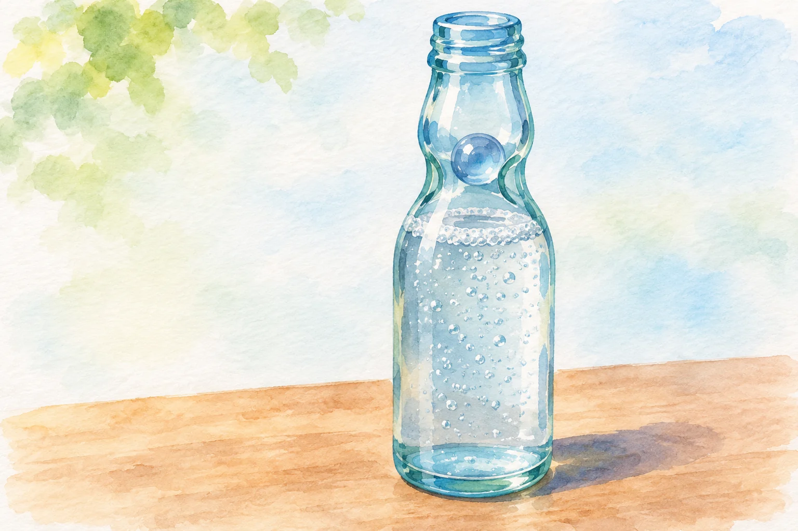
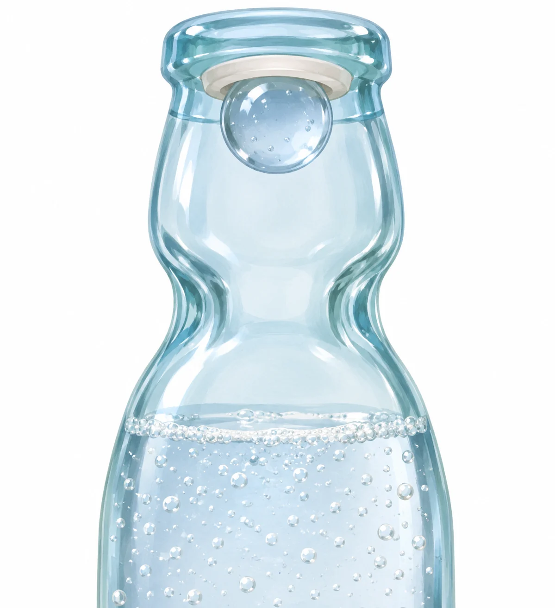

**ラムネ瓶のビー玉は、飲み口をふさぐための栓です。** 飾りや音を楽しむためだけに入っているのではなく、開ける前には中の圧力を利用して瓶を密閉しています。

AI生成の参考イラスト。開栓後に玉が瓶内へ落ちたイメージであり、密栓位置の図ではありません。

## ガラス玉を、内側から押しつける

瓶の中にあるガラス玉が、飲み口のゴムにぴったり押しつけられると、栓になります。このとき玉を押さえているのが、瓶の内側からかかる炭酸ガスの圧力です。

AI生成の参考・概念イラスト。密栓位置の概念画。実製品の詳細寸法や内部構造を正確に再現しない。

製造元の[倉敷鉱泉の説明](https://www.kurashikikousen.com/ramune-story/)では、炭酸水を充填した瓶を逆さにして玉を飲み口へ移動させると、内部の圧力によって玉が口ゴムに押しつけられます。瓶を元の向きに戻しても、圧力が玉を押さえるので密栓が保たれます。

開けるときに玉を押し落とすのは、この栓を外す操作です。開けたあとにカラカラと動く玉は、直前まで中身を閉じ込める役を果たしていました。

## 瓶のくびれにも役目がある

ラムネ瓶は、途中がくびれた独特の形をしています。倉敷鉱泉によると、この形は玉が底まで落ちるのを防ぎ、製造時に瓶を逆さにした際、玉を素早く飲み口へ戻すのに役立ちます。

ガラス玉だけでなく、その移動を支える瓶の形まで含めて、一つの仕組みになっているのです。

## 最初からビー玉入りだったわけではない

[トンボ飲料が紹介する歴史](https://www.tombow-b.jp/learnenjoy/origin/ramune/)では、初期のラムネにはコルク栓が使われていました。その後、ガラス玉で密閉する瓶が登場し、日本でも普及していきます。

小さな玉を押す、という今ではおなじみの開け方も、もとは炭酸を逃がさず閉じ込める工夫でした。瓶の中身だけでなく、栓の仕組みにも炭酸の性質が使われています。
