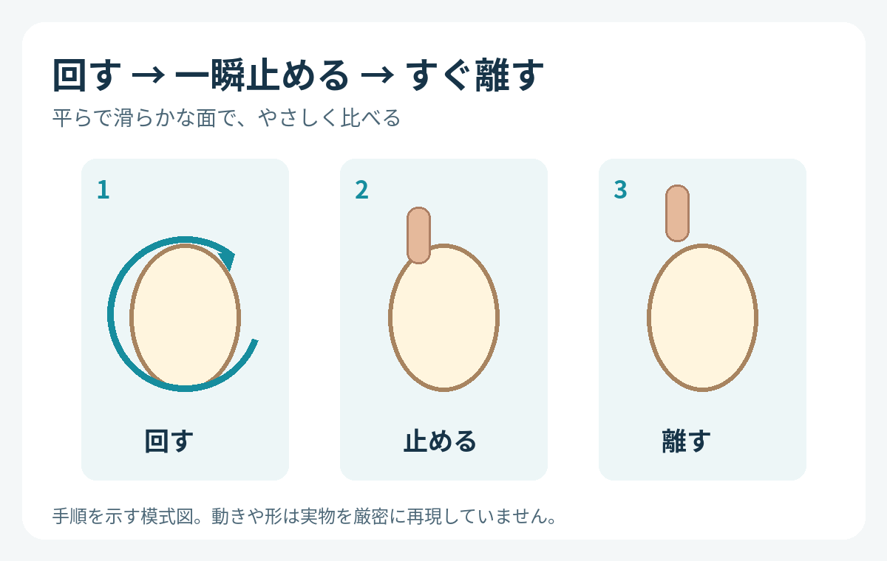
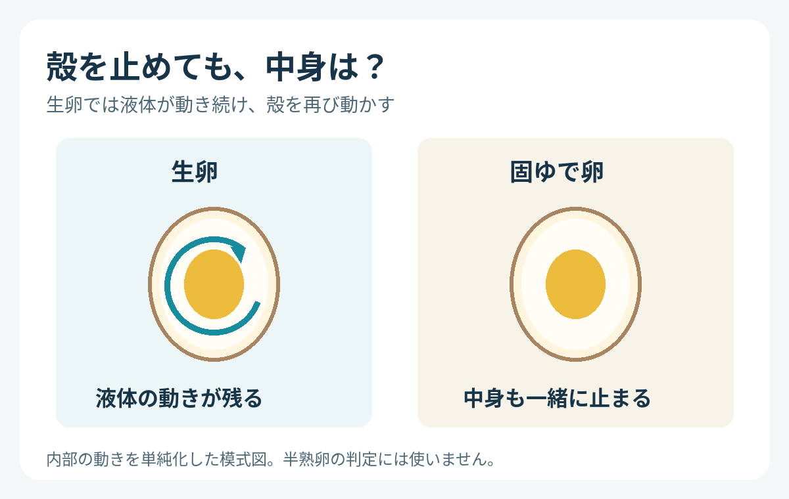

**生卵と固ゆで卵は、回して一瞬止め、すぐ手を離した後の動きで見分ける手がかりが得られます。**生卵は中の液体が動き続けるため、殻が再び回り始めます。中まで固まった固ゆで卵は、止まったままです。

## 「回り方」より、止めた後を見る

殻が付いたままでは、中が生なのか固まっているのかは見えません。そんなときに使えるのが、科学館Exploratoriumが紹介する、卵を回してから止める比較です。

平らで滑らかな面に卵を置き、やさしく回します。指で一瞬だけ殻の回転を止め、すぐに指を離して、その後の動きを見ます。長く押さえ続けると中身も止まるので、「一瞬止めて、すぐ離す」が比べるポイントです。

回す速さを競うのではなく、止めた後に動きが戻るかを観察します。手順を単純化したオリジナル模式図。

## 殻が止まっても、液体は動いている

生卵では、殻と中の液体が同じように一瞬で止まるわけではありません。殻を止めた直後も液体には動きが残り、手を離すと、その動きが殻を再び回します。

一方、固ゆで卵の中身は固まっています。殻と中身が一緒に止まるため、指を離しても生卵のようには回り直しません。外からそっくりに見える二つの卵でも、中身の状態が動きの違いとして表れるのです。

殻と中身の関係を単純化したオリジナル模式図。内部の形や流れを厳密に再現したものではありません。

## わかるのは中身の状態の違い

これは、生卵と中まで固まった固ゆで卵を比べる方法です。半熟卵の火の通り具合を正確に判定したり、鮮度や食べられるかどうかを確認したりする方法ではありません。

試すときは卵が机から落ちない場所で、割れないようにやさしく扱いましょう。見た目を変えずに中の違いがわかるのは面白いですね。殻の外から見ているのに、観察しているのは殻だけでなく、その中に残った動きでもあります。
