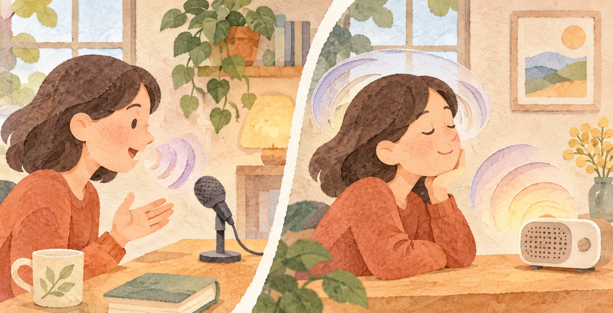
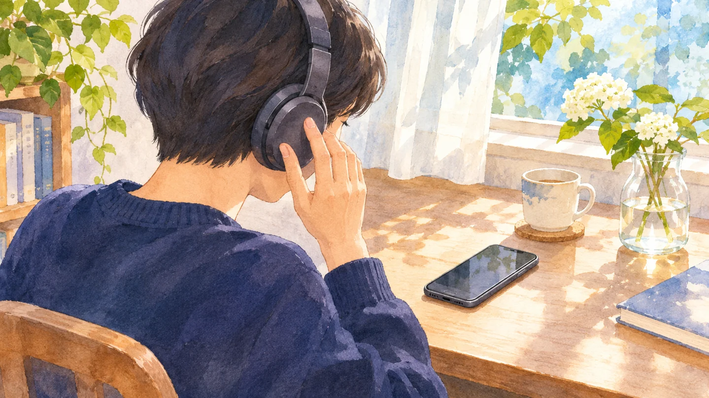

**録音した自分の声が、話しているときの声と違って聞こえる。大きな理由は、耳に届く音の道筋が変わることです。** 声そのものが録音の瞬間に別人の声になったわけではありません。

AI生成の参考イラスト。記事の出典資料から転載した画像ではありません。

## 話している間は、二つの経路で聞いている

誰かの声を聞くとき、声による空気の振動が耳に入り、鼓膜や耳の奥の器官に伝わります。これを気導といいます。自分が話すときも、口から出た音は空気を通って自分の耳に届きます。

ただし、自分の声にはもう一つの経路があります。声を出すときの振動が、頭の骨や周囲の組織などを介して耳の奥に届く骨導です。話している本人は、空気からの音と、体を通る振動が合わさった声を聞いています。東京大学の解説も、普段聞く自分の声には気導音と骨導音の両方が混ざると説明しています。

## 再生すると、何が変わる？

普通のマイクは、主に空気中を伝わってきた声を受け取ります。それを再生して聞くとき、話していたときのような、自分の声から頭の中へ伝わる振動は加わりません。この違いが「いつもの声と違う」と感じる主な理由です。

録音を聞き返す場面の参考イラスト（AI生成）。

骨導の音は、空気を通った音と全く同じ性質ではありません。Frontiers for Young Mindsの研究者たちは、空気を通る音、骨を通る音、両方を含む音を別々に録音して紹介しています。自分で発した声と、外から聞き返す声が一致しないことを、音の経路の違いとして確かめられます。

友人の声を録音して聞き返すと、自分の声ほど大きな違いを感じない場合があります。友人が目の前で話すときも録音を再生するときも、自分の耳には主に空気を通った音が届くからです。それでも機器や部屋による差は残ります。

## 録音は「他人に聞こえる声そのもの」？

他人は通常、話し手の頭を通る骨導音を聞きません。その点では、録音は自分が話しながら聞く声より、相手に届く声に近いといえます。ただし、録音が相手の耳に届く声を100％再現するわけでもありません。マイクやスピーカー、イヤホンは音の特徴を変えます。部屋の響き、マイクとの距離、周囲の騒音も録音に影響します。

たとえば同じ人が同じ言葉を話しても、スマートフォンを口元に近づけたときと、離して置いたときでは録音の印象が変わります。再生するイヤホンを替えても、聞こえ方は変わるでしょう。「録音の声こそ唯一の本当の声」と考えるより、聞く場所と経路によって声の印象が変わる、と捉えるのが自然です。

面白いのは、声を出している本人にしか聞こえない響きがあることです。録音で違和感があっても、「変な声だった」と決めつけなくていい。聞く経路が変われば、同じ声でも印象は変わります。
