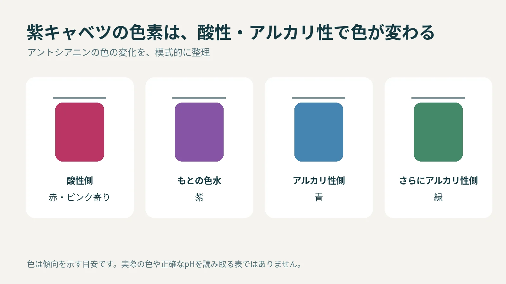
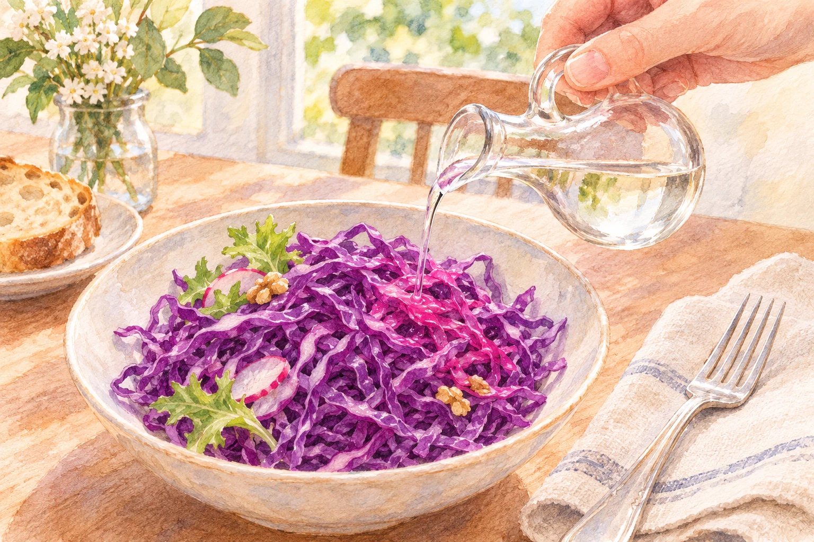

**紫キャベツに酢を加えると赤っぽくなるのは、葉に含まれる色素「アントシアニン」が、周囲の酸性・アルカリ性に応じて色を変えるためです。** 酢で酸性になると、紫から赤やピンク寄りの色へ変化します。

## 紫の色素が、まわりの変化を知らせる

アントシアニンは、もともと紫キャベツに含まれる色素です。酢そのものの色が付いたのではなく、色素の見え方が変わっています。[米国化学会の実験教材](https://www.acs.org/education/activities/red-cabbage-indicator.html)も、この性質を使って酸性・塩基性を調べる方法を紹介しています。

紫キャベツから取り出した紫の色水は、酸性にすると赤へ変わります。一方、アルカリ性が強くなるにつれて青、緑へ変化すると、[日本化学会の解説](https://kdc.csj.jp/learning/item_365.html)にあります。

色の変化を示した模式図。日本化学会と米国化学会の解説をもとに制作。実際の色合いを保証する見本や、数値を読み取るpH表ではありません。

## 色が変わることと、安全に食べられることは別

この色素は、周囲の性質を大まかに知る「指示薬」として使えます。ただし、見た目が同じ赤でも、そこから酸性の強さを正確な数字で読み取れるわけではありません。

また、食材を使った実験でも、いろいろな液体を混ぜたものを口に入れるのは避けてください。米国化学会は、実験に使った材料を飲食しないこと、大人と一緒に行うことを案内しています。食卓で酢を加えて色を楽しむことと、薬品を使う実験は分けて考えましょう。

食用の酢をかけた紫キャベツのサラダを描いたAI生成の参考画。色は模式的で、正確なpHや食品の安全性は判断できません。

紫キャベツは、味付けをしたときの変化が目にも見える食材です。いつものサラダの色にも、身近な化学が表れています。
