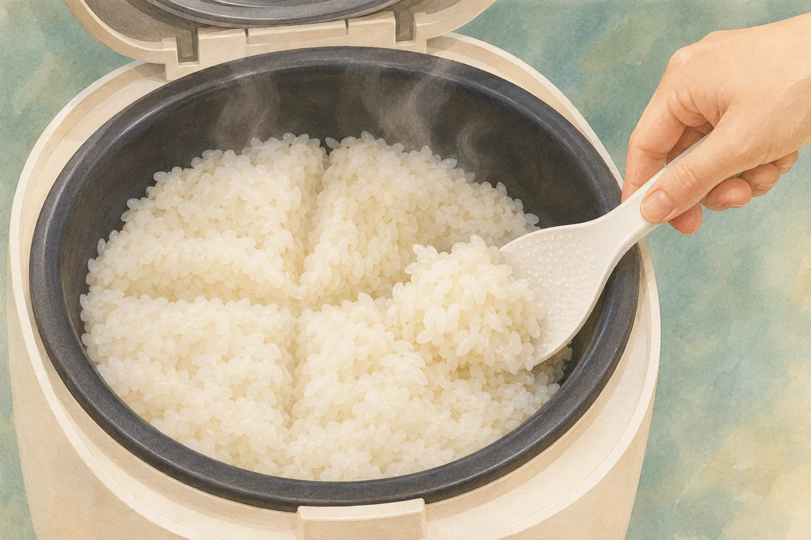
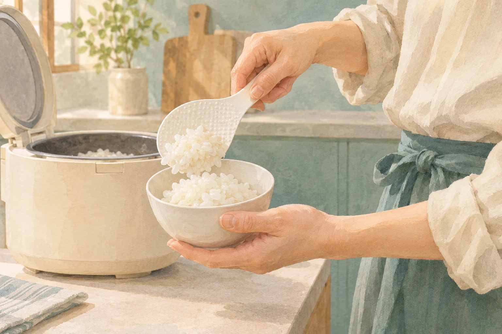

炊けたご飯をほぐすと、米粒の表面の余分な水分が逃げ、粒同士がくっついてかたまるのを抑えられます。ぐるぐるかき混ぜるより、米粒をつぶさず、底からふんわり持ち上げるのがポイントです。

## 炊きたての表面には、余分な水分がある

タイガー魔法瓶は、炊きたての米粒の表面には余分な水分がついていると説明しています。そのままにすると、ご飯がふやけ、粒同士がくっついてかたまりやすくなるそうです。

ほぐすと、その水分を逃がすことができ、食感を整えられます。象印も、炊き上がったらすぐにほぐすことを勧めています。「炊けたから、あとは放っておいても同じ」ではないのですね。[タイガーの解説](https://www.tiger-corporation.com/ja/jpn/feature/rice-cooker/takitate50/32/)・[象印の炊き方ガイド](https://www.zojirushi.co.jp/gohan/howto/)

## ぐるぐる練らずに、底から持ち上げる

では、どのようにほぐせばよいのでしょう。

タイガーが紹介しているのは、まずご飯をしゃもじで十字に分け、分けた部分ごとに、内釜の側面からしゃもじを入れて底から持ち上げる方法です。少しずつ返すように、ふんわりとほぐします。

大切なのは、米粒を押しつぶさないこと。力いっぱい練るのではなく、かたまりをやさしくほどくイメージです。仕上げのひと手間だからこそ、勢いよりも軽さが役に立ちます。

※画像はほぐす動作のイメージです。実際の操作は、お使いの機種の取扱説明書に従ってください。

## 「蒸らし」と「ほぐし」は、別の段階

「ご飯は炊けてから蒸らすのでは？」と思うかもしれません。

象印は、同社の現代の炊飯ジャーでは、蒸らしまでが炊飯プログラムに含まれていると説明しています。その場合、炊き上がりの合図が鳴った時点で蒸らしも終了しており、さらに待たずにほぐす案内になっています。

ただし、これは鍋や土鍋で火にかけて炊く方法まで、蒸らしが不要という意味ではありません。炊き方や機種、メニューの案内を確かめ、その方法で必要な工程が終わってから、仕上げのほぐしに進みましょう。[蒸らしと炊飯プログラムについて](https://www.zojirushi.co.jp/kakushiaji/article/004679/)

炊き上がりの音は、食卓への合図であると同時に、しゃもじの出番を知らせる音でもあります。ご飯をつぶさず、底からふわり。いつもの一杯を整える、小さな仕上げです。
