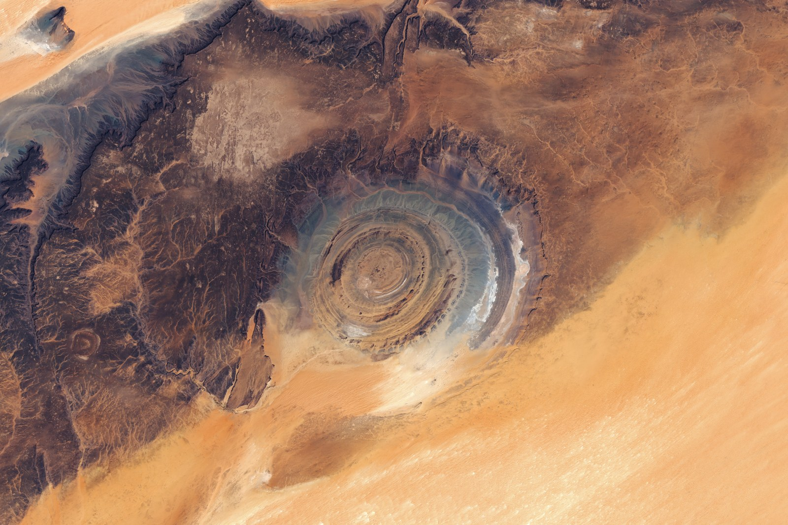
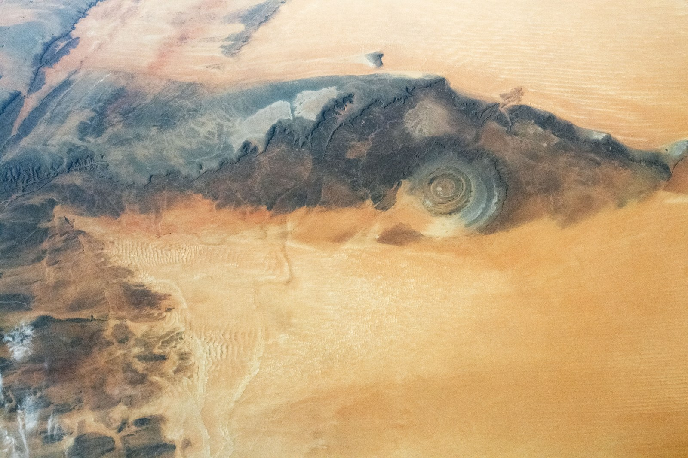

**サハラ砂漠の「目玉」は、モーリタニアにあるリシャット構造です。** 直径は約40km。宇宙からは、岩の輪がいくつも重なった大きな的のように見えます。昔は隕石が落ちた跡と考えられましたが、現在は隆起した地層が長い時間をかけて削られた地形と説明されています。

2026年3月5・6日のLandsat観測を組み合わせた画像。輪の幅や色は一様ではなく、周囲には枝分かれした谷も見えます。画像：NASA Earth Observatory / Lauren Dauphin、Landsat data: U.S. Geological Survey。

## 輪の出発点は、持ち上がった岩

[NASA Earth Observatoryの解説](https://science.nasa.gov/earth/earth-observatory/eyeing-the-richat-structure/)によると、この場所では地下の火成岩の活動に伴って上の岩が押し上げられ、ドーム状になりました。地面に円い線を描いた何かがあるわけではなく、まず岩の層そのものが大きく変形したのです。

## 削られ方の違いが、同心円を見せる

隆起した地層の上部が侵食されると、異なる種類の岩が地表に現れます。岩によって削られやすさが違うため、残った部分が円形の尾根になりました。[NASAの別の解説](https://science.nasa.gov/earth/earth-observatory/the-eye-of-sahara-150060/)も、岩の侵食速度の違いが環状の尾根をつくったと説明しています。

ISSから2020年7月10日に撮影。視野が広がると、目玉の周囲に広大な砂丘地帯があることも分かります。写真：NASA / ISS Crew Earth Observations Facility and Earth Science and Remote Sensing Unit, Johnson Space Center（ISS063-E-43607）。NASA公開版はトリミング・コントラスト調整等が施されています。

円い形だけを見れば衝突の跡にも見えますが、岩石や地下の構造を調べることで、別の成り立ちが分かってきました。

## 「目玉」は空から見える地質の断面図

観測画像に見える輪は、押し上げられた岩の層が削られ、削られにくい岩が尾根として残ったものです。輪と輪の間の低い場所にも、岩の削られ方の違いが表れています。

「ドーム」といっても、現在そこに丸い山がそっくり残っているわけではありません。[国際地質科学連合の地質遺産解説](https://iugs-geoheritage.org/geoheritage_sites/richat-structure-a-cretaceous-alkaline-complex/)では、地表では少し楕円形のくぼみと同心円状の尾根として現れると説明されています。

輪のきれいさに目を奪われますが、面白いのは、その模様が「足してつくられた」のではなく、岩が削られた結果だということ。全体像と周囲の砂丘を見比べると、目玉だけを切り取った印象とは少し違う、長い地形の変化が見えてきます。

表紙写真：NASA / ISS Crew Earth Observations Facility and Earth Science and Remote Sensing Unit, Johnson Space Center（ISS030-E-12516、2011年12月17日撮影）。NASA公開版はトリミング・コントラスト調整等を含みます。
