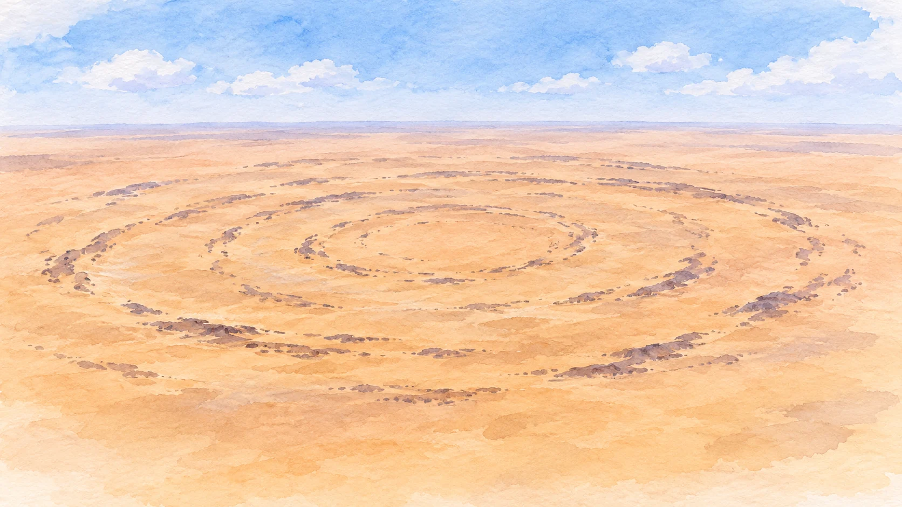
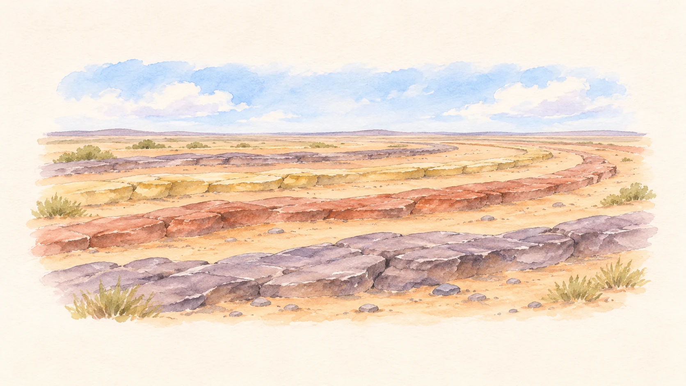

**サハラ砂漠の「目玉」は、モーリタニアにあるリシャット構造です。** 直径は約40km。宇宙からは、岩の輪がいくつも重なった大きな的のように見えます。昔は隕石が落ちた跡と考えられましたが、現在は隆起した地層が長い時間をかけて削られた地形と説明されています。

リシャット構造の環状の岩の帯を表すAI生成の概念イラスト。実地形や標高を精密再現した図ではありません。

## 輪の出発点は、持ち上がった岩

[NASA Earth Observatoryの解説](https://science.nasa.gov/earth/earth-observatory/eyeing-the-richat-structure/)によると、この場所では地下の火成岩の活動に伴って上の岩が押し上げられ、ドーム状になりました。地面に円い線を描いた何かがあるわけではなく、まず岩の層そのものが大きく変形したのです。

## 削られ方の違いが、同心円を見せる

隆起した地層の上部が侵食されると、異なる種類の岩が地表に現れます。岩によって削られやすさが違うため、残った部分が円形の尾根になりました。[NASAの別の解説](https://science.nasa.gov/earth/earth-observatory/the-eye-of-sahara-150060/)も、岩の侵食速度の違いが環状の尾根をつくったと説明しています。

侵食で岩の帯が見える様子を表すAI生成の概念イラスト。実地形や地層断面の精密再現ではありません。

円い形だけを見れば衝突の跡にも見えますが、岩石や地下の構造を調べることで、別の成り立ちが分かってきました。

## 「目玉」は空から見える地質の断面図

写真に見える輪は、押し上げられた岩の層が削られ、削られにくい岩が尾根として残ったものです。輪と輪の間の低い場所にも、岩の削られ方の違いが表れています。
