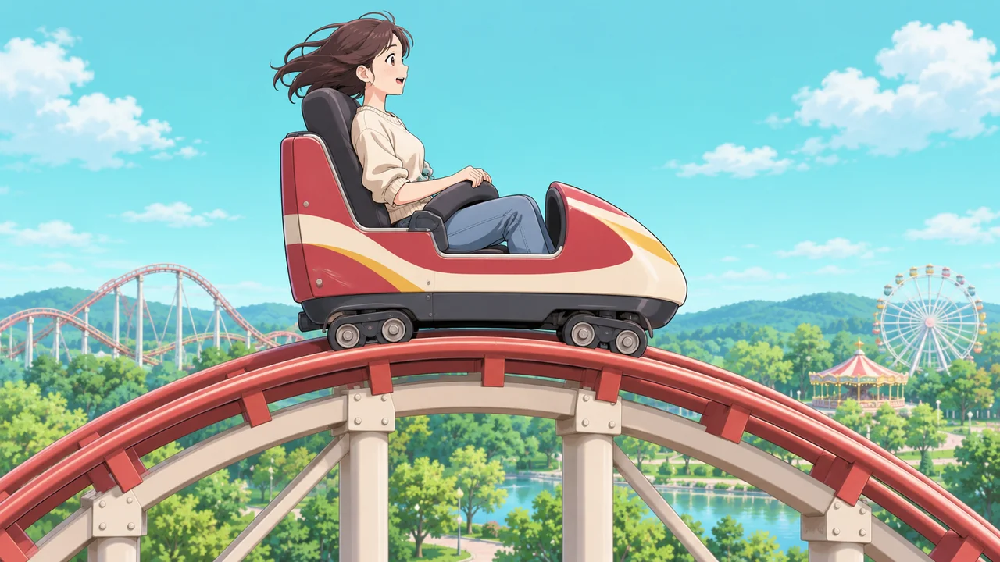
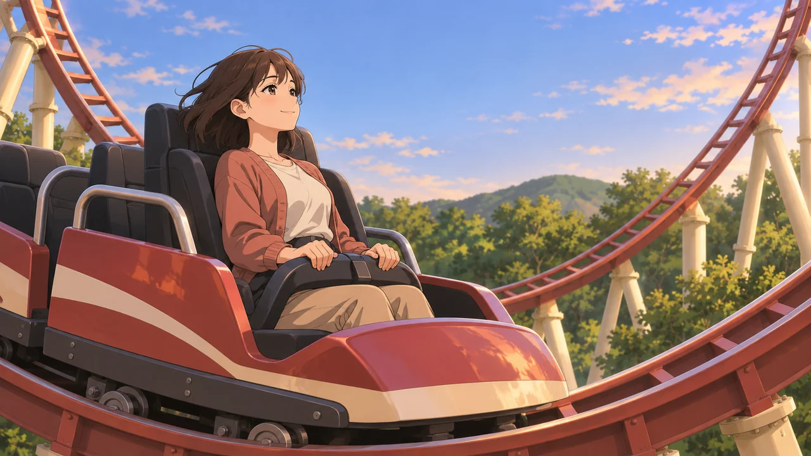

**ジェットコースターが山の頂点を越えるときの「フワッ」は、座面から体を押し上げる力が小さくなることで説明できます。重力が消えたり、体そのものの質量が減ったりするわけではありません。**

急降下の高さや速さに目が行きますが、体の軽さを考えるなら、座席がどれだけ支えているかが手がかりです。

## 普段の「重さ」には、支えがある

静かな場所で椅子に座っているとき、体には下向きの重力が働きます。同時に、座面などから上向きに支えられているので、その場にとどまれます。

この押し返す力が変わると、体の重さの感じ方も変わります。物理でいう「見かけの重さ」です。体重計も、重力を直接読み取るのではなく、体を支える力を測っています。

たとえばエレベーターが下向きに加速すると、床から受ける支えは小さくなります。「下の階へ向かっている」という移動方向ではなく、**動き方がどう変わっているか**がポイントです。

## 山を越えると、座面の支えが小さくなる

*AI生成の参考イラスト。山を越える場面のイメージで、特定の遊具や実際の力の大きさを再現したものではありません。*

山の頂点付近では、車両の進む向きが下向きへ変わっていきます。座席に乗る人も、その曲がった軌道に沿って動きます。

この場面を、下向きに加速する体と座面の関係として考えます。座面からの支えが小さくなると、普段ほど体を押し上げられず、軽く感じます。支える力がほとんどなくなる状態が、見かけの重さがほぼゼロの状態です。**下へ引く重力は、その間も働いています。**

遊園地の用語では、浮くような感覚を「エアタイム」と呼びます。Kings Islandの公式用語集も、山の頂点や落下で感じる浮遊感として紹介しています。

ただし、エアタイムという言葉から「必ず完全な無重力になる」とは言えません。この記事では、その入口となる座面の支えの変化に注目しています。

## 谷の底では、逆に重く感じることも

*AI生成の参考イラスト。谷の底で体が座席に押しつけられるように感じる場面のイメージです。*

下りから上りへ向きを変える谷の底では、今度は上向きの加速度が必要です。座面が重力に対抗するだけでなく、体の動きを上向きに変える分も支えるため、普段より強く押され、重く感じることがあります。

同じ一周でも、軽く感じる場所と重く感じる場所がある。この違いは、重力が増減するのではなく、主に座席から受ける力が変わることで説明できます。

だから「下っている間は、ずっとフワフワ」ではありません。軌道の曲がり方や速さによって、必要な加速度は変わります。体が感じているのは、落差の数字だけではないのです。
