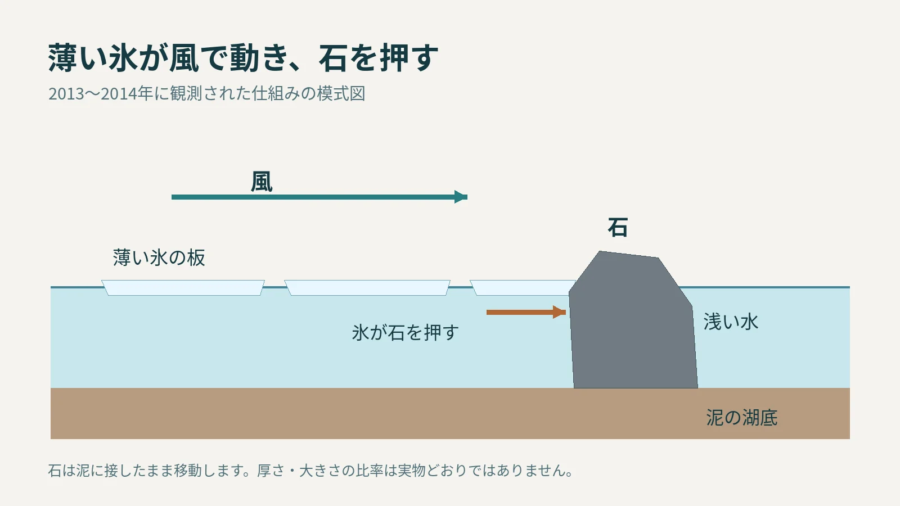
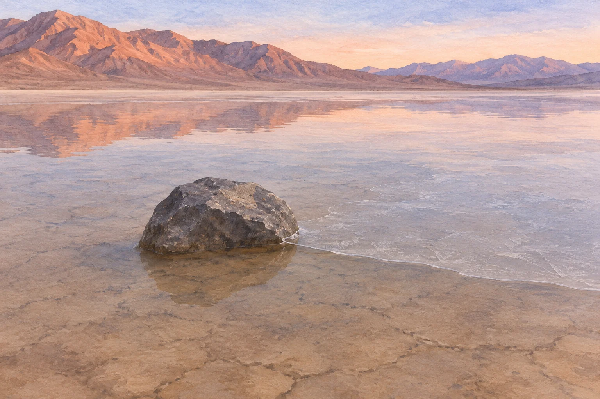

**デスバレーの「レーストラック・プラヤ」で石が動く仕組みとして、浅い水面にできた薄い氷が風で動き、石を押す様子が直接観測されています。** 石が自力で歩くわけでも、いつも強風だけで転がされるわけでもありません。

## 乾いた地面の跡は、水があるときにできる

写真でよく見るのは、乾いた湖底に石と長い筋が残った姿です。ところが、観測された移動が起きたのは、水が浅くたまっていたときでした。

[米国国立公園局の説明](https://www.nps.gov/deva/planyourvisit/the-racetrack.htm)によると、冬の夜に水面へ薄い氷ができ、日差しで溶け始めると大きな板状に割れます。それを風が押し、氷が前方の石を動かします。石は下の柔らかい泥に跡を刻みます。

観測された仕組みを示す模式図。厚さや大きさの比率は実物どおりではありません。石を氷で浮かせて運ぶ図ではありません。

## 数ミリの氷でも、石を押せる

2014年の[研究論文](https://journals.plos.org/plosone/article?id=10.1371/journal.pone.0105948)は、GPSを取り付けた石や写真、気象観測を組み合わせ、実際の移動を報告しました。観測された氷は厚さ約3〜6ミリで、石の速さは毎分約2〜5メートルでした。

薄くても、広い面積を持つ氷の板が動けば、石を押す力を伝えられます。乾いた湖底の写真だけからは想像しにくいところです。

浅い水と薄い氷がそろい、石の側面に氷板の縁が触れる場面を描いたAI生成の参考画。石は湖底に接したままです。氷や水の厚さ、石の大きさは実測比ではありません。

## いつ行っても動くわけではない

水がたまること、夜に凍ること、氷が溶けて割れること、風が吹くこと。こうした条件がそろわなければ、観測された仕組みは働きません。石が何年も動かないこともあります。

また、国立公園局の記事では、研究者が特に大きな石の移動までは見ていないことにも触れています。一度の観測で、現地のすべての跡や石について結論が出た、と広げすぎないことが大切です。

乾いた湖底に残る長い筋は、石が動いたときの水や氷まで写してはくれません。写真の跡と、観測された薄い氷の仕組みを重ねると、同じ場所に一時的に広がっていた水面が浮かび上がります。
