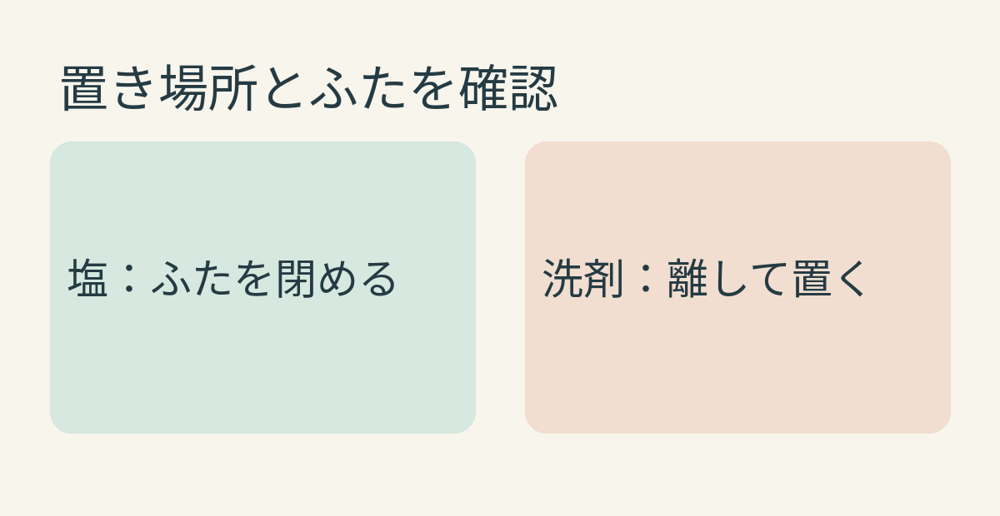
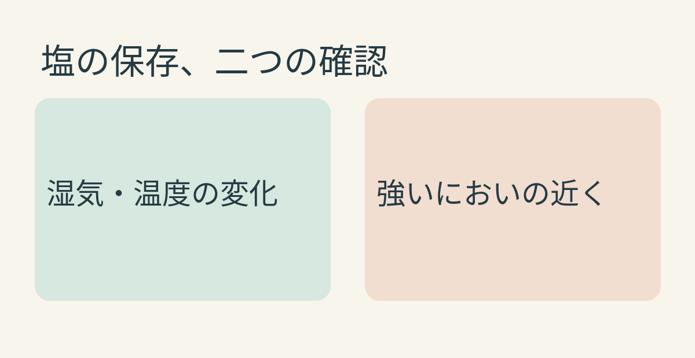

**塩は、近くにある強いにおいが移ることがあります。** 伯方塩業は、においの強いもののそばを避け、密閉容器で保存するよう案内しています。白くて見た目が変わらなくても、置き場所には気をつけたいところです。

## においの強いものと塩は、離して置こう

[伯方塩業の保存案内](https://www.hakatanoshio.co.jp/salt/basic/)は、塩にはにおいを吸着しやすい性質があり、密閉容器を使って、においの強いもののそばを避けるよう勧めています。洗剤のような強いにおいの日用品も、塩とは離して置くのが無難でしょう。

買ってきた袋のまま使うなら、開封口がきちんと閉じられるかを確認。容器に移すなら、食品用の清潔でふたが閉まるものを選びましょう。密閉容器に入れたからといって、強いにおいのすぐ隣に置いてよいという意味でもありません。まず保管場所を離し、容器も閉じる、という二段構えが分かりやすいです。

独自の模式図。保存時の配置を単純化したもので、距離や容器の密閉性能を保証する図ではありません。

## におい移りと「固まる」は別の注意

塩の保存でよく思い浮かぶのは、湿気で固まることかもしれません。[伯方塩業](https://www.hakatanoshio.co.jp/salt/basic/)は、塩の「固まりやすい」「においを吸着しやすい」を別々の注意点として挙げています。固まりにくくするには温度変化が大きい場所や湿度が高い場所を避けるよう案内しています。[日本海水の解説](https://nihonkaisui.co.jp/small_customer/learning_salt/basic_knowledge)では、湿度の変化によって塩の粒が結びつくことが、固まる理由と説明されています。

つまり、固まっていなければにおい移りもない、とは判断できません。反対に、塊になったというだけで洗剤のにおいが移ったと決めることもできません。見たいのは「湿気や温度の変化」と「周囲の強いにおい」の両方です。

独自の模式図。におい移りと固まりやすさを分けて示しています。起こる速さや程度を示すものではありません。

## 商品の表示も最後に確認

塩といっても製品ごとに特徴があります。たとえば味の素は、[「瀬戸のほんじお」の案内](https://okyakusama.ajinomoto.co.jp/qa/shio/honjio/)で、もともとしっとりした塩が湿度の高い時期にさらに水分を吸うことがあると説明し、開封後は容器や袋の口を閉めるよう勧めています。ここでの湿気の説明を、すべての塩が同じ状態になるという意味に広げないようにしましょう。

塩を調味料棚に戻す前に、隣に置いた日用品と、ふたの閉まり具合を一度見る。小さな確認ですが、におい移りを防ぐには、理にかなった習慣ですね。
