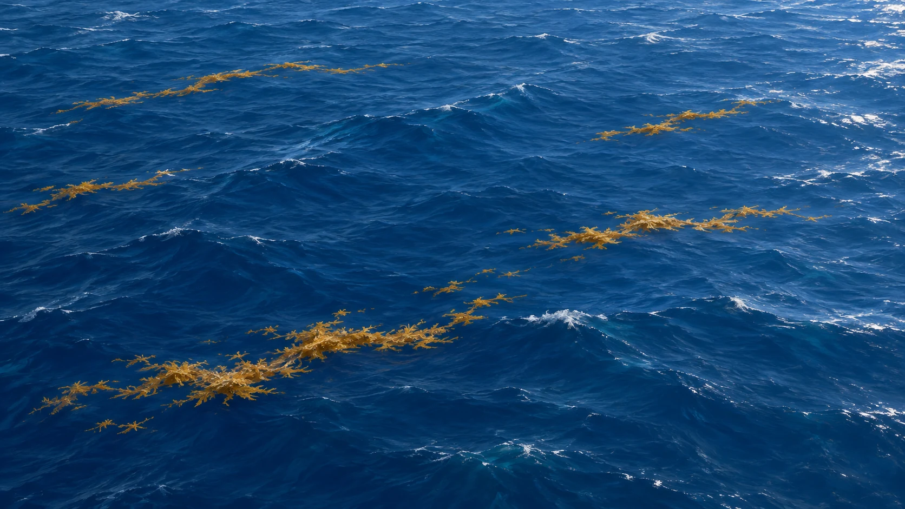
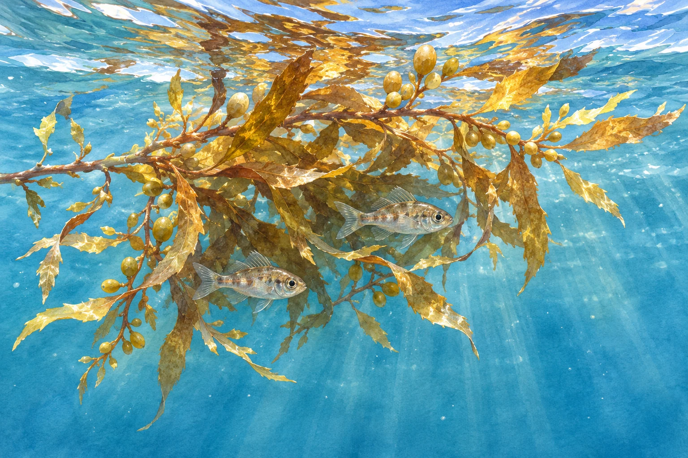

**サルガッソ海には海岸線がありません。** 北大西洋の中で、陸地ではなく周囲の海流によって区切られる「海」です。名前に付いた「サルガッソ」は、海面に浮かぶホンダワラの仲間に由来します。

## 海なのに、岸がない？

[NOAAの海と大洋の解説](https://oceanservice.noaa.gov/facts/oceanorsea.html)では、地理で使う英語の「sea」は、ふつう「ocean（大洋）」より小さく、陸に一部を囲まれる水域と説明しています。ただし、サルガッソ海はその例外。陸地との境ではなく、海流を境界として呼ばれています。

見える海藻の帯が、そのままサルガッソ海の境界線になるわけではありません。

[NOAAのサルガッソ海の説明](https://oceanservice.noaa.gov/facts/sargassosea.html)では、西側にメキシコ湾流、北側に北大西洋海流、東側にカナリア海流、南側に北赤道海流を挙げています。こうした海流に囲まれる北大西洋亜熱帯循環の内側にある、というのがこの海の特徴です。海流は動くため、境界を海岸線のように一本の固定線として引けるわけではありません。

## 海面に浮かぶ、もう一つの特徴

この海の名前は、浮遊する褐藻「サルガッスム（ホンダワラの仲間）」から来ています。NOAAによると、この海には海底に付着せず、外洋を漂いながら増える種類が生息します。海藻は塊や帯となって浮かびます。枝についている小さな実のような部分は、実ではなく気体を含む浮き袋です。これが浮力を助けます。なお、ホンダワラの仲間すべてが海底に付かず暮らすわけではなく、ここで扱っているのは外洋を漂う種類です。

[NOAA Ocean Explorationの解説](https://oceanexplorer.noaa.gov/ocean-fact/sargassum/)には、この浮遊海藻が魚やカニ、エビ、ウミガメなどの食べ物や隠れ場所になるとあります。一見ただ漂うだけの海藻も、小さな生き物の居場所なのです。

海の名前を聞くと、まず陸地に囲まれた形を思い浮かべがちです。それなのに、流れそのものが輪郭をつくるというのが面白いところ。さらに、漂う海藻が小さな生き物には居場所になる。サルガッソ海の不思議さは、船を捕まえる伝説より、そんな海の成り立ちにあります。
