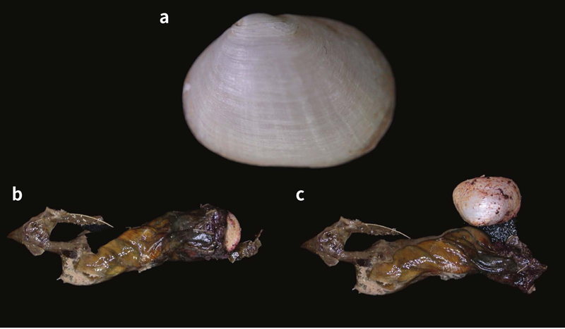

オーストラリア南岸沖、水深約4,000〜5,000メートル。ウニの食道から出てきたのは、白っぽい二枚貝でした。ただのみ込まれたばかりの餌なら、そこにいても不思議はありません。**すみかだと見抜く手がかりは、貝の足から伸びた細い糸と、貝が入ったままの食道の標本**でした。

## 網の中に残った、ぬるぬるの管

深海から引き上げた貝の足には、体をどこかに固定するときに使う「足糸」が付いていました。研究チームが網で採ったものを調べ直すと、薄い管に収まったままの貝も見つかりました。管の組織をDNAで調べると、深海のウニの一種と一致しました。

*上（a）は長さ17.8ミリの殻。左下（b）の食道から、右下（c）では貝が姿を現している。[Valentich-Scott、MacIntosh、Goto（2026）、ZooKeys](https://doi.org/10.3897/zookeys.1297.204489) の図を[京都大学が再構成した写真](https://www.kyoto-u.ac.jp/ja/research-news/2026-11-19-0)をそのまま掲載。[CC BY 4.0](https://creativecommons.org/licenses/by/4.0/)*

## 150年前の標本にも、喉の住人がいた

このウニの消化管から貝が見つかったという記録は1970年代からありました。今回、豪州沖の貝が新種として記載され、「喉にすむもの」を意味する *gulicola* という種小名が付きました。さらに約150年前の英国チャレンジャー号の探検で持ち帰ったウニを調べると、その食道にも、同じ属の別種の貝が残っていました。

ウニは海底の泥を食べます。その泥に交じった有機物を、食道で受け取れるのかもしれません。これは研究チームの仮説です。生まれたばかりの貝がどうやってウニの喉へたどり着くかも、まだ分かっていません。
