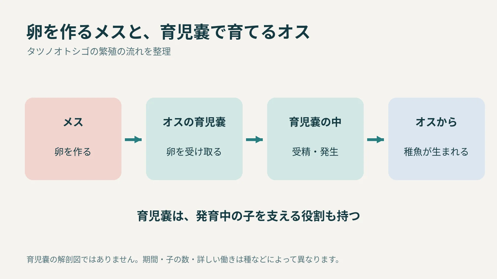
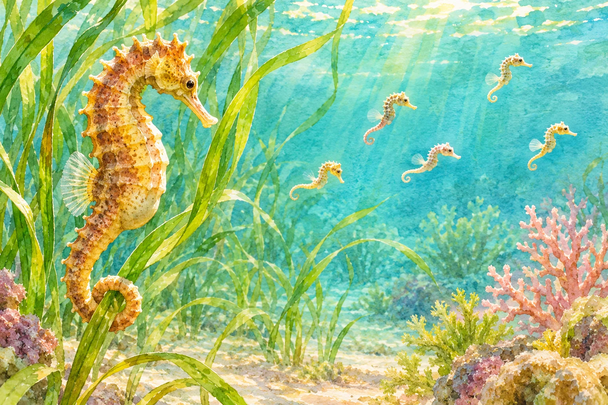

**タツノオトシゴは、オスが稚魚を産みます。ただし、卵を作るのはメスです。メスから渡された卵をオスが「育児嚢（いくじのう）」という袋で育て、成長した子が外へ出てきます。**

## 卵を作る役と、おなかで育てる役が分かれる

[米国海洋大気庁（NOAA）の解説](https://oceanservice.noaa.gov/facts/seahorse.html)によると、メスは成熟した卵をオスの育児嚢へ移し、そこで受精が起こります。その後、袋の中で発生が進み、稚魚が生まれます。

「オスが出産する」と聞くと、卵までオスが作るように感じるかもしれません。実際には、卵を作る段階と、受精後に体の袋で育てる段階を、メスとオスが分担しています。

繁殖の流れを整理した模式図。育児嚢の解剖図や、子の数・大きさを示した図ではありません。

## 育児嚢は、卵を入れるだけの袋ではない

育児嚢の役割は、卵を落とさず持っておくことだけではありません。[タツノオトシゴの育児嚢を調べた研究](https://academic.oup.com/mbe/article/32/12/3114/2579313)では、胚を守ることに加え、ガス交換や塩分環境の調節などに関わることが説明されています。

また、[シドニー大学が2020年に紹介したポットベリーシーホースの研究](https://www.sydney.edu.au/news-opinion/news/2020/07/12/male-seahorses-transport-nutrients-to-embryos-research.html)では、オスから発生中の子へ栄養が渡ることも示されました。人の妊娠とまったく同じ仕組みという意味ではありませんが、父親の体が子の発育を支えていることが分かります。

育児嚢から出た後の稚魚が水中を泳ぐ姿を描いたAI生成の参考画。種類や実際の子の数を示すものではありません。

## 種による違いもある

育児嚢の形や働きは、タツノオトシゴとその近縁の魚の間でもさまざまです。妊娠期間や一度に生まれる数を、すべて同じ数字で説明することもできません。

卵を作るのはメスで、受け取った卵が育つ場所を用意するのはオス。図の矢印をこの順番にたどると、「オスが出産する」という一言の中にも、二匹の異なる役割があることが分かります。
