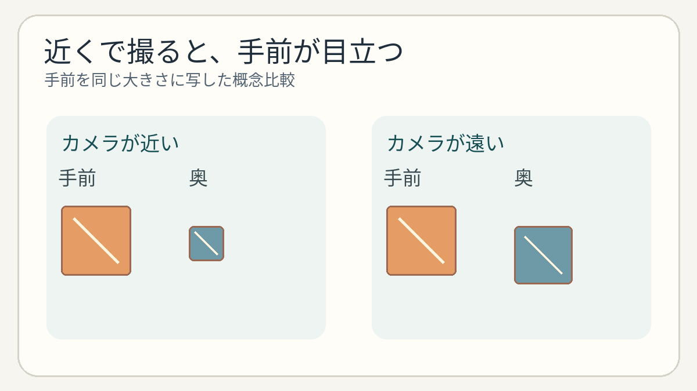
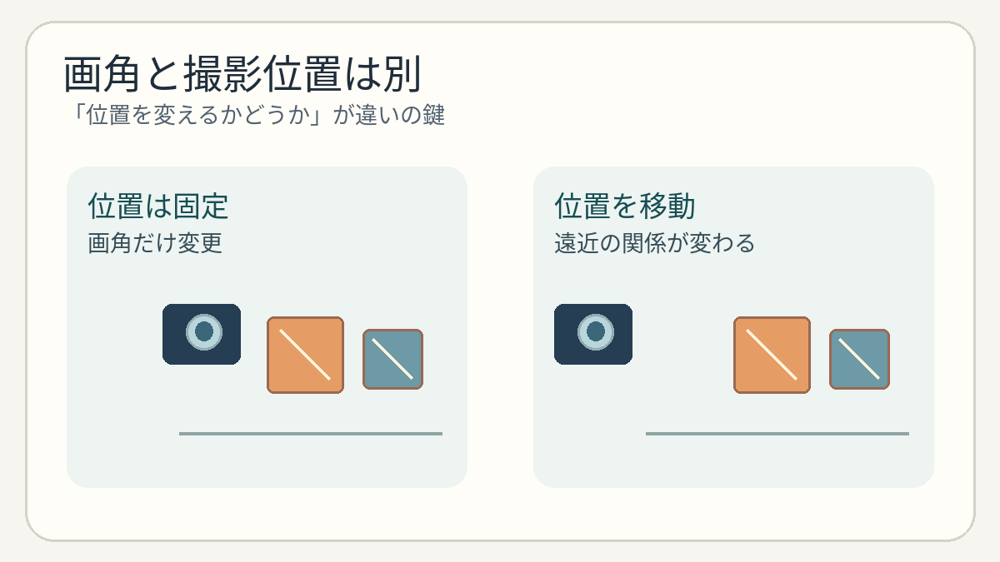

**自撮りで手前の部分が大きく見える理由の一つは、カメラが顔に近いことです。** 近くから撮ると、手前にある部分と奥にある部分の距離の差が、写真の中では大きさの差として目立ちます。顔そのものが変わったわけではありません。

## 「近いものほど大きい」が顔にも起こる

遠くの建物が小さく見えるのと同じ遠近感は、近距離の撮影にも働きます。カメラへ近い部分ほど、写る大きさが相対的に大きくなるのです。鼻などカメラに近い部分が強調されて見えることがあるのも、この位置関係で説明できます。ただし、どの程度違って見えるかは、距離、向き、カメラの位置などによって変わります。

同じ大きさの物体を手前と奥に置き、手前の写る大きさをそろえるよう画角や中央の切り取りを合わせた概念比較です。同じ焦点距離・画角での実測比較ではなく、顔の形や寸法を再現したものでもありません。

## レンズだけが原因ではない

「広角レンズは顔を変える」と言われることがあります。しかし、[写真技術の解説](https://cdn.cambridgeincolour.com/tutorials/camera-lenses.htm)が区別するように、遠近感を直接決めるのは被写体に対する**カメラの位置**です。広角では同じ大きさに写そうとしてカメラを近づけがちなので、レンズと距離の効果が一緒に変わり、混同しやすいのです。[ニコンの遠近感の解説](https://nij.nikon.com/learn/phototech/manual/19/02.html)も、人物を同じ大きさに写すためにカメラとの距離を変えた比較で、背景の写り方が変わると説明しています。

二つの操作を区別するための関係図です。物体の寸法や正確な撮影配置、撮影結果の比較を示すものではありません。

カメラの位置を固定してズームしても、撮った画像の中央を切り取っても、手前と奥の位置関係は変わりません。一方、カメラを前後へ動かせば、その距離関係が変わります。また、画面の端で直線が曲がるような**レンズ固有の歪曲**は、ここでいう遠近感とは別の現象です。角度を変えれば、どの部分が手前になるかも変わります。

自撮りの写り方が気になったら、レンズ名だけを見るより、まずカメラを置く位置と向きを比べると理由が分かりやすくなります。写真を作るのはレンズだけでなく、カメラをどこに置くかでもあるのです。
