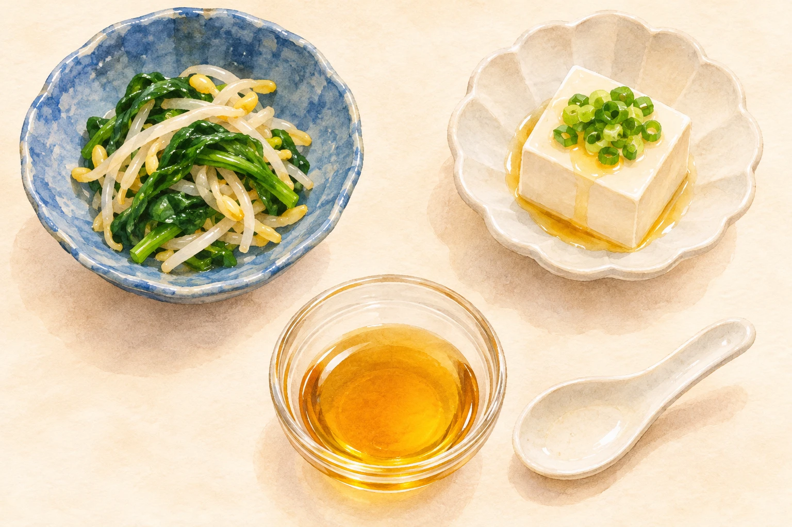
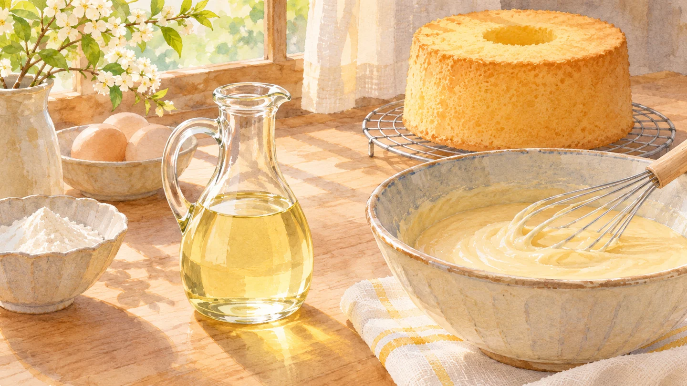

**ごま油のあの香ばしさは、ごまを煎ってから搾ることと関係しています。** 一方、焙煎せずに搾る「太白（たいはく）ごま油」には、よく知っているごま油特有の香りがほとんどありません。同じごまが原料でも、料理での出番が変わるのが面白いところです。

ごま油は炒め物だけでなく、ナムルや冷ややっこなどにも使えます。ただ、「ごま油なら、どれを使ってもあの香りになる」と思うと、少し戸惑うかもしれません。まず見たいのは、入れるタイミングよりも手元の油がどんなタイプかです。

AI生成の参考イラスト。焙煎ごま油の用途をイメージしたもので、特定のレシピや使用量を再現した写真ではありません。

## 香ばしさは、瓶に入る前につくられる

[かどや製油の「純正ごま油」](https://www.kadoya.com/products/sesameoil/junsei/)は、ごまを煎ってから搾る製品です。特徴として、いりごまらしい香ばしい風味を挙げています。料理中に初めて香りをつけるというより、製造の段階ですでに香ばしさを持った油なのですね。

焙煎タイプの中にも違いがあります。[マルホンのFAQ](https://www.gomaabura.jp/faq/)では、焙煎を深くすると色が濃くなり、香りも強くなると説明しています。同社の商品には、穏やかに香る浅煎りから、濃厚な風味の深煎りまであります。

「ごま油の香りは好きだけれど、この料理では少し控えめにしたい」。そんなとき、量だけでなく焙煎の違いも選ぶ手がかりになります。ただし、瓶越しの色だけで強さを正確に比べられるわけではありません。商品ごとの香りの説明も一緒に読むと、使う場面を想像しやすくなります。

## 香りを足さないごま油にも、出番がある

太白ごま油は、焙煎したごまの強い香りを加えずに使いたいときの選択肢です。[マルホンの「太白胡麻油」](https://www.gomaabura.jp/item/taihaku/)も、素材の風味を生かす油として紹介されています。おすすめの用途には、玉子焼きやパスタのほか、お菓子やパンまで並んでいます。

焙煎しないごま油をお菓子に使う場面の参考イラスト（AI生成）。特定のレシピや油の量を示すものではありません。

ごま油でお菓子、と聞くと香ばしいごま風味を想像しそうですが、この製品ではその香りをつけることが目的ではありません。「ごまからできていること」と「焙煎ごまの香りがすること」は、分けて考えると納得できます。

なお、[マルホンの案内](https://www.gomaabura.jp/item/taihaku/)では、「太白」は竹本油脂の登録商標とされています。ここで挙げた用途や製品の特徴は、同社の説明に基づく例です。別の商品でも、名前だけで使い方を決めずに表示を確かめてください。

## 「生搾り」は、生食専用という意味ではない

太白ごま油の説明には「生搾り」という言葉も出てきます。ここでのポイントは、**ごまを焙煎せずに搾ること**。食卓で必ず生のまま使う、という指定ではありません。

マルホンは太白胡麻油の用途に揚げ物なども挙げています。また、かどやの香ばしい「純正ごま油」も、炒め物とあえ物の両方が用途です。香りのあるタイプも、香りのないタイプも、加熱する料理に出番があります。「ごま油はすべて加熱できない」と覚える必要はありません。

一方、どの料理でも同じ順番で使えばよいわけではありません。油を使って食材を炒めるのか、できた料理に風味を添えるのかで役割が変わります。商品の用途に合うレシピを選び、その手順に沿って使うのが確実です。

## 今日は、香ばしさを足したい？

ごま油を選ぶときは、「今日はごまの香りも料理の味わいに加えたいか」と考えると整理しやすくなります。ナムルや冷ややっこに香ばしさを添える使い方もあれば、素材の風味を生かすために焙煎しない油を使う場面もあります。

香りが控えめだから物足りない油、とは限りません。前に出る役と、ほかの材料を引き立てる役。同じごまからできた油にその両方があると知ると、台所の一本を見る目もちょっと変わりますね。
