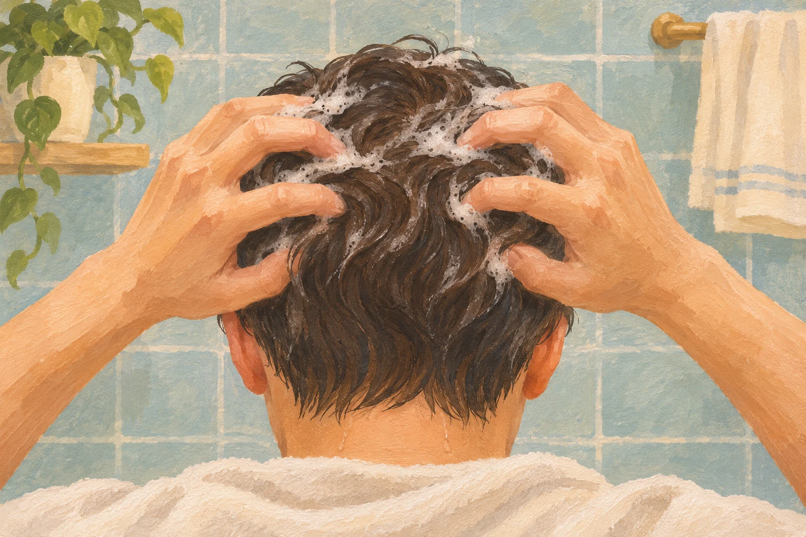
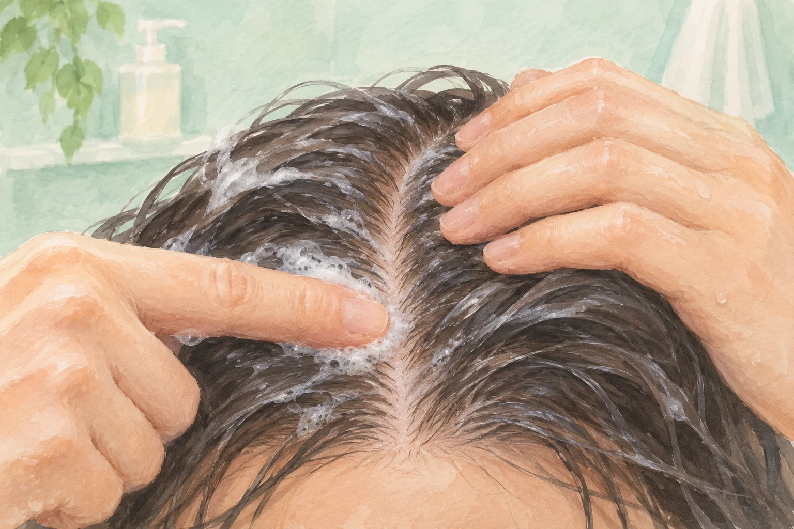

**シャンプーで洗うのは、髪の毛だけではありません。髪の下にある頭皮の皮脂や汚れを洗い流すことも大切です。** 髪の表面がよく泡立っていても、頭皮全体にシャンプーが届いているかは、もう一歩確認したいところです。

指の腹で髪と頭皮をやさしく洗う参考イラスト（AI生成）。製品の使用量や医療上の判断を示すものではありません。

## 髪にも頭皮にも、違う汚れが付く

日本化粧品技術者会は、シャンプーが落とす汚れとして、皮脂や垢、ほこり、ヘアスタイリング剤などを挙げています。それらを、洗浄成分である界面活性剤が包み込み、洗い流しやすくします。

つまり、髪の汚れを洗わなくてよいという話でもありません。髪と頭皮の両方を洗う製品です。長い髪を揉むことに集中すると、髪の下にある地肌を見落としやすい。そこで、洗浄成分をどこへ届けるかが大事になります。

## 最初のお湯を、頭皮まで届かせる

シャンプーをつける前は、髪だけでなく頭皮もしっかり濡らします。花王は、指で髪をかき分けながら全体を濡らす方法を案内しています。水分が行き渡ると泡立ちやすくなり、シャンプーも広がりやすくなります。

使う量は製品の表示を目安にし、手に取ってから髪の根元付近へ広げます。髪の量が多い場合は、表面の髪を少し持ち上げると頭皮へ届かせやすくなります。量を増やす前に、まず濡らし方や届き方を見直す余地があるのですね。

## 爪でこすらず、指の腹で

洗うときは指の腹を頭皮に当て、やさしく小刻みに動かします。花王と資生堂の案内は、どちらも指の腹を使う点で共通しています。爪を立てたり、髪同士を強くこすり合わせたりする洗い方は避けます。

髪をかき分け、指の腹を地肌にやさしく当てる洗い方の参考イラスト（AI生成）。爪でこする方法や強い力で押す方法を示すものではありません。

泡には、洗髪中の摩擦を和らげる役割もあります。日本化粧品技術者会は、髪と髪、髪と指の間のクッションになると説明しています。泡を立てる意味は見た目の気持ちよさだけではなく、なめらかに洗うことにもあるのです。

## 耳の後ろと襟足は、最後にもう一度

すすぎでは、髪の表面だけにシャワーを流して終わらせず、指を通して根元や頭皮までお湯を届かせます。耳の後ろ、生え際、襟足などは、洗い残し・すすぎ残しに注意したい場所です。

花王は、すすぎも洗っている過程の一つとして案内しています。洗浄成分でなじませた汚れを、最後にきちんと流すところまでが洗髪なのですね。

新しい道具を増やさなくても、髪を少しかき分け、指の腹が地肌に届いているか確かめることはできます。いつものシャンプーも、「髪の下まで洗えているかな」と考えるだけで、手の動かし方が少し変わりそうです。
