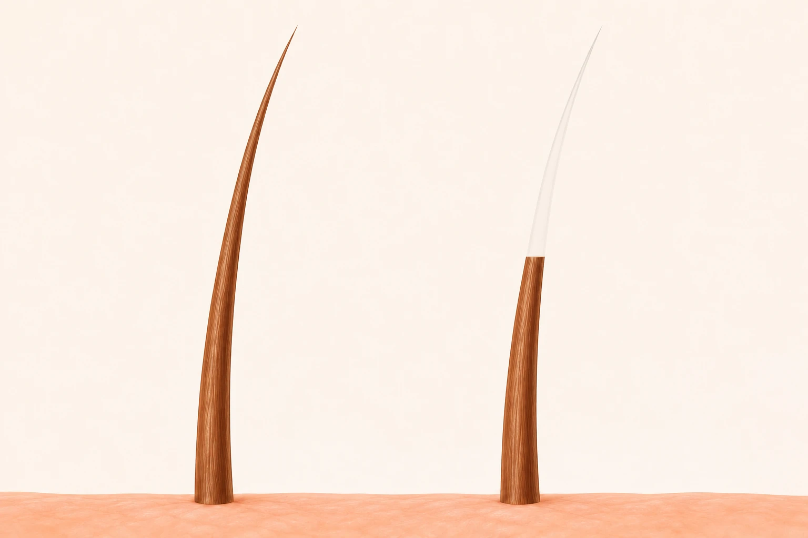

**毛を剃っても、剃ったことで毛が太くなったり、伸びるのが速くなったりするわけではありません。** それでも、伸びかけが前より濃く見えたり、指にザラッと当たったりすることがあります。手触りが変わったことと、毛の育ち方が変わったことは、分けて考える必要があります。

## 細い先がなくなると、同じ毛でも目立ち方が変わる

切られていない毛の先端は細くなっています。その途中を剃ると、細い先がなくなり、もともと幅のあった部分が新しい先端になります。切ったから軸が膨らんだのではなく、先端として見えている場所が変わるのです。

[Mayo Clinicの解説](https://www.mayoclinic.org/healthy-lifestyle/adult-health/expert-answers/hair-removal/faq-20058427)も、剃ったあとの鈍い毛先は、伸びる途中で硬く感じられたり、目立って濃く見えたりすることがあると説明しています。太さや成長速度の変化とは別の話です。

形だけをたとえるなら、細くまとまった筆先と、その途中を切った筆先の違いに近いでしょう。途中を切れば幅のある切り口が現れますが、切る操作で元の束を太くしたわけではありません。もちろん、筆と毛では素材も成長の仕方も違うので、たとえは先端の形だけの話です。

毛先の形を説明する模式図。右の薄い輪郭は切られた部分を示します。形を説明する模式図で、太さや長さを比較した図ではありません。実際の顕微鏡写真でもありません。

## 毛先を切ることと、毛を育てる場所は別

毛は、見えている先端から伸びているわけではありません。[Cleveland Clinicの解説](https://my.clevelandclinic.org/health/body/23435-hair-follicle)によると、毛を作るのは皮膚の中にある毛包という構造で、成長はその中の根元から始まります。

普段の剃毛で短くするのは、皮膚から出ている毛です。先端の形を変えることと、皮膚の中で毛が育つ仕組みが変わることは同じではありません。「切った場所」と「伸び始める場所」を分けると、剃っただけで毛の太さや成長速度が変わらない、という説明も理解しやすくなります。

また、「濃い」という言葉にも二つの意味が混ざります。毛そのものの色や太さの話なのか、それとも短い毛先が目立って見える話なのか。Mayo Clinicは、剃毛で毛の色も変わらない一方、伸びかけの毛は濃く見えることがある、と区別しています。

## 「そう感じた」は、勘違いだけで片づけなくていい

剃ったあとの毛に触れて、前より硬いと感じる。その感覚を丸ごと否定する必要はありません。考えたいのは、その感覚から何が言えるかです。

「指にザラッと当たった」と「毛が太く育つようになった」は、似ているようで違う主張です。毛先の形の変化で説明できるなら、後者まで飛躍しなくてもよいのです。

この話で面白いのは、日常の実感と説明を対立させずに済むところです。目や指が捉えた変化は大切にしつつ、それが先端の形なのか、毛の成長なのかを分ける。身近な疑問でも、何を比べているのかがはっきりすると、答えはずっと見通しよくなります。
