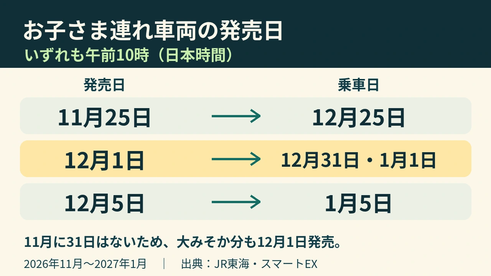

東海道新幹線の「お子さま連れ車両」は、**2026年12月25日乗車分が11月25日（水）午前10時に発売**されます。年末年始分がその日に一斉に出るわけではありません。たとえば12月28日に行き、1月3日に帰るなら、発売日は行きが11月28日、帰りが12月3日。どちらも午前10時です。

JR東海が設定するのは、12月25日（金）から翌年1月5日（火）まで。東京〜新大阪の一部の「のぞみ」の12号車で、合計140本です。140本は期間全体の本数で、すべての「のぞみ」に付くわけではありません。

## 大みそかと元日は、どちらも12月1日発売

基本は乗車日の1か月前の午前10時。11月に31日はないので、**12月31日（木）に乗る分は12月1日（火）に発売**されます。翌日の1月1日（金）に乗る分も、発売は同じ12月1日です。

- **12月25〜30日乗車** → 11月25〜30日の、それぞれ同じ日付
- **12月31日・1月1日乗車** → 12月1日
- **1月2〜5日乗車** → 12月2〜5日の、それぞれ同じ日付

スマートEXやエクスプレス予約には一部の指定席を最大1年前から予約できるサービスがありますが、**お子さま連れ車両は対象外**です。普通車指定席の予約が受け付けられていても、この車両の席は上の日程を待ちます。

## スマートEXでは「席種」から探す

1. [JR東海の設定列車一覧](https://recommend.jr-central.co.jp/oyakotabi/fs/)で、乗る日と方向に対象列車があるか確認します。
2. スマートEXの新幹線予約で、乗車日、区間、人数を入力します。「席種」から「お子さま連れ車両」を選び、対象の「のぞみ」を探します。詳しくは[公式の予約ガイド](https://smart-ex.jp/reservation/reserve_smart/bringing_children/)へ。
3. 座席を選んだら、確定前に日付・列車・人数を確認します。往路と復路はそれぞれの発売日を控えておくと、片方を取り忘れずに済みます。

エクスプレス予約、LINEからEX、駅の窓口や指定席券売機などでも取り扱います。シートマップで座席を選べるのは、ネットの選択肢ではエクスプレス予約とスマートEXです。スマートEXは11月25日〜12月3日の午前10時前後にアクセスが集中し、一時的にログインしづらくなる可能性を案内しています。

## 12号車を選ぶ前に知っておきたいこと

12号車は、おむつ替えのできるトイレや多目的室に近い普通車指定席です。子ども連れだけが乗る車両ではなく、多目的室も先約などで使えない場合があります。スマートEXの案内では予約は6名まで。6歳未満でも一席使う場合は、「こども」として予約が必要です。

この車両には特大荷物スペースつき座席がなく、3辺の合計が160cmを超え250cm以内のスーツケースなどは持ち込めません。ベビーカーは別扱いで、荷物としての事前予約は不要です。置き場所は[JR東海の荷物案内](https://railway.jr-central.co.jp/oversized-baggage/)で確認できます。

なお、同じ12月25日〜1月5日には、東海道・山陽新幹線の「のぞみ」が全席指定席になります。これは子連れ車両の設定とは別です。希望の12号車に空席が見つからなければ、時間をずらすか、ほかの号車の指定席も見てみてください。
