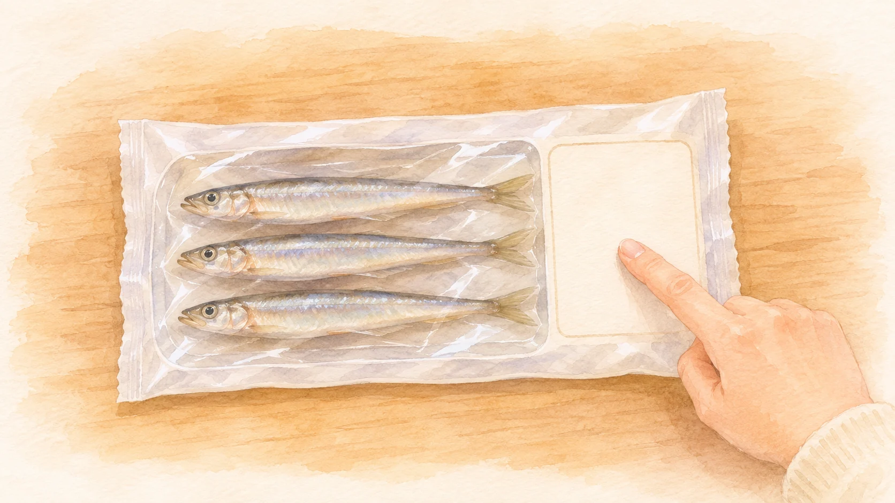
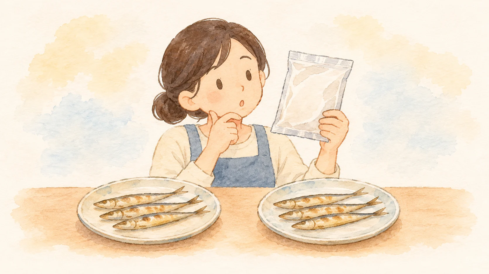

**シシャモとカラフトシシャモは、同じキュウリウオ科に属する別の種類の魚です。** カラフトシシャモは「カペリン」とも呼ばれます。名前が似ていても、同じ魚の産地違いというわけではありません。

シシャモ類の商品表示を確認する場面を描いたAI生成の参考イラスト。実際の魚種は商品の原材料表示などで確認してください。外観による種の識別図ではありません。

## 北海道のシシャモと、広く分布するカペリン

[北海道の魚図鑑](https://www.pref.hokkaido.lg.jp/sr/gid/fis010.html)によると、シシャモは北海道の太平洋沿岸に分布する日本固有の魚です。産卵の時期になると、鵡川や十勝川などの河川をさかのぼります。

一方、[北海道立総合研究機構の解説](https://www.hro.or.jp/upload/41180/dayori973sisyamokanri.pdf)は、カラフトシシャモが太平洋から大西洋の北部に広く分布すると説明しています。同じような干物で見かけても、もともと暮らしている範囲は大きく違います。

## 「ししゃも」という呼び名が、少し紛らわしい

道総研は、流通する「ししゃも」と名の付く魚には、カラフトシシャモが多く含まれることを紹介しています。北海道のシシャモとは別種ですが、似た姿や食べ方から、名前が混同されやすいのです。

小魚を食卓で見かける場面のAI生成の参考イラスト。二皿が異なる魚種である証拠や種の識別図ではありません。

「子持ち」は卵を持つ状態を表す言葉で、それだけで魚種が決まるわけではありません。商品の原材料名などにある「シシャモ」「カラフトシシャモ」「カペリン」といった表記が、魚種を区別する手掛かりになります。

## 別の魚だと知ると、食卓の見え方も変わる

魚種が違うことと、おいしさの評価は別の話です。片方を単に「偽物」と呼ぶより、それぞれ名前と生まれ育った場所がある魚として見るほうが、この違いをよく理解できます。

身近な一皿から、北海道の川と海、さらに北の海まで話が広がる。食品の名前には、意外と大きな生き物の世界がつながっています。
