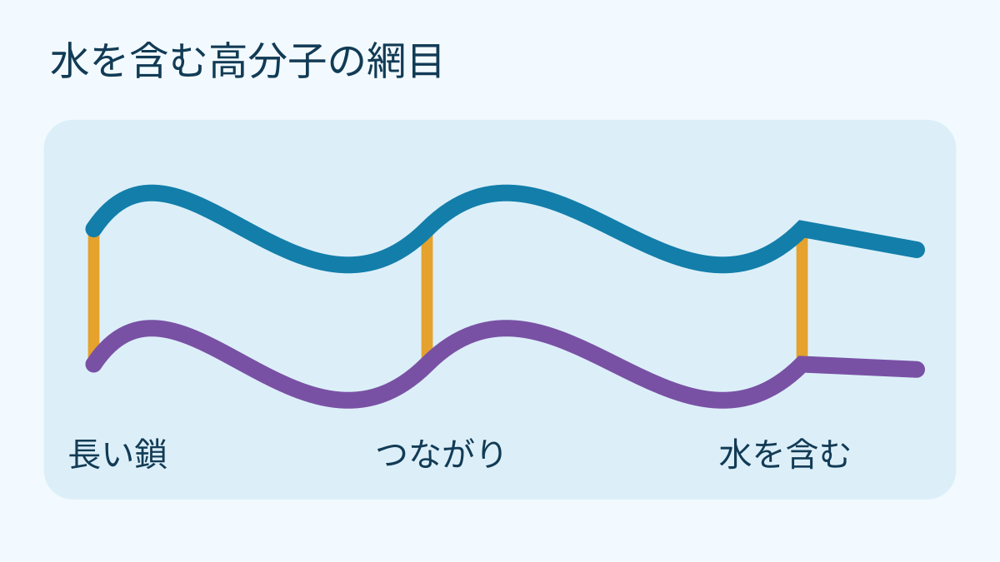
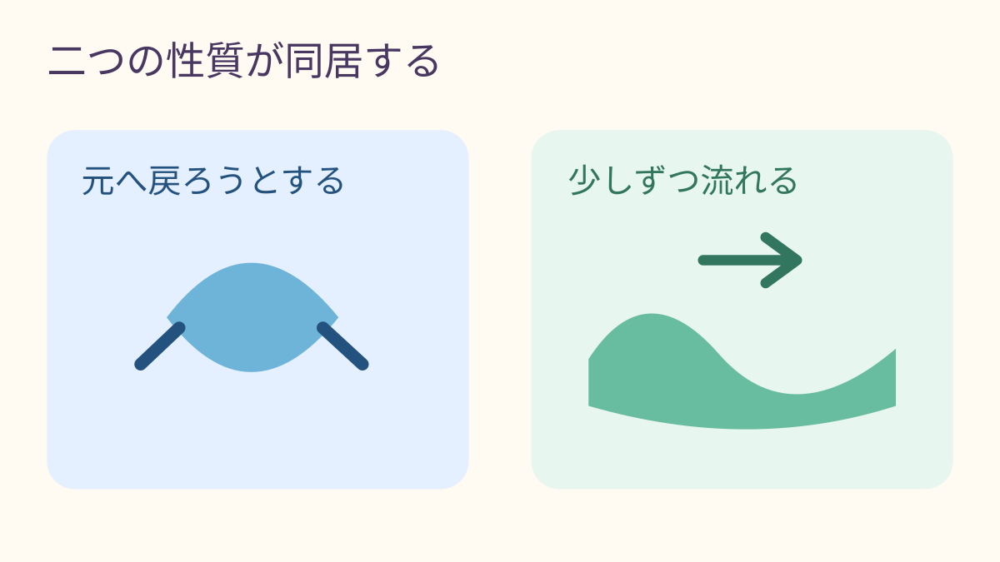

**ぷるぷる伸びるのは、水の中にある長い高分子の鎖が、互いにつながりながら動けるから。** 水のようにはすぐに流れず、時間がたつと形が変わります。ここでは、ポリビニルアルコール（PVA）とホウ酸塩の系を例に、その中で起きることを考えます。

## 見えない「長い鎖」

高分子は、小さな部分がたくさん連なった長い分子です。PVAの鎖が水の中で別々に動ける状態なら、鎖は互いをすり抜けやすく、全体も流れます。そこに鎖どうしをつなぐ部分ができると、動きは制限されます。一本だけを引っ張っても、隣の鎖が一緒についてくるようなイメージです。

青と紫の線は長い鎖、橙色の線は鎖どうしのつながりを示す記号です。分子の形や数、水が入る空間の実際の大きさを表したものではありません。

大切なのは、水を含むことと、鎖どうしがつながることを分けて考える点です。水は鎖の周りに広がり、材料の大部分を占めますが、水だけならこの形にはなりません。つながりは鎖の動きをまとめて制限し、柔らかなまとまりを作ります。

## 伸びるのに、流れるのはなぜ？

PVA系の例では、つながりがあるため、形を変えると戻ろうとする性質が現れます。一方、つながりは永久に固定されたものではありません。ワシントン大学の解説は、弱いつながりが切れ、再びできるモデルで説明しています。鎖が動けるため、全体としてもゆっくり流れます。こうした「元へ戻ろうとする面」と「流れる面」をあわせ持つ振る舞いを、粘弾性と呼びます。水だけのさらさらした流れとも、形を保ち続ける硬い固体とも違うところです。

ただし「スライム」という名前のものが、すべて同じ高分子や同じつながり方でできているわけではありません。水の含み方や鎖の結びつき方が異なれば、見た目が似ていても動きは変わります。この説明は特定の材料を理解するためのモデルです。鎖とつながり、水の関係に目を向けると、あの独特な動きも少し整理できます。
