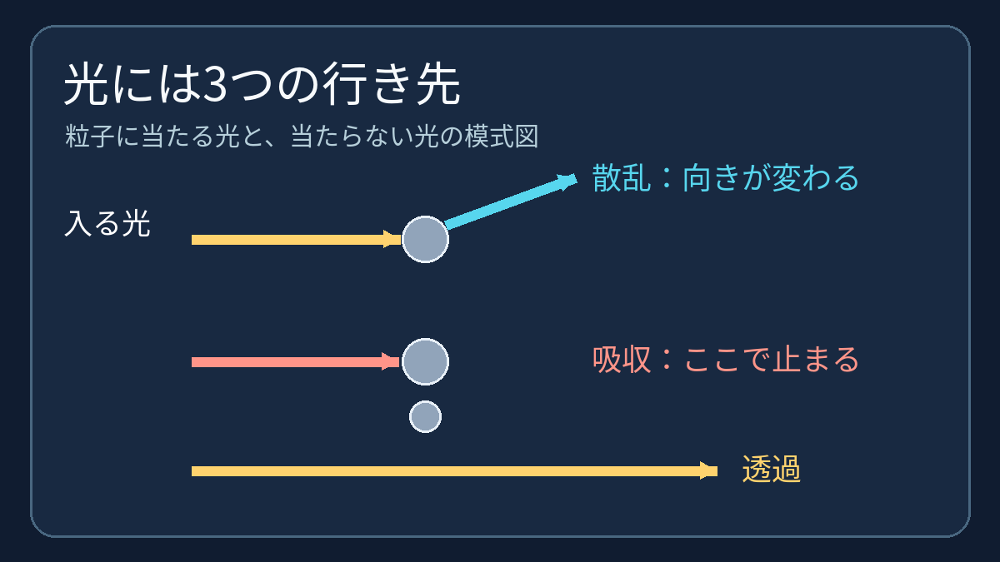
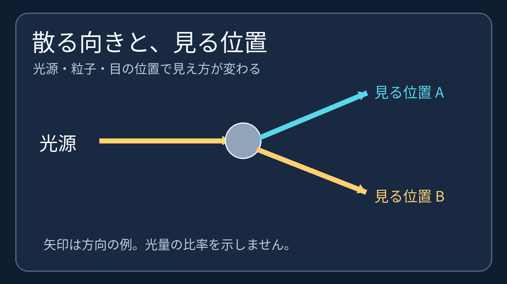

**煙が光を散らしたり遮ったりする主な理由は、空気中に漂う細かな粒子が光の進む方向を変え、また一部の光を吸収するからです。** 直進して届く光が減る一方、別の方向から散らばった光が目に入ることもあります。

## 煙は「気体だけ」ではない

目に見える煙の光学的な働きを考えるとき、主役は空気中に浮かぶ固体の微粒子や液滴です。こうした浮遊粒子を「エアロゾル」と呼びます。煙に気体成分が含まれないという意味ではありませんが、煙を単なる気体として扱うと、光が散らばるしくみを見落とします。

## 散乱と吸収は別の道

粒子に当たった光の一部は、進む方向が変わります。これが**散乱**です。別の一部は粒子に**吸収**されます。吸収された光を「反射して目へ戻る光」と数えることはできません。さらに、粒子に出会わず、もとの方向へ通り抜ける光もあります。

遠くのものから届く光は、途中で散乱・吸収されると、まっすぐ届く分が減ります。これを光の「減衰」と考えられます。ただし散乱は光の消滅ではなく、進路の変更です。別の方向へ進んだ光が見る人に届けば、煙自体が明るく見える場合もあります。

## 明るく見えるかは、位置でも変わる

光が粒子からどちらへ散るかは一様ではありません。光がもともと進む向きに近い「前方散乱」と、光源の側へ戻る「後方散乱」は区別されます。光源と見る人の位置が違えば、目に入る散乱光の量も変わります。粒子の大きさ・成分や光の波長も効くため、「煙があるなら、光を当てると必ず見えにくくなる」とは言えません。

煙が白っぽく見えたり、奥がかすんだりする背景には、散乱で加わる光と、直進して届かなくなる光の両方があるのです。身近な「見える」の裏に、光の道筋が何本も重なっていると思うと面白いですね。
