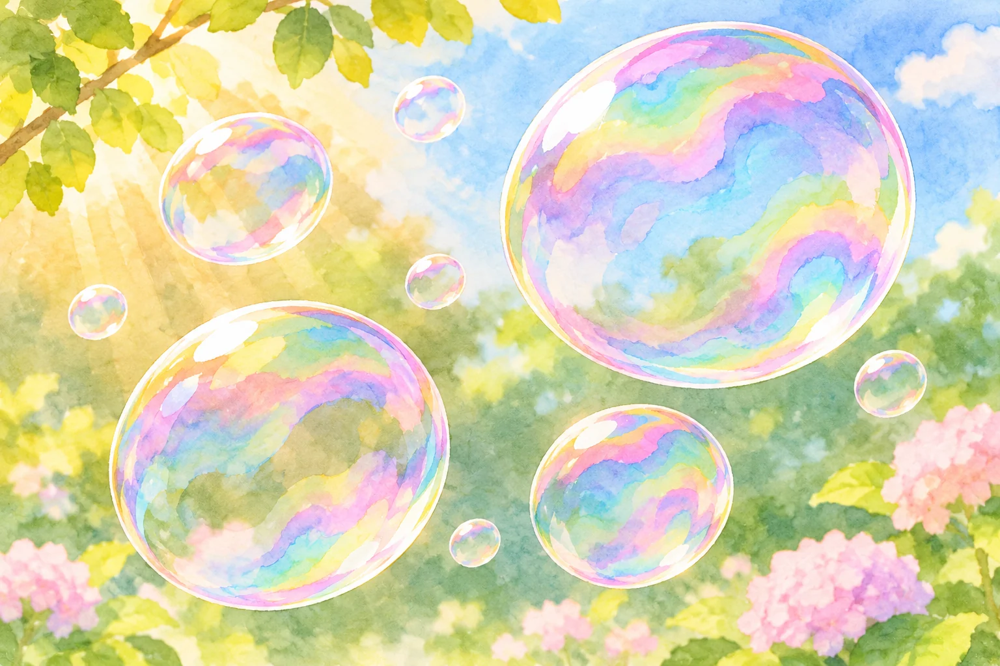
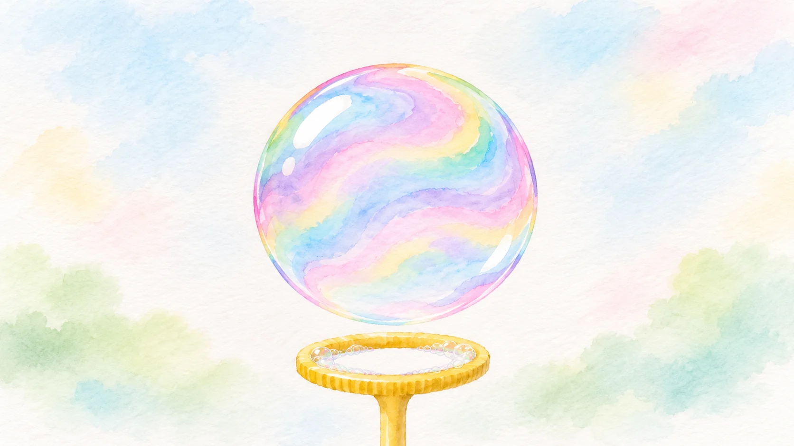

**シャボン玉の表面に見える色は、薄い膜の両面で反射した光が重なり合って生まれます。** 色のついた絵の具が表面を流れているわけではありません。透明に見える膜が、光の進み方を変えているのです。

AI生成の参考イラスト。色彩の揺らぐ複数のシャボン玉の水彩画。実物や実験を記録した画像ではありません。

## 薄い膜の「表」と「裏」で、光が反射する

シャボン玉の膜に光が当たると、一部は外側の面で反射します。別の一部は膜の中へ進み、内側の面で反射して外へ戻ってきます。この二つの光は同じ場所から戻るように見えても、通った道の長さが少し違います。

光には波としての性質があります。二つの波の山と山が合えば強まり、山と谷が重なれば弱まります。膜の両面から返ってきた光でも、この重なりが起こります。これが「薄膜干渉」です。米国の科学館Exploratoriumは、シャボン玉の膜の外側と内側からの反射が重なり、色が現れると説明しています。

## どうして一色ではなく、いろいろな色になる？

白い光には、さまざまな色に対応する光が混ざっています。膜で反射したあと、そのすべてが同じように強まるわけではありません。ある色の光は強まり、別の色の光は弱まります。目に届く光の組み合わせが変わるため、色がついて見えるのです。

シャボン玉の膜に見える色の変化を表すAI生成の参考イラスト。膜厚や色の定量的な対応を示す図ではありません。

その組み合わせを左右するのが、膜の厚さです。厚さが違えば、内側の面で反射した光が戻るまでの道の長さも変わります。シャボン玉の膜は一様な厚さとは限らず、液が動いたり薄くなったりすると色の帯や模様も変化します。見ているあいだに色が揺れ動くのは、膜そのものが変わっている手がかりでもあります。

さらに、見る角度や光の当たる角度も関係します。同じ膜でも斜めから見れば、膜を通る光の道の長さが変わり、目に届く色が変わりえます。見る位置を少し変えるだけで印象が違うのは、このためです。

膜の厚さが色に関わるといっても、「赤なら何ミリ」というように一つの数字へ簡単に置き換えられるわけではありません。光の当たり方や観察する方向も合わせて考える必要があります。同じ色が別の場所に現れることもあり、色だけから膜の厚さを決めつけることはできません。

## 虹と同じ仕組みなの？

どちらも光に関わる色ですが、仕組みは分けて考えましょう。虹は主に、雨粒の中で光が屈折・反射し、色ごとに進む向きが違うことで見えます。一方、シャボン玉の表面の色を生む中心は、薄い膜の両面で反射した光の干渉です。研究論文でも、虹の色とシャボン玉の色は、見え方も生まれる仕組みも異なると説明されています。

シャボン玉の色は、表面に固定された模様ではありません。液が動いて膜の厚さが変わり、光を受ける角度も変わる。そのたびに強まる色の組み合わせが変わるので、丸い玉の中を色の帯が流れていくように見えます。
