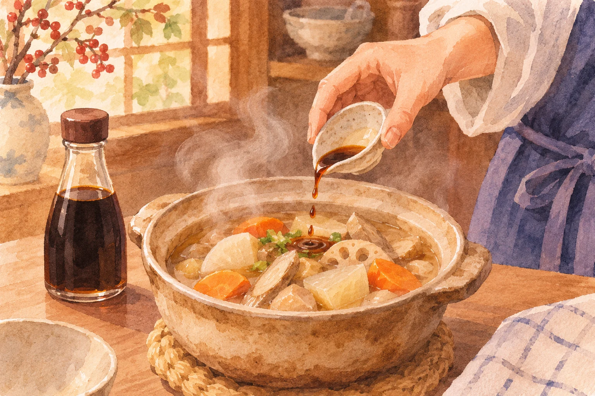
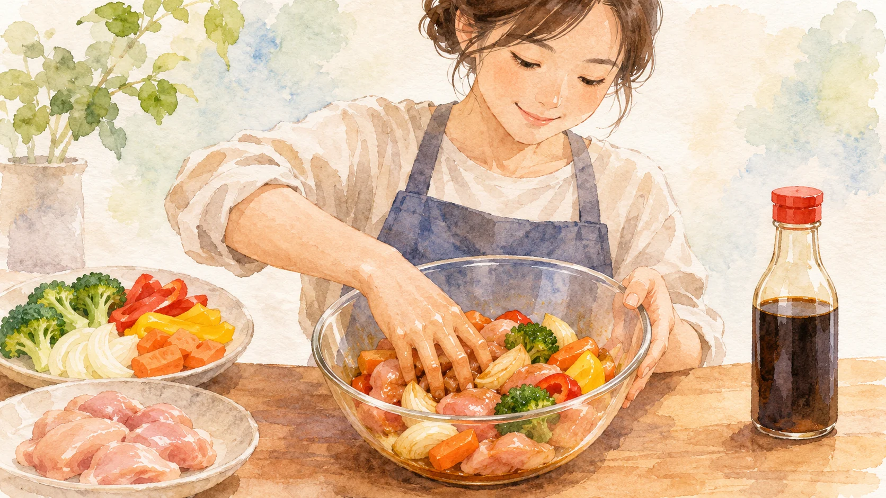

**しょうゆの香りを前に出したいなら、仕上げ近くに加える方法があります。** ただし、どの料理でも「最後に全部入れる」が正解というわけではありません。下味をつけたいのか、煮汁に味をつけたいのか、香ばしいたれをつくりたいのか。目指す仕上がりによって、入れる場面は変わります。

AI生成の参考イラスト。記事の出典資料から転載した画像ではありません。

## 最後に加えると、香りが立つ

たとえばキッコーマンのけんちん汁のレシピでは、根菜を炒めてから煮込み、最後の香りづけにしょうゆを加えます。塩を味つけの基本にして、しょうゆを仕上げに使う構成です。鍋を長く煮立てる前からしょうゆを入れるのではなく、料理ができあがるころに加えて、その香りとコクを生かしています。

ヤマサ醤油のアヒージョのレシピも、しょうゆの半量を仕上げに使います。火からおろして回しかけるのは、香りを生かすとともに、熱い油がはねるのを避けるためです。熱い油を使う料理では、香りだけを考えて勢いよくしょうゆを注ぐのは危険です。レシピにある火の扱いまで一緒に確かめたいですね。

## 先に入れる意味もある

同じアヒージョのレシピでは、残り半量を鶏肉の下味に使っています。仕上げの香りと、材料の味つけを分けているわけです。先に加える分には、材料そのものに味をつける役割があります。仕上げに加える分とは、使う目的が違うのですね。

AI生成の参考イラスト。下味に使う一例を表した概念画。どの料理にも共通する手順ではありません。

また、照り焼きではしょうゆを含むたれを加えてから煮詰め、つやを出すレシピがあります。キッコーマンは、鶏つくねの照り焼きで、たれが少なくなるまで全体にからめる方法を紹介しています。しょうゆを熱することで生まれる香ばしい香りもあります。加熱をすべて避けるのではなく、どんな香りや食感を出したいかがポイントです。

## 覚えたいのは「いつ」より「何のため」

しょうゆには、塩味やうま味だけでなく、料理を引き立てる香りがあります。火を止めるころに少し加えると、その香りを前に出す使い方ができます。一方で、食材への下味や煮詰めたたれをつくるなら、途中で加えることにも役割があります。

同じしょうゆでも、長く煮る汁物と、短時間で仕上げる炒め物、香ばしさを狙う照り焼きでは、欲しい仕上がりが違います。レシピの順番を見たら「なぜここでしょうゆを入れるのだろう」と考えてみる。タイミングを丸暗記するより、その料理の狙いがつかみやすくなります。
