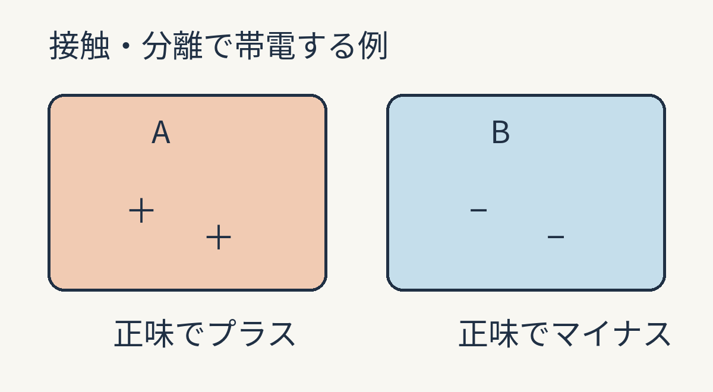
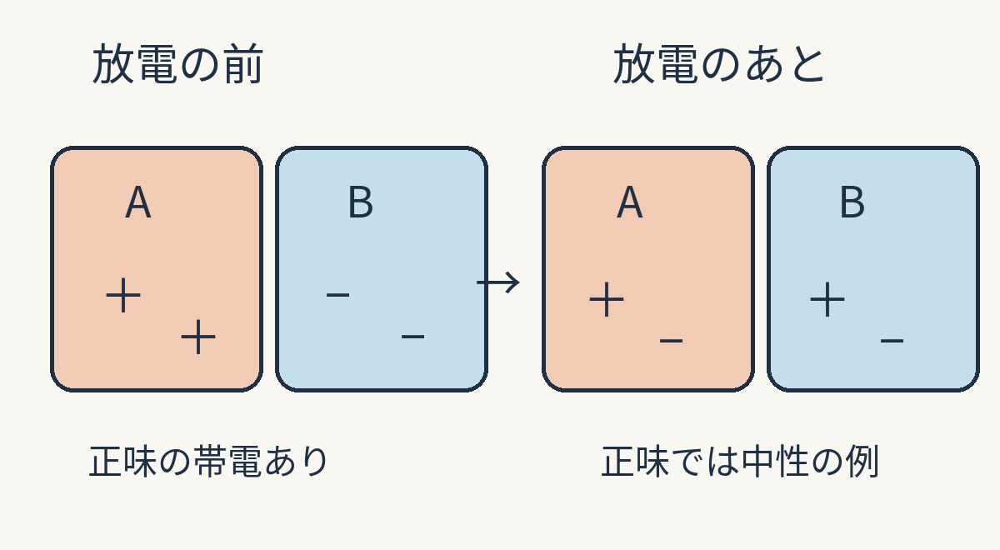
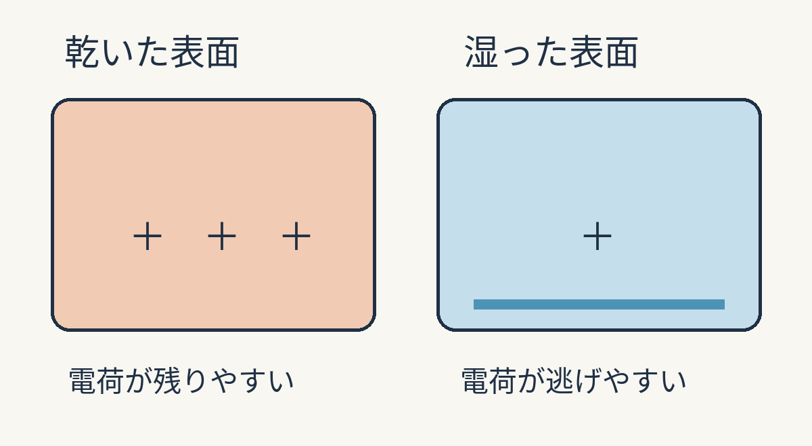

**触れようとした瞬間の「バチッ」は、たまっていた電荷が一気に移る放電です。** 服や床と接して離れると帯電することがあり、乾燥した日は電荷が逃げにくくなるため、この小さな衝撃が起きやすくなります。

独自の模式図。＋−は帯電の状態を示す記号で、粒子の数ではありません。A・Bは特定の材質や、その測定結果を表していません。

## 「こする」の中で起きていること

衣服と衣服、靴と床のように、違う材質の表面が接して離れると、電荷が偏って残ることがあります。こする動作はその接触と分離を繰り返しますが、摩擦だけが静電気の原因というわけではありません。[UCLAの静電気実験教材](https://demoweb.physics.ucla.edu/node/108)も、接触を作ったり切ったりすると電荷が移る一方、その細かな仕組みは十分には分かっていないと説明しています。

入門的には、片側で電子が増え、もう片側で減る例を考えると、＋と−の偏りをイメージできます。ただし、どの物の組み合わせでも「電子だけが移る」と決めつける図ではありません。電荷の残り方は材質や表面の状態にも左右されます。

## 触れた瞬間に何が起きる？

体と相手の物の電気的な状態に差があるまま指先などが近づくと、その差を縮めるように電荷が短時間で移ります。これが放電です。火花が見える場合もありますが、いつも光るわけではありません。[バルセロナ大学の説明](https://www.ub.edu/ossma/en/safety-health/preventive-space-pas-pdi-research-staff/inform-yourself/physical-laboratory/static-electricity)では、放電は電荷を渡す側でも受け取る側でも起こり、短く急なときに火花になるとされています。

放電で正味の帯電がなくなる一例です。電荷そのものは消えず、常に中性になるわけでもありません。矢印は時間の順序です。

## 乾燥した日ほど起きやすいのは？

湿り気によって物の表面に薄い水分の層ができると、そこを通じて、たまった電荷が少しずつ逃げやすくなります。乾燥した日はその逃げ道ができにくく、触れたときまで電荷の偏りが残りやすいのです。UCLAの教材も、湿度が高いと実験器具の絶縁体の表面に薄い水の膜ができ、電荷が蓄積する前に逃げると説明しています。

表面水分の働きを示す入門モデルです。記号の数は電荷量ではなく、すべての材質や湿度条件で同じ変化が起きることも示しません。

動画のような大げさな電撃は物語の演出。でも、突然の「バチッ」にも、接して離れて電荷が残る時間と、それが一気に動く瞬間があると思うと、ちょっと見方が変わります。
