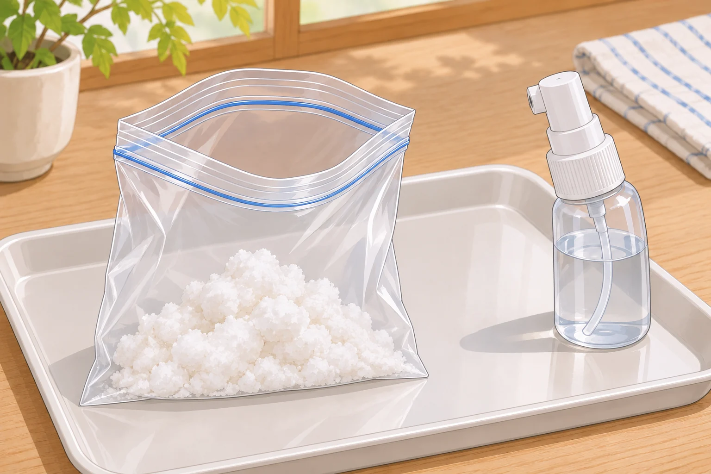
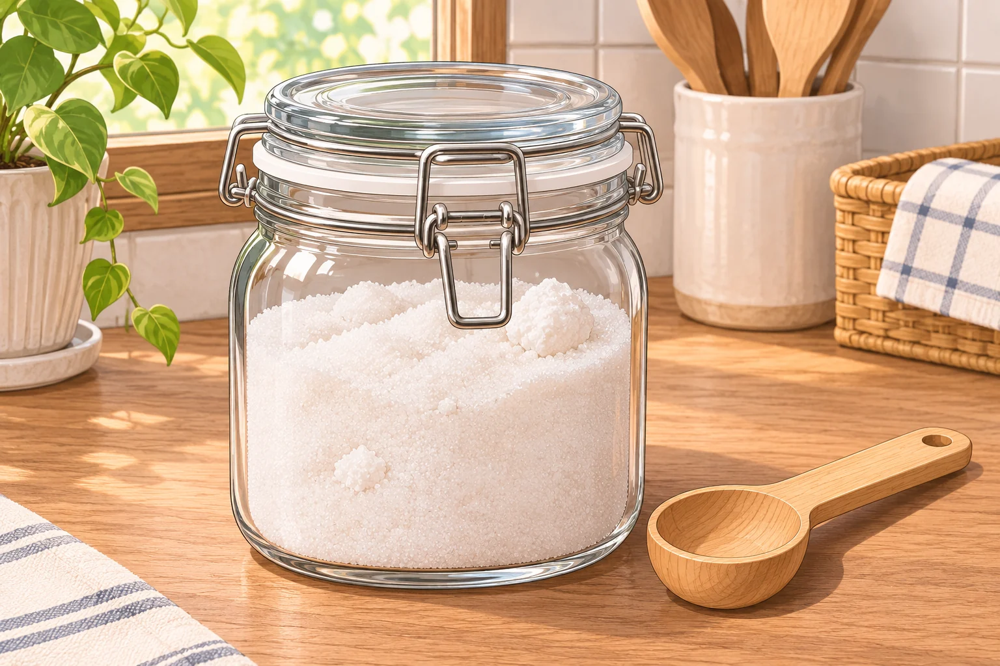

**上白糖がカチカチに固まる主な理由は、乾燥によって砂糖の粒どうしをつなぐ小さな結晶ができることです。**「砂糖が固まったら、湿気を吸ったせい」と思いがちですが、上白糖では乾きすぎが原因になるのです。

## どうして乾くと固まるの？

上白糖の粒の表面には、製造時に加えられた砂糖液が付いています。外気が乾燥してこの液の水分が蒸発すると、液に溶けていた砂糖が小さな結晶として現れます。その結晶が粒と粒を橋のようにつなぎ、塊になります。農林水産省も、特に上白糖は固まりやすいと説明しています。

一方、湿気と無関係というわけでもありません。砂糖が湿気を吸うと粒の表面が溶け、そこから再び乾くと結晶どうしがくっつきます。砂糖を扱う宮崎商店は、日々の湿度の変化でも固まると説明しています。つまり、ひとことで「湿気が原因」「乾燥が原因」と決めるより、水分が出入りして粒どうしが結びつく、と考えると分かりやすいでしょう。

## 固まった砂糖はどうほぐす？

乾燥して固まった上白糖なら、少量の水分を補って、粒をつなぐ小さな結晶を溶かす方法があります。農林水産省が紹介するのは、砂糖を袋に入れて霧吹きで水をかけ、口をしっかり閉じて数時間置く方法。かけすぎると砂糖そのものが溶けるので、水を一気に注ぐのは避けましょう。

宮崎商店は、水を加えるときは料理に使う分だけを取り分けるよう勧めています。水分が抜ければ、また固まる場合があるためです。大量の砂糖を一度にぬらすより、必要な分から扱うほうがよさそうです。

乾燥して固まった上白糖には、ごく少量の水分を補う方法があります。使う分だけを別に取り、ぬらしすぎないのがポイント。AI生成の参考イラスト。

## 固めないための保存のコツ

台所は調理で湿度が変わりやすい場所です。開封前のポリ袋も外気の影響を完全には防げません。使う分を、ふたの閉まる容器に入れ、湿度の変化を小さくするのが基本です。なお、ここで説明しているのは水分の変化による塊です。異物や汚れ、異臭などがある場合まで、同じ説明で判断しないでください。

湿度の変化を避けるため、ふたの閉まる容器で保存します。AI生成の参考イラスト。

塩は湿気で固まる印象が強いだけに、砂糖には「乾きすぎ」を戻す方法があるのが面白いところ。力ずくで砕く前に、まず保存中の水分の変化を思い出したいですね。
