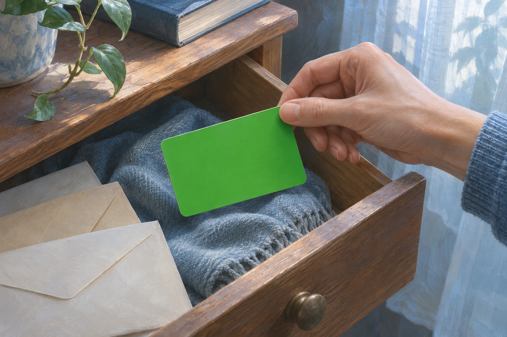
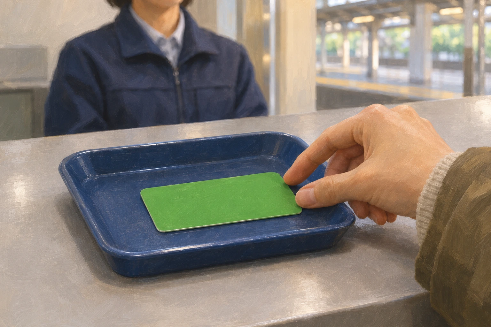

**JR東日本の一般的なカード型Suicaでは、チャージ残額がゼロでも、返却すれば最初に預けた500円が戻ります。** この500円は使い残した運賃ではありません。カードを発行するときに預けるお金で、電車に乗ったり買い物をしたりしても減りません。

## 残高がゼロでも、預り金は残っている

引き出しから、しばらく出番のなかったSuicaが出てきたとします。最後に使って残額を空にしていたとしても、「もう使えるお金がない」と「返しても戻るお金がない」は別の話です。

無地の交通系カードを描いた参考イラスト。実際のSuicaの券面ではありません。

JR東日本が2001年にサービスを始める前の資料には、預り金を設けた理由が書いてあります。**カードの使い捨てを防ぐため**です。当時のSuicaイオカードの発売額には、運賃に使える分と預り金が別々に含まれていました。使うお金がなくなったときにも、カードを捨てずに返す理由が残る。残高ゼロのカードを見ると、むしろこの仕組みの狙いがよく分かります。

## 手数料が引かれるのは、残額のほう

カードを返す際、チャージ残額が220円を超えていれば、残額から手数料の220円を引き、預り金を足して返金します。残額が220円以下なら預り金だけが戻ります。手数料は預り金の側からは引かれません。

たとえば、残額が100円なら、チャージ分からの返金はありません。それでも預り金の500円はそのまま戻ります。残額100円とゼロで、返ってくる額が同じなのはこのためです。

駅でカードを返す場面の参考イラスト。実際の窓口や手続きの案内図ではありません。

こうして分けてみると、見落としやすいのは残額よりも、「何のために預けたお金か」のほうです。残額は使うためのお金。預り金は、使い終えたカードを返すと戻るお金。同じカードに関わっていても、役割が違います。
