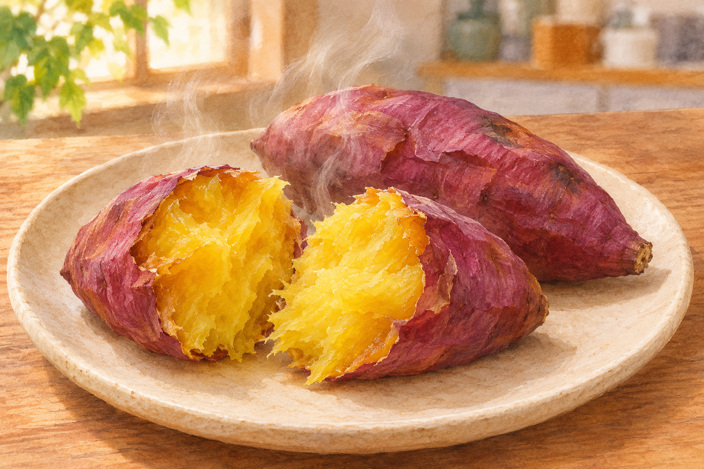
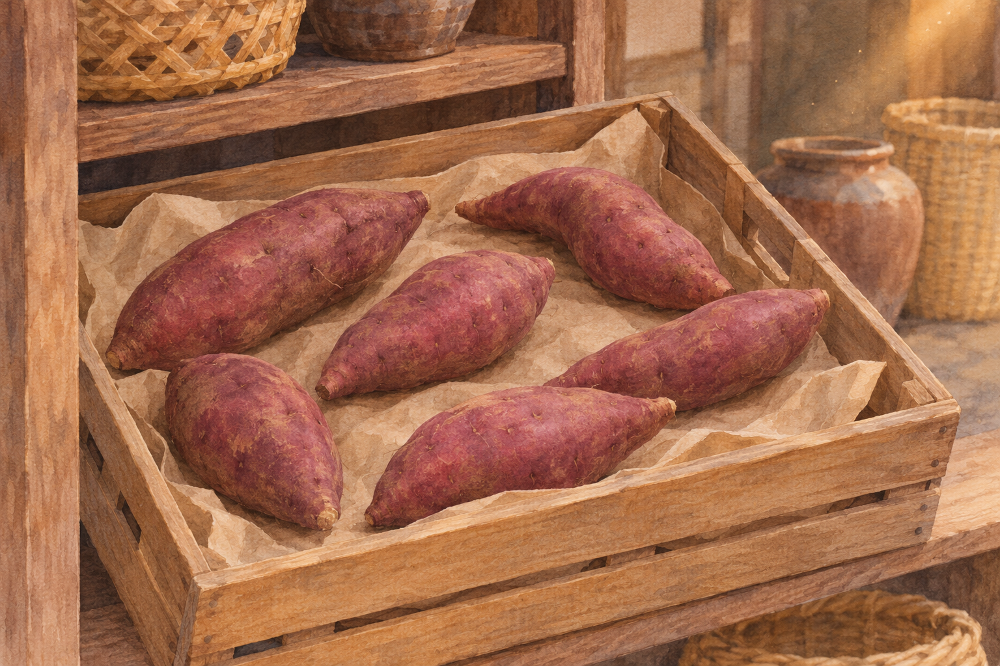

**焼き芋が砂糖なしでも甘い大きな理由は、加熱中に、いもの中のでんぷんから「麦芽糖」という甘い糖が作られることです。この変化を助けるのが、さつまいも自身に含まれる酵素「β-アミラーゼ」です。**

甘さを左右するのは、いもに火が通ったかどうかだけではありません。でんぷんの変化と酵素の働きが、うまく重なる必要があります。同じように温めたつもりでも甘さが違う、その理由を見ていきましょう。[日本いも類研究会の解説](https://www.jrt.gr.jp/q_a/spqa_yakiimo/)

砂糖などを添えていない焼き芋の参考イラスト（AI生成）。品種を特定した図ではありません。

## でんぷんがほどけてから 甘さが生まれる

でんぷんは、ブドウ糖がたくさんつながった物質です。ただ、いもの中にでんぷんと酵素が一緒にあるだけで、すぐに大量の麦芽糖が作られるわけではありません。

生のでんぷんは粒の状態で存在しています。水分とともに加熱されると、粒の構造が変わって酵素が作用しやすくなります。この変化が「糊化（こか）」です。片栗粉を水と一緒に温めたとき、とろみがつく変化を思い浮かべると近いでしょう。

その糊化したでんぷんにβ-アミラーゼが働き、麦芽糖、別名マルトースが作られます。麦芽糖はブドウ糖が二つつながった糖です。材料も酵素も、もともとさつまいもの中にある。加熱によって、それらが働ける状態になるのです。[日本いも類研究会の解説](https://www.jrt.gr.jp/q_a/spqa_yakiimo/)

## ゆっくり加熱するのには理由がある

ここで厄介なのは、温度を上げれば何もかもうまくいくわけではないことです。

でんぷんを糊化させるには熱が必要です。一方、β-アミラーゼは高温になると働きを失っていきます。甘さを増やすには、**でんぷんが酵素の作用を受けられる状態になり、しかも酵素がまだ働いている時間**を確保したいのです。

農研機構の研究では、蒸したさつまいもにできる麦芽糖の量は、酵素活性だけでは説明できませんでした。酵素が十分に働くいもでは、でんぷんの糊化温度が低いほど麦芽糖が多くなる傾向がありました。「酵素がたくさん働けば、それだけで甘くなる」という単純な話でもないわけです。[中村ほか、2014年の研究](https://www.jstage.jst.go.jp/article/nskkk/61/12/61_577/_article/-char/ja)

じっくり加熱する意味は、この二つが重なる時間を取りやすくすることにあります。ただし、焼き時間を延ばせば甘さが際限なく増える、という意味ではありません。

## 「何度なら必ず甘い」と言い切れない

焼き芋の話では「70℃前後」という数字がよく登場します。でも、この数字をすべての品種に共通する正解として扱うのは大ざっぱです。

農研機構は、でんぷんの糊化開始温度が低い品種「クイックスイート」と、一般的な品種「ベニアズマ」を比較しています。でんぷん液の粘度変化で測った糊化開始温度は、前者が約55℃、後者が約75℃でした。いもの組織内で起きる変化を別の方法で調べた値とは、同じになりません。[農研機構の研究成果](https://www.naro.go.jp/project/results/laboratory/nics/2015/nics15_s07.html)

この研究の元論文では、クイックスイートはベニアズマより低い加熱温度で組織内のでんぷんが糊化し始め、80℃で加熱した場合にも酵素活性が維持されました。甘さを作れる温度の幅に違いがあったのです。[中村ほか、2014年の比較研究](https://www.jstage.jst.go.jp/article/nskkk/61/2/61_62/_article/-char/ja/)

なお、こうした数字は研究で調べたでんぷんや試料の条件付きの値です。オーブンをその温度に設定すれば、どんな大きさのいもでも同じ仕上がりになる、という調理指定ではありません。

## 電子レンジでも甘くなる品種がある

短時間で急速に加熱すると、糖が作られる時間を十分に取れない場合があります。ここから「電子レンジではさつまいもは甘くならない」と覚えたくなりますが、例外があります。

先ほどのクイックスイートは、より低い温度からでんぷんが糊化するため、短時間の加熱でも甘くなる利点を持つ品種です。加熱方法の違いを考えるときは、いもの品種も一緒に見る必要があります。[農研機構の研究成果](https://www.naro.go.jp/project/results/laboratory/nics/2015/nics15_s07.html)

また、糖が生まれる仕組みは焼き芋だけのものでもありません。麦芽糖の生成は、蒸したさつまいもでも研究されています。甘さの説明を「表面がこんがり焼けたから」だけで済ませると、いもの内部で起きる変化を見落としてしまいます。[蒸しいもを調べた研究](https://www.jstage.jst.go.jp/article/nskkk/61/12/61_577/_article/-char/ja)

## 焼く前の貯蔵でも 甘さは変わる

加熱する前のさつまいもの参考イラスト（AI生成）。研究で使われた貯蔵設備・条件の再現ではありません。

もう一つ、焼き方だけでは決まらない理由があります。収穫後、どう貯蔵されていたかです。

農研機構による「べにはるか」の解説では、貯蔵中にショ糖が増え、それが貯蔵後の甘さに関わると説明されています。ショ糖は、砂糖の主成分と同じ種類の糖。麦芽糖が加熱中に作られる話と、貯蔵中に糖の構成が変わる話を分けると整理しやすくなります。[農研機構技報 No.7、19ページ](https://www.naro.go.jp/publicity_report/publication/laboratory/naro/naro_technical_report/ebook/vol7/pageindices/index19.html)

四つの品種で貯蔵と焼成を調べた研究も、焼き芋の甘さには麦芽糖だけでなくショ糖が重要だと報告しています。だから、味を比べて「前と同じように焼いたのに違う」と感じても、焼き方だけが原因とは限りません。[津久井ほか、2022年の研究](https://www.jstage.jst.go.jp/article/jafps/48/5/48_221/_article/-char/ja)

## 感想

砂糖を入れる場面がないのに、いもの中では甘さを作る仕事が進んでいる。そこが面白いのじゃ。

「まだ焼けないのか」と急かしたくなるが、待っている時間にも理由があると思うと、少しは我慢できそうじゃな。……少しは。

焼き芋の甘さの鍵は、**品種の性質、貯蔵、そして加熱中のでんぷんと酵素の働き**。次に食べ比べるなら、品種名や「熟成」の表示にも目を向けると、違いを探す楽しみが増えそうです。
