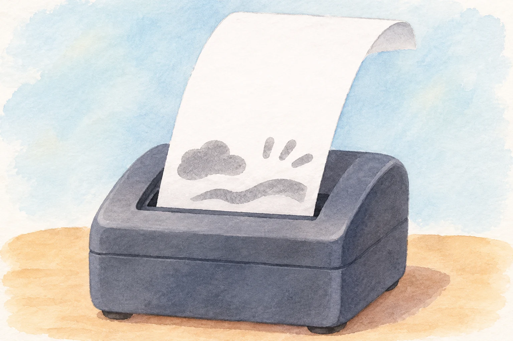
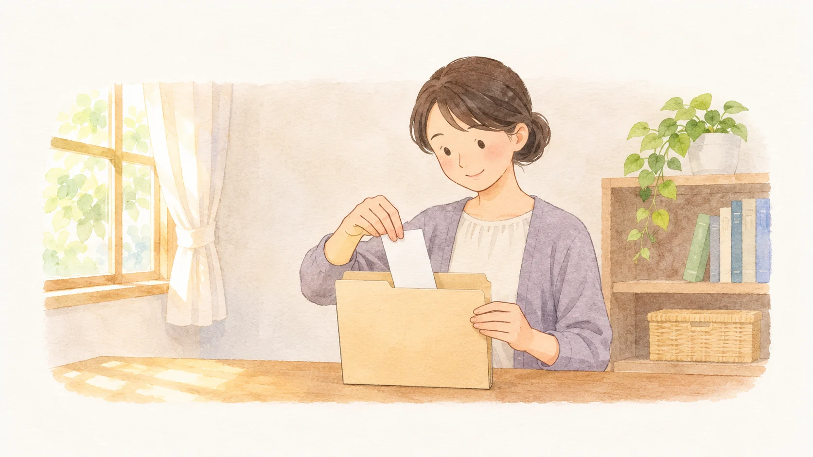

**感熱紙を使ったレシートは、熱を受けた部分の発色層が反応して文字になります。** そのため、印字された部分以外にも熱が加わると、紙の地肌が変色することがあります。ただし、どんなレシートでも同じように黒くなるわけではありません。

AI生成の参考イラスト。感熱プリンターから出るレシートのイメージ画。印字や変色の様子は概念画。実験結果ではない。

## インクが見えなくても、文字が出る理由

感熱紙には、色をつくる「ロイコ染料」と、その発色を助ける「顕色剤」などを含む層が塗られています。レシート用のプリンターでは、サーマルヘッドという部品が必要な場所だけを加熱します。三菱製紙の説明によると、その熱で材料が溶けて接触し、反応して色が出る仕組みです。

小さな文字や数字が現れるのは、プリンターが熱を加える場所を細かく制御しているから。見た目には白い紙でも、発色する材料が表面近くに用意されており、必要な部分だけに熱を届けることで文字を描いているのです。

## 「温めたら黒くなる」は全レシート共通？

感熱紙であれば、印字に使ったのと同じ発色の仕組みが、意図しない熱でも働く可能性があります。一方、レシートには異なる印刷方式や用紙もあります。また感熱紙自体も一種類ではありません。リコーはレシート向けの製品のほか、耐熱性や長期保存性を高めた製品も案内しています。

つまり、紙の見た目だけで「必ず同じ温度で、同じ色になる」とは決められません。ここで大切なのは、変色を確かめるために熱を加えることではなく、残したい情報を熱から守ることです。

## 残したいレシートは、熱だけに注意すればいい？

三菱製紙は、高温や高湿のほか、直射日光や蛍光灯の光、水分、油脂、ハンドクリームなどを、印字の変色や色あせの原因として挙げています。ラップフィルムや皮革製の財布・書類入れに含まれる可塑剤などとの接触にも注意が必要です。ずっと財布に入れたままなら安心、とは限らないのですね。

レシートを熱や光から遠ざけて保管する場面のAI生成の参考イラスト。長期保存を保証するものではありません。

保管するなら、まず熱や強い光を避け、濡らさず、印字面に別の素材や薬品が触れにくい場所を選びましょう。それでも、どの感熱紙にも永久に読める保証があるわけではありません。買い物や保証に関わる大切な内容は、購入先が認める電子明細なども確認し、必要に応じてレシートの写真やコピーを別に残しておくと、元の印字が読みにくくなったときに内容を見返せます。提出時に原本が必要かどうかは、提出先の案内に従ってください。

レシートの文字は、紙と熱の組み合わせで生まれる記録です。だからこそ、保存したい一枚には、印字したあとも少し気を配りたいですね。
