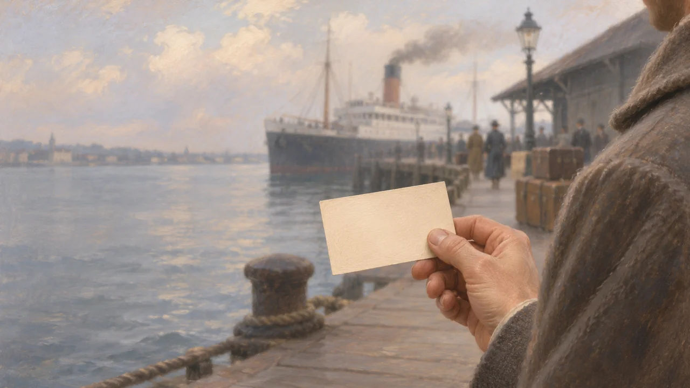
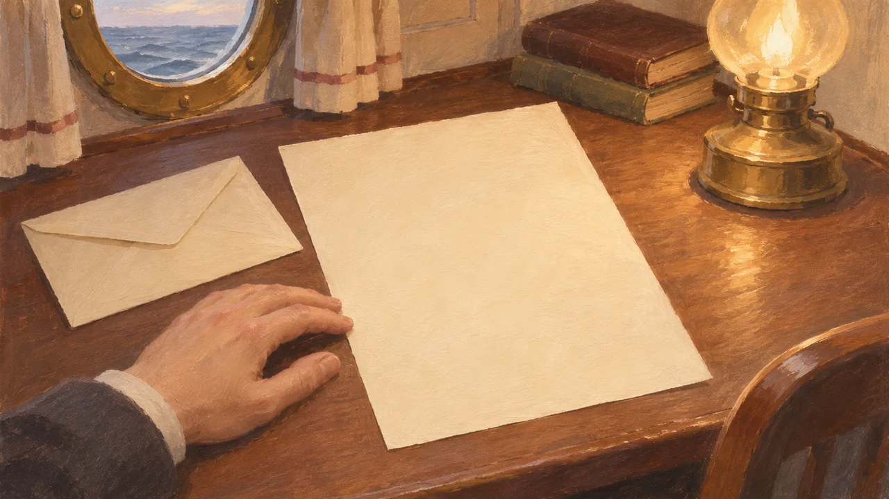

**タイタニックの二等客ルーシー・リズデールが支払った運賃は、10ポンド10シリングでした。** 米国国立公文書館が紹介している、ニューヨーク行きの切符一枚の値段です。豪華な特別室を借りる額とは別の、乗客一人の支払額です。

## 切符一枚、トランク五つ

*当時の旅立ちを想像した挿絵です。本人や切符の復元ではありません。*

1912年、ルーシーは親族のいるアメリカへ移り住むため、トランク五つを持って港へ向かいました。新しい暮らしに持っていこうとしたものの中には、銀メッキのフォークや、看護の本もありました。

ルーシーは沈没から生還しましたが、荷物は失いました。後から出した請求書類には、港まで乗った鉄道の手荷物の領収書と、船会社の荷物引換証が残っています。引換証は、なんと四つの言語で印刷されていたそうです。

## 現代のお金に換算するときの注意

昔の運賃を現代のお金に直す方法は、一つではありません。たとえばイングランド銀行の物価換算は、昔と今の英国で買えるものを比べる目安です。今の円で表すなら、どの時点の為替を使うかでも数字は変わります。

それに、特別室一室の値段と、ルーシーが買った切符一枚の値段では、そもそも買っているものが違います。数字の大きさだけで見比べると、そこが見えなくなります。

## 救助船から届いた短い電報

*船から便りを出す場面を想像した挿絵です。実物の電報を再現したものではありません。*

救助船カルパチアからルーシーが姉妹の一人に送った電報が、博物館に残っています。1912年4月18日付。伝えたのは「無事です」という短い知らせでした。

切符代を調べていて意外だったのは、豪華な部屋の話より、引換証や電報のような小さな紙に、一人の旅が残っていたことです。
