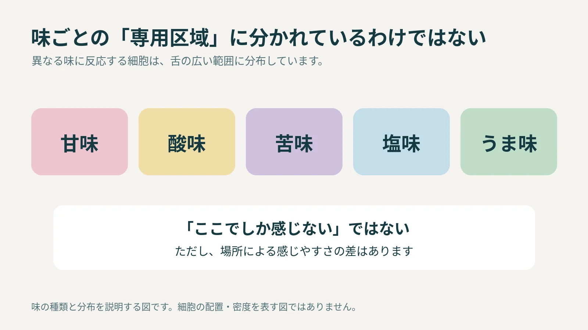

**「甘味は舌の先だけ、苦味は舌の奥だけ」という説明は正しくありません。異なる味に反応する細胞は、舌の広い範囲に分布しています。** 苦いチョコレートを舌の先に置けば苦味を避けられる、という仕組みではないのです。

## 味ごとに、舌が区画分けされているわけではない

食べ物に含まれる物質が味を感じる細胞を刺激すると、その情報が神経を通して脳へ伝わります。こうした細胞は「味蕾（みらい）」という構造の中に集まっています。

[米国国立聴覚・伝達障害研究所（NIDCD）](https://www.nidcd.nih.gov/health/taste-disorders)は、味ごとに専用の区域があるという見方を、よくある誤解として説明しています。基本的な味として挙げられるのは、甘味、酸味、苦味、塩味、うま味です。

この五つは、食べ物の風味を整理する土台になります。たとえば、いちごらしい風味を感じるときには、甘味や酸味だけでなく香りも関わります。「基本の味が五つある」という話は、食べ物の風味を五種類だけに分けられるという意味ではありません。

味の種類と分布についての説明図。細胞の実際の配置や密度を表すものではありません。

## 「どこも同じ強さで感じる」とも限らない

舌地図が誤りだからといって、どの場所もまったく同じ感度になるわけではありません。[味の空間的な感じ方を整理した2022年の総説](https://pmc.ncbi.nlm.nih.gov/articles/PMC8956797/)では、舌などの場所によって小さな感度の差があることも説明されています。

「ここでしか感じない」と「ここでは感じやすさが少し違う」は、別の話です。境界線で甘味区域と苦味区域を描き分けた図は、この違いを伝えきれていません。

## チョコレートのおいしさは、舌だけでは決まらない

食べ物の風味には、基本的な味に加えて、香り、温度、食感なども関わります。NIDCDも、これらの感覚が組み合わさって風味が生まれると説明しています。

刺激場所を舌先に限定した[糖水溶液の実験](https://pmc.ncbi.nlm.nih.gov/articles/PMC4542652/)では、低温でショ糖の甘味評価が下がった一方、同じ条件の果糖では有意な低下が見られない場合もありました。アイスそのものを食べた実験ではなく、温度や糖の種類などの条件で結果が変わるため、食品の印象を温度だけで説明することはできません。

チョコレートの風味には味だけでなく香りや食感も関わる場面を描いたAI生成の参考画。香りの線は演出で、実際に見える煙や感覚の測定結果ではありません。

チョコレートなら、甘さや苦さだけでなく、香りや口どけも楽しみの一部です。「苦味を感じるのは舌の奥だけ」と考えると、この一口の説明はかえって難しくなります。味の種類と、香りや食感の役割を分けて捉えるほうが、風味を言葉にしやすくなります。
