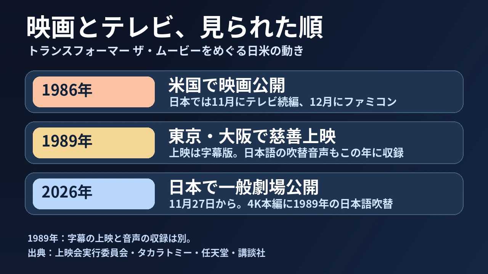

1986年に米国で公開されたアニメ映画『トランスフォーマー ザ・ムービー』が、11月27日から日本で一般向けの劇場公開を始めました。**本編は4K映像に、1989年に収録した日本語吹替**。本編後の新作CG短編『オプティマスプライム：アウェイクニング』は12分で、こちらは英語音声・日本語字幕です。

## テレビでは、すでに新しい総司令官がいた

日本では最初のテレビシリーズが1986年11月7日に終わり、翌週の14日に『トランスフォーマー2010』が始まりました。続編の総司令官は、それまでのコンボイではなくロディマスコンボイ。交代の経緯を描くのが映画ですが、日本では当時、一般向けの劇場公開がありませんでした。

図：映画・テレビ・ゲームを日本の観客が見られた時期と、吹替録音の年。1989年の慈善上映は字幕版で、日本語吹替の上映とは別です。出典：上映会実行委員会、タカラトミー、任天堂、講談社。

同じ年の12月のファミコンソフト『トランスフォーマー コンボイの謎』で操作するのは、コンボイでもロディマスコンボイでもなく**ウルトラマグナス**です。映画は司令官交代の経緯、テレビの続編はその後、ゲームは別の主人公の任務。タイトルだけでは分かりにくいところです。

## 1989年にも上映はあった。今回は全国の劇場で

講談社の『テレビマガジン』によると、1989年8月に東京と大阪で字幕版の慈善上映がありました。今回が日本で一度も上映されていなかった作品の初上映というわけではありません。違うのは、一般向けに全国の劇場へ広がり、1989年に収録した日本語吹替が映画館で聞けることです。

上映会の実行委員会は全国60館での公開を発表しています。日程は劇場によって違うので、[上映会公式サイト](https://transformers-the-movie2026.com/)の案内を参照してください。ローソン・ユナイテッドシネマの上映館は、[同社の劇場一覧](https://www.unitedcinemas.jp/all/movie.php?movie=14109)から各館の予定表へ進めます。
