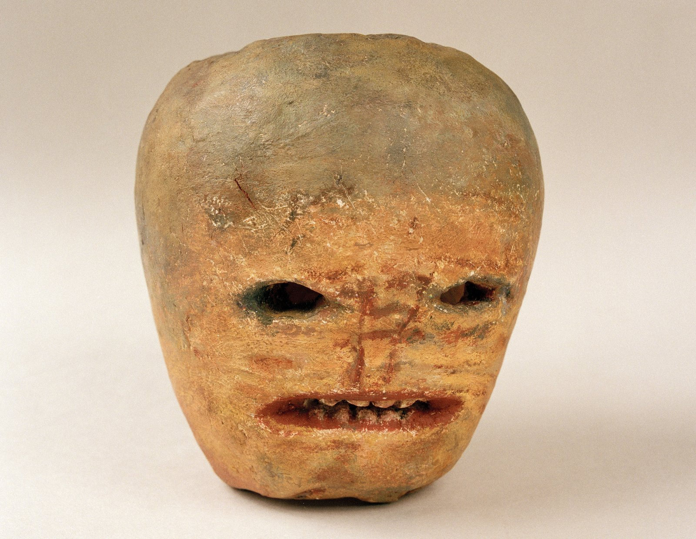
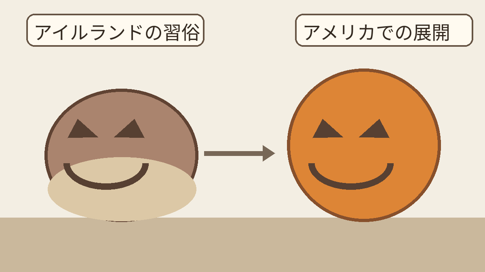

**ハロウィンのランタンには、カボチャだけでなくカブを使う習俗もありました。** アイルランド国立博物館には、その姿を伝える資料があります。

[同館の祭り全体の解説](https://www.museum.ie/en-IE/Collections-Research/Folklife-Collections/Folklife-Collections-List-%281%29/Religion-and-Calendar-Customs/Hallowe-en-Samhain)には、食事やゲーム、仮装も登場します。今回はその中の「ランタンの材料」を見てみましょう。

## 博物館に残る「幽霊カブ」

アイルランド国立博物館は、ドニゴール県フィンタウン近郊に由来する「Ghost turnip（幽霊カブ）」を紹介しています。1943年、近くで教えていた学校教師からカブのランタンが寄せられ、その教師は「この地域で1900年ごろにいつも作られていた型」だと説明したそうです。[アイルランド国立博物館の収蔵品解説](https://source.museum.ie/en-IE/Collections-Research/Collection/Top-things-to-see-in-the-Irish-Folklife-Collection/Artefact/Ghost-turnip/b202e8ea-0728-4b3d-b0f1-82660fe45ce9)

ここで注意したいのは、**博物館で紹介される姿は、当時のカブそのものではなく、博物館の画家が制作・彩色した石膏模型**だということ。資料はこの土地の習俗を知る手がかりですが、全地域に同じ形が広がっていた証拠ではありません。

*Ghost turnip、NMI collection F1943.350。石膏模型の写真。© National Museum of Ireland / [CC BY-SA 2.0](https://creativecommons.org/licenses/by-sa/2.0/)（[原典](https://source.museum.ie/en-IE/Collections-Research/Collection/Top-things-to-see-in-the-Irish-Folklife-Collection/Artefact/Ghost-turnip/b202e8ea-0728-4b3d-b0f1-82660fe45ce9)、幅1600pxに縮小・JPEG圧縮、トリミングなし）。このライセンス表記は写真に対するものです。*

## カボチャとはどうつながる？

同館は、顔を付けたカブのランタンを10月31日の夜に人を驚かせるために用いたと説明し、今日広く見られるカボチャ版を、このアイルランドの習俗がアメリカで展開したものと位置づけています。つまり「カボチャより前にカブの例がある」は言えても、世界中のランタンが一度に置き換わった、という単純な話ではありません。[アイルランド国立博物館の解説](https://source.museum.ie/en-IE/Collections-Research/Collection/Top-things-to-see-in-the-Irish-Folklife-Collection/Artefact/Ghost-turnip/b202e8ea-0728-4b3d-b0f1-82660fe45ce9)

独自の概念図。形を単純化したもので、すべての地域で材料が一斉に変わったことを示す図ではありません。

「ジャック・オー・ランタン」という名には、天国にも地獄にも迎えられず、灯りを持ってさまようジャックの**民話**が結びついています。これは名前にまつわる物語で、1943年に受け入れられた収蔵品の来歴とは別の種類の情報です。

カボチャとはまた違う、カブの顔の迫力。材料が変わると、ハロウィンの灯りの印象まで変わるのが面白いですね。
