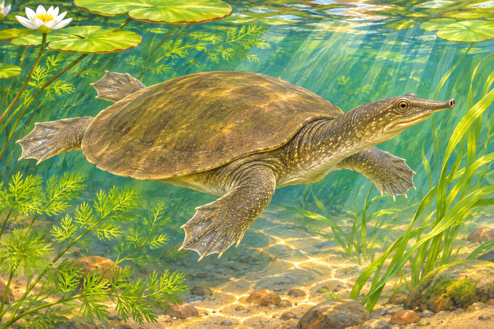

**カメは、服を脱ぐように甲羅から出ることはできません。甲羅は背骨や肋骨とつながった、体の骨格の一部だからです。**

カメの甲羅は「背負っている家」のように見えます。けれど、見た目のたとえをそのまま体のしくみだと思うと、肝心なところを見誤ります。まずは、甲羅のどこが骨で、どこが表面の覆いなのかを分けてみましょう。

## 背中だけでなく お腹側にもある

甲羅は大きく、背中側の「背甲」とお腹側の「腹甲」に分けられます。

参考イラスト（AI生成）。実物写真や精密な解剖図ではありません。

アメリカ自然史博物館の解説では、甲羅は体を外から守る構造であると同時に、内側の骨格の一部でもあり、背骨は背甲の裏側と一体になっています。背中に取り外し式の盾を背負う姿とは、しくみが違うのです。

## 表面の模様と 中の骨は同じではない

よく見かける硬い甲羅には、骨の外側を覆う「甲板」があります。甲板の主な材料はケラチンで、人の爪や髪にも使われているたんぱく質です。

ここで区別したいのは、**表面の甲板と、その下にある骨**。見えている模様だけが甲羅のすべてではありません。博物館の標本写真でも、表面の甲板と下の骨を見比べられます。

私が面白いと思うのは、見えている表面と、体を支える骨が別の層だという点です。「甲羅は骨」で話を終えるより、爪にも使われる材料がその外側を覆っている、と考えるほうが姿を想像しやすくなります。

## 柔らかい甲羅の仲間もいる

すべてのカメが、同じ硬さ・同じ表面の甲羅を持つわけではありません。

参考イラスト（AI生成）。実物写真や精密な解剖図ではありません。

サンディエゴ動物園の解説には、オサガメやスッポンの仲間のように、丈夫な皮膚で覆われ、骨の構成にも違いがある例が紹介されています。だからといって、着替えのように脱げる甲羅になるわけではありません。

「硬い板が並ぶカメ」という身近な印象を、すべての種類にそのまま当てはめないようにしましょう。

## 甲羅にも感覚がある

同動物園は、カメが甲羅を通して圧力や痛みを感じることも説明しています。甲羅を、感覚のない持ち物のように扱うことはできません。

私には「背負っている家」より、**体そのものに組み込まれた守り**と考えるほうがしっくりきます。硬そうに見えるからといって、感覚までないわけではない。この違いを知ると、甲羅を見る目も少し変わります。
