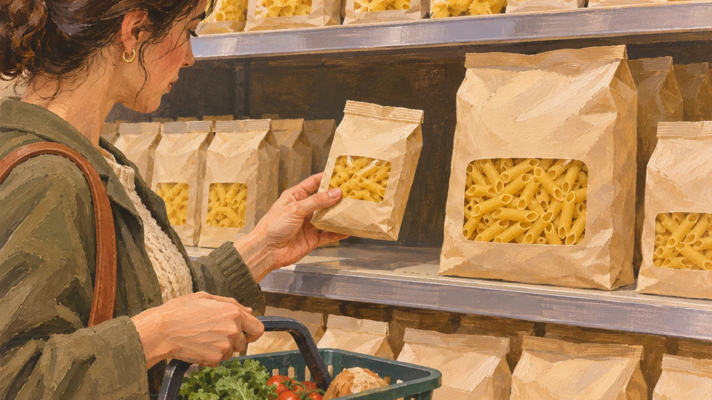
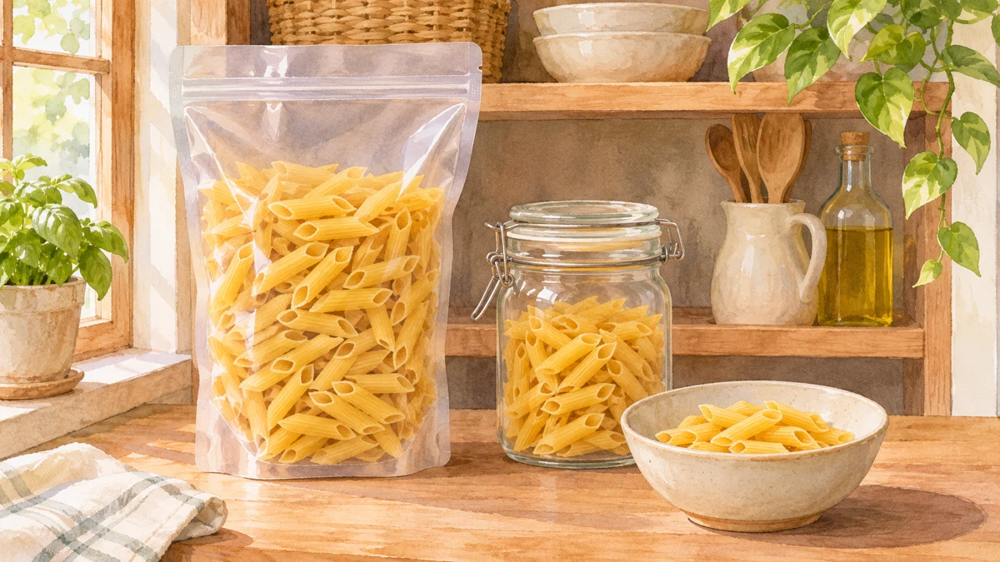

**大容量パックが必ず割安とは限りません。** 値札の合計金額だけでなく、100gなど「同じ量あたりの値段」にそろえると、内容量の違う商品を比べられます。この値段を単位価格と呼びます。

東京都の消費生活情報では、単位価格表示を「100gあたり」「10mlあたり」など、単位量あたりの価格を示すものとして紹介しています。違う内容量どうしの価格を比べやすくするための見方です。

## 架空の2パックを比べる

**ここからの価格と内容量は説明のために作った数字で、実際の店や動画内の商品価格ではありません。** 同じ種類の商品で、どちらも税込価格、ほかの条件も同じと仮定します。

買い物のイメージです。絵の袋は、以下の架空例の量や価格を表していません。

小パックは200gで240円、大パックは500gで650円。合計金額だけなら大パックのほうが高いものの、量も多いので、そのままでは割安かどうかは分かりません。計算は「価格÷内容量」。まず1gあたりを出し、100を掛ければ100gあたりになります。

小パックは240÷200×100＝**100gあたり120円**。大パックは650÷500×100＝**100gあたり130円**。この架空例では、名前が「大」でも100gあたりの値段は小パックのほうが10円低い、という結果です。

## 数字をそろえた後にも見ること

比較するときは、片方だけ「1gあたり」、もう片方は「100gあたり」にしないこと。gとkgが混ざっていれば同じ単位に直します。また、税込と税抜、割引の有無など、値段の条件もそろえないと比較がずれます。「1個あたり」で比べるなら、重さではなく個数にそろえます。

使い切れる量や置き場所も考えるためのイメージです。保存方法や一食分の量を指定するものではありません。

単位価格が低いことと、自分に合う商品であることは別です。品質や用途が違えば数字だけで同じものとして比べられません。大きいパックを使い切れるかも考えたいところです。

少し面白いのは、答えを出す前に「何を同じにするか」を決めるだけで、比べやすくなることです。安そうな見た目に頼らず、自分で確かめる手がかりが一つ増えます。

値札に単位価格があれば、数字だけでなく単位も確認。表示がなくても、価格と内容量が分かれば計算できます。「大」という名前から一歩離れて、同じ物差しにそろえる。パックの見え方が少し変わる計算です。
