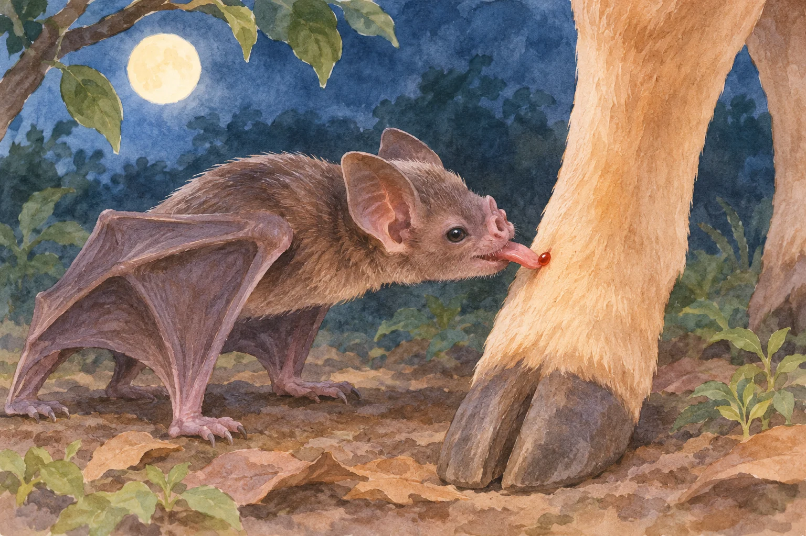
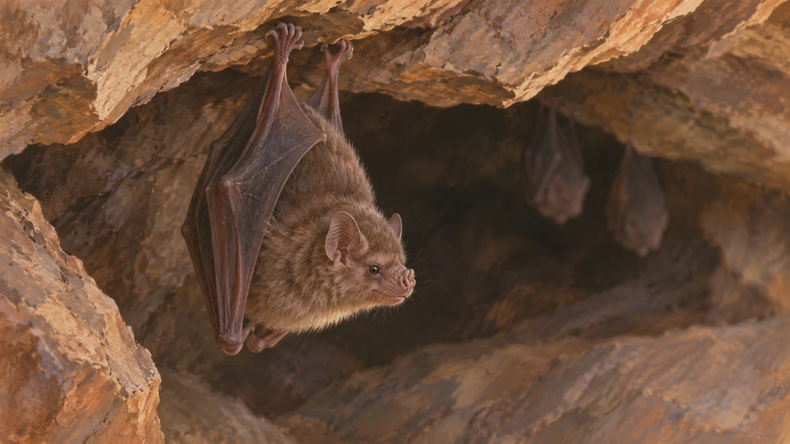

**チスイコウモリは、出てきた血を舌でなめて食べます。** 血管に牙を刺し、ストローのように血を吸い上げる、という映画の吸血鬼のイメージとは違う方法です。

チスイコウモリの食事を描いた参考イラスト（AI生成）。

## 歯で小さな傷をつけ、舌でなめる

[米国地質調査所の解説](https://www.usgs.gov/faqs/do-vampire-bats-really-exist)によると、鋭い前歯で相手の皮膚に小さな傷をつけ、そこから流れる血を舌でなめます。血を栄養として利用していることは本当ですが、「吸う」という言葉から想像しやすい動作とは少し違います。

チスイコウモリの一種、ナミチスイコウモリ（学名：Desmodus rotundus）は、ウシやウマなどの哺乳類の血を主な食べ物にしています。歯は血を取り込む管ではなく、血が出るきっかけを作る役目です。

## 唾液にも食事を助ける働きがある

[Bat Conservation International](https://www.batcon.org/bat/desmodus-rotundus-2/)は、チスイコウモリの唾液にある特別なタンパク質が、血を固まりにくくすると説明しています。傷から出た血がすぐ固まらないことで、なめ取る食事が続けやすくなります。

歯、舌、唾液が別々の役割を担うところに、この食べ方の特徴があります。

## コウモリなら何でも血を食べるわけではない

同団体によると、血を食べるコウモリとして知られているのは3種です。ナミチスイコウモリは、洞窟や木のうろなどをねぐらにして、群れで暮らします。

洞窟のねぐらを描いた参考イラスト（AI生成）。

映画の吸血鬼と比べて意外だったのは、牙の形よりも、少しずつ血をなめ取るところです。歯だけでなく舌や唾液にも役割があると知ると、ひとくくりに「吸血」と呼ぶだけでは見えない違いが分かります。

「吸血」という名前でも、歯で傷をつけ、出てきた血を舌でなめる食べ方です。人や動物で試したり、野生のコウモリに触れたりしないでください。
