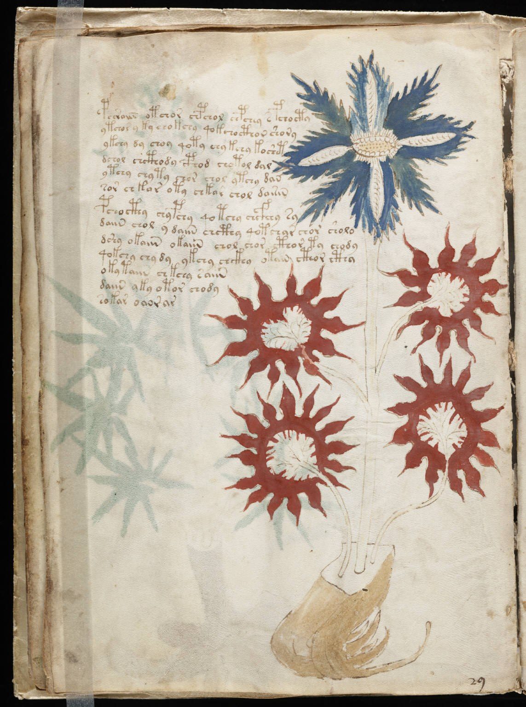
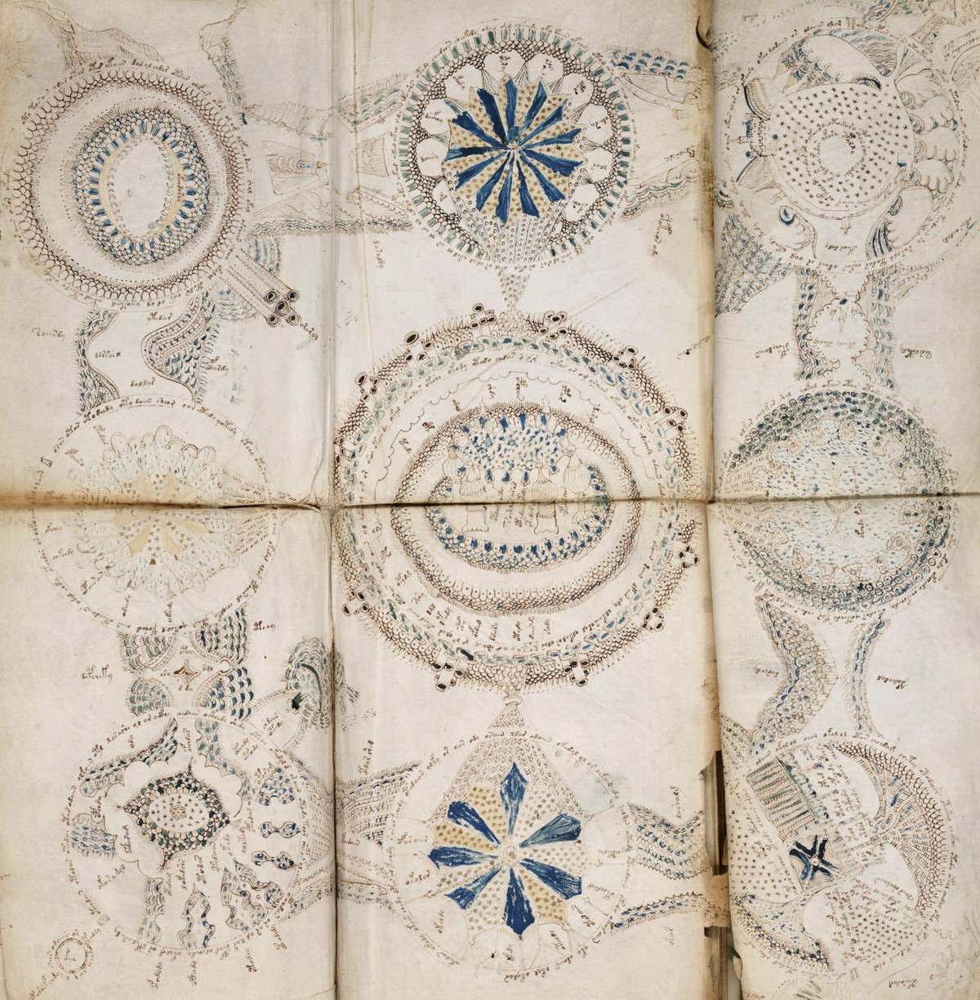

**ヴォイニッチ手稿の本文は、いまも解読されていません。** 所蔵する[イェール大学バイネッケ図書館の解説](https://beinecke.library.yale.edu/beinecke/collections/beinecke-cipher-voynich-manuscript)では、筆者も文字体系も不明とされています。本そのものを見られるのに、何が書かれているかは分からない。そこが、この写本の不思議さです。

## 絵はある。でも、文章の答え合わせはできない

画像：[Wikimedia Commons](https://commons.wikimedia.org/wiki/File:Voynich_Manuscript_(32).jpg)、Public domain。植物の種類を特定した図ではありません。

花や葉、根のような形と、その横に並ぶ文字。絵から何かを想像したくなりますが、それだけで「薬の使い方が書いてある」とは決められません。[写本目録](https://pre1600ms.beinecke.library.yale.edu/docs/pre1600.ms408.htm)も、挿絵の特徴をもとにページ群を分類しています。図の分類と、文章の意味が読めることは別なのです。

画像：[Wikimedia Commons](https://commons.wikimedia.org/wiki/File:Voynich_manuscript_cosmological_example_86v_crop.jpg)、Public domain。配信元で切り抜かれた部分図です。

手稿の所蔵元：Beinecke Rare Book and Manuscript Library, Yale University。本文の二つの画像は縮小・JPEG再圧縮のみ。表紙は[閉じた手稿の小口を写した同館の画像](https://commons.wikimedia.org/wiki/File:Voynich_manuscript_(head).jpg)（Wikimedia CommonsではPublic domainと表示）を縮小してWebPに変換したものです。文字や絵の描き足しはありません。

円形図が連なるページもあります。所蔵館は天文・占星術、入浴、薬草などに関わるように見える挿絵を紹介していますが、**絵の見た目は、確定した訳文の代わりにはなりません。**

## 本の古さと、文章の正体は別の話

所蔵館は、素材の科学的検査が15世紀の写本との整合性を示唆すると説明しています。ただし、素材が古いことだけで、誰がいつ文字を書き、何を意味したかまで証明できるわけではありません。暗号なのかどうかも含め、説明を決めつけないことが大切です。

1912年に古書商ヴォイニッチが入手したこの本は、いまは所蔵館の案内から[全ページの高精細画像を閲覧](https://beinecke.library.yale.edu/beinecke/collections/beinecke-cipher-voynich-manuscript)できます。目の前に手がかりはあるのに、答えはまだ届かない。その距離感が、なんとも気になる本です。
