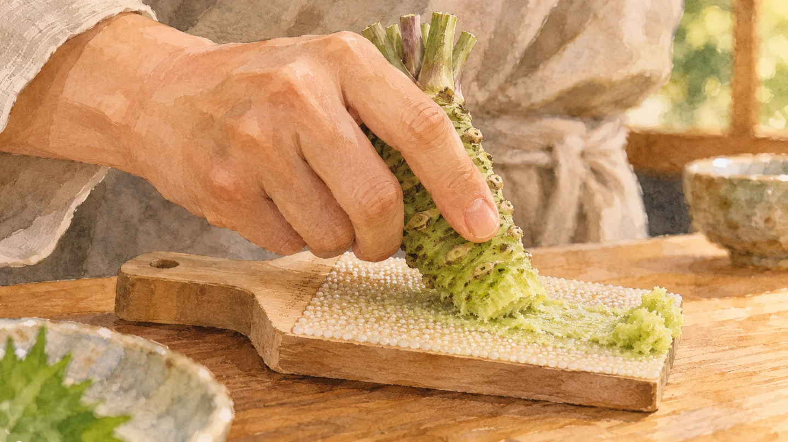
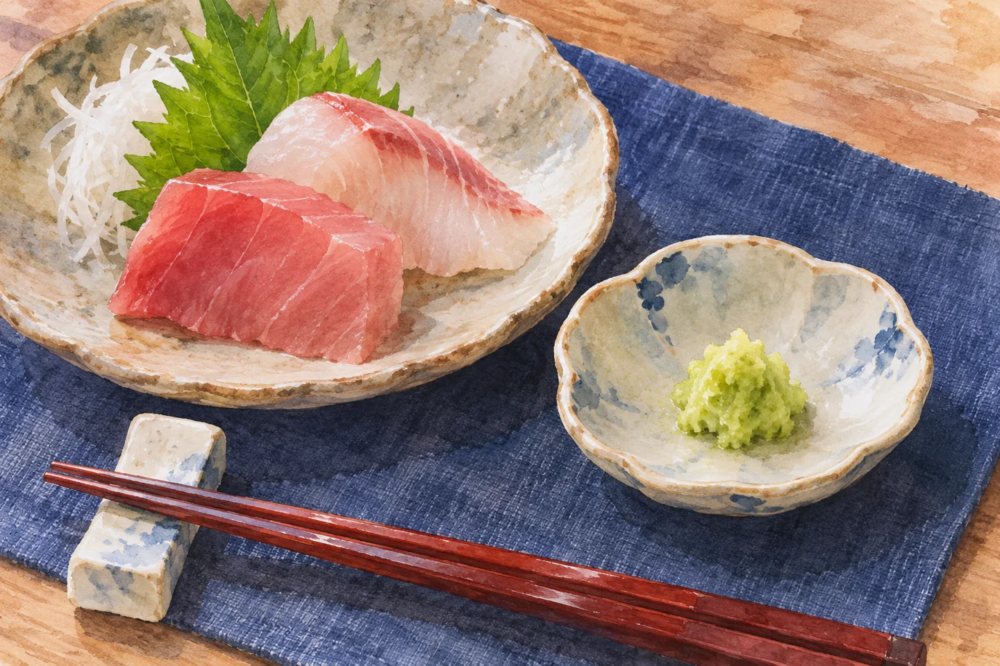

**わさびをすりおろすと辛くなるのは、細胞が壊れることで、わさびに含まれる材料と酵素が反応し、ツーンとする辛味成分が生まれるからです。** 辛味成分が最初からそのまま大量に詰まっている、という話ではありません。

本わさびをすりおろす場面の参考イラスト（AI生成）。

## 「細かくする」が反応のきっかけ

[日本わさび協会の解説](https://www.wasabi.or.jp/public/knowledge/character)では、辛味のもとになる「シニグリン」は、それ自体では辛くないと説明しています。組織が壊れると、酵素の「ミロシナーゼ」が働き、「アリルからし油」という辛味成分ができます。[エスビー食品の解説](https://www.sbfoods.co.jp/sbsoken/washoku/wasabi.html)も、細胞が壊れたときに水と酵素が辛味のもとに作用すると説明しています。おろし金が辛味を加えるのではなく、わさびの中で反応が始まるのです。

できた辛味成分は空気中へ飛びやすいため、鼻に抜けるような刺激にもつながります。[エスビー食品の解説](https://www.sbfoods.co.jp/sbsoken/washoku/wasabi.html)も、しばらく置くと辛さが弱くなり、香りが変わると説明しています。「作られる」一方で「飛んでいく」性質があるのです。

## 噛むだけでは辛くならない？

「すりおろすと辛い」は、「噛んでも辛くならない」という意味ではありません。この反応の原理から考えると、噛んだときも細胞が壊れれば辛味成分は生まれえます。すりおろしは、その組織を細かく壊しやすくする方法です。

おろしたわさびを添えた一皿の参考イラスト（AI生成）。

なお、ここでの話は**生の本わさびをすりおろす場面**についてです。チューブ入りなどの加工わさびには原料や製法の違いがあり、同じ条件としては扱えません。[日本わさび協会の「加工わさび」の説明](https://www.wasabi.or.jp/public/knowledge/character)でも、粉わさび、ねりわさび、おろしわさびを分けています。

わさびの辛味は、削ることで隠れていた味が単に表へ出るだけではありません。**細胞が壊れた後の反応で作られる**。そう考えると、「おろす」という一手間にも理由が見えてきます。
