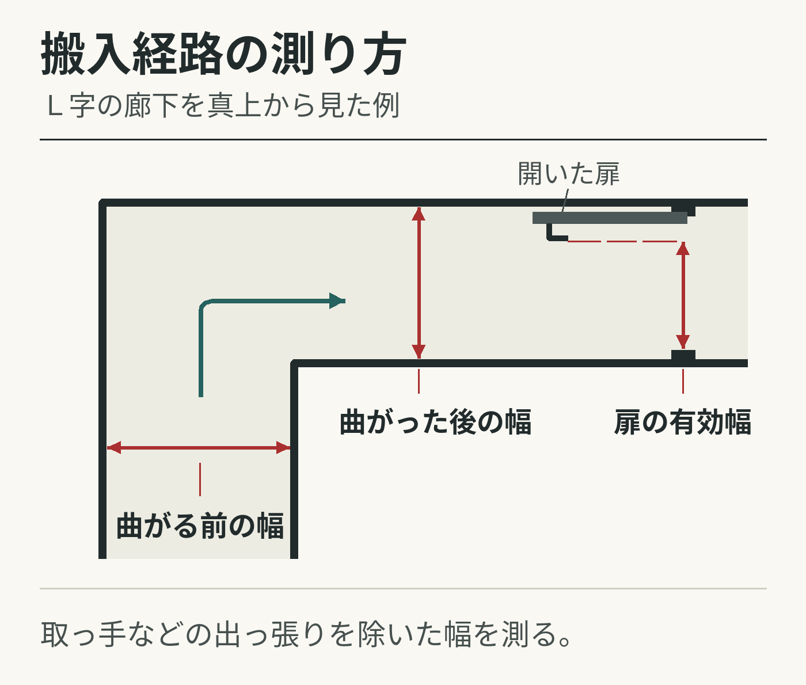

洗濯機を買う前に、洗面所の置き場は測った。玄関も本体より広い。それでも運び込めないことがあります。見落としやすいのは、**ドアを開けても取っ手が出っ張る場所と、本体の向きを変える曲がり角**です。

## 寸法図だけで「幅」が三つもある

ドラム式洗濯機の寸法図を開くと、本体だけの幅、運ぶときに握る手掛けを含む幅、さらに排水ホースまで含む幅が載っています。たとえばパナソニックのNA-SX80PCは、ボディ幅600ミリ、手掛けを含めて609ミリ、ホースを含めた総外形の幅は639ミリ。同じ機種でも、どこを測った数字かでこれだけ違います。

玄関や廊下では、手掛けを含む本体が通り、作業する人の手も入るかを確認します。置き場ではホースを取り回し、扉を開けて洗濯物を出せるかまで考えます。必要な余裕は機種と搬入経路で変わるので、候補の型番の設置条件を参照してください。

## メジャーを持ったら、この順で回る

| 測る場所 | 控えておく寸法 |
| --- | --- |
| 玄関と洗面所の入口 | ドアを実際に開き、扉の厚みや取っ手、靴箱のでっぱりを除いた幅。 |
| 廊下・階段・エレベーター | 曲がり角の手前と先の幅。階段は手すりの内側と踊り場の奥行き、エレベーターは入口と箱の奥行き。 |
| 防水パンと周囲 | パンの内側の幅・奥行きと排水口の位置。蛇口や棚までの高さ、洗濯機の扉を開けられる空間。 |

直線の廊下を通れても、L字で本体を回すと奥行き方向の角が壁に近づきます。ぎりぎりなら、**曲がる手前とその先が一緒に写る写真**を撮り、型番と採寸メモを添えて販売店に搬入できるか相談すると、家の形を伝えやすくなります。階段料金や必要な部材が分かったら、[洗濯機の買い替え総額を2店で比べる](/tools/appliance-total/)で見積もりを比べられます。
